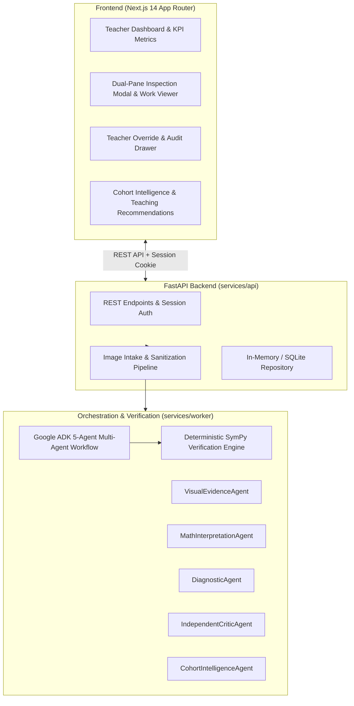

# ClassLens — Multimodal Handwritten Math Diagnostic Platform

[](https://www.python.org/downloads/)
[](https://nextjs.org/)
[](https://fastapi.tiangolo.com/)
[](https://www.sympy.org/)
[](https://github.com/google/skills)
[]()

> **Empowering Singapore Secondary 1 Mathematics Educators to see how students actually think.**
> ClassLens pinpoints the exact number-line hop where student reasoning breaks down—separating conceptual misconceptions from superficial arithmetic slips using multimodal AI and deterministic mathematical proof.

---

## 1. Executive Summary & Google AI Use Case

When grading student mathematics worksheets, teachers often see only a wrong final answer (e.g. $+1$ instead of $+2$), with no easy way to determine whether the student understands integer operations or made a minor counting slip. Conversely, students who make **compensatory errors** (two cancelling mistakes) may land on the correct final answer despite holding severe conceptual misconceptions.

**ClassLens** bridges this gap:
1. **Multimodal Visual Evidence Extraction**: Analyzes handwritten ink strokes, arrows, and number-line arcs.
2. **Deterministic Mathematical Proof**: Employs an exact SymPy engine to verify each intermediate displacement with zero LLM hallucination.
3. **5-Agent Diagnostic Architecture**: Powered by Google Agent Development Kit (ADK) abstractions, including an independent critic agent that audits diagnoses.
4. **Teacher Override Authority**: Educators maintain full control to confirm, correct, or annotate any diagnosis with complete audit logging.

---

## 2. System Architecture



### The 5 Google ADK Agents
- **VisualEvidenceAgent**: Extracts observable ink strokes, hops, arrowheads, tick intervals, and written final values without diagnosing errors.
- **MathInterpretationAgent**: Matches observed hops against valid solution paths (e.g. direct start vs. hop from zero, commutative reordering).
- **DiagnosticAgent**: Evaluates mathematical correctness of each hop and identifies evidence-supported misconceptions.
- **IndependentCriticAgent**: Audits proposed diagnoses for unsupported conclusions, enforcing a bounded single-retry limit.
- **CohortIntelligenceAgent**: Synthesizes whole-class patterns, clusters shared misconceptions, and suggests tiered pedagogical reteaching blueprints.

---

## 3. Current Implementation Status: Simulated vs. Live AI

| Capability | Current State | Technical Details |
| :--- | :--- | :--- |
| **Mathematical Verification** | **Active & Production-Ready** | 100% deterministic exact evaluation using SymPy (`sympy.Rational`, `sympy.sympify`). Zero hallucination risk. |
| **Image Intake & Sanitization** | **Active & Production-Ready** | Validates JPEG, PNG, WebP magic bytes; strips EXIF metadata; bounds decoding to 16M pixels (decompression-bomb defense); computes RMS contrast and Laplacian blur metrics; confines uploads to `local-data/uploads/` with SHA-256 deduplication. |
| **Durable Local Persistence** | **Active & Production-Ready** | Relational SQLite database (`local-data/classlens.db`) in WAL mode with foreign keys, transactional integrity, and non-destructive migration from JSON backups. |
| **Agent Orchestration** | **Active (Offline Mock Mode)** | Google ADK agent contracts implemented with Pydantic schemas. Currently backed by deterministic synthetic fixtures and structured observations for offline evaluation ($0.00 cloud spend guarantee). |
| **Teacher Review & Audit** | **Active & Production-Ready** | Full teacher confirmation and override persistence with complete tamper-evident audit history surviving process restarts. |
| **Live Multimodal Gemini 3.8 Flash** | **Offline Evaluation Ready** | Full dry-run validation implemented. Dual-gate fail-closed circuit breaker enforces $0.00 spend guarantee until explicit owner authorization. |

> [!NOTE]
> **No Claim of Live Handwriting OCR**: In the current offline demonstration, diagnostic breakdowns on the 13 sample responses are driven by deterministic synthetic observation schemas matching the problem vertical slice, **not by live ungrounded Gemini OCR calls**. Real uploaded worksheets in mock mode truthfully remain in `AWAITING_LIVE_ANALYSIS` without fabricating diagnoses.

---

## 4. Getting Started

### Prerequisites
- **Python**: `>= 3.11` (managed via `uv` or standard `python3.12`)
- **Node.js**: `>= 18.18` (LTS recommended)
- **Package Managers**: `uv` (recommended) or `pip`, `npm`

### 4.1 Backend Setup (FastAPI)

1. **Clone the repository**:
   ```bash
   git clone git@github.com:gihanmu/ClassLens.git
   cd ClassLens
   ```

2. **Set up Python virtual environment**:
   ```bash
   # Using uv (fastest)
   uv venv
   source .venv/bin/activate
   uv pip install -e ".[dev]"

   # Or using standard pip
   python3 -m venv .venv
   source .venv/bin/activate
   python -m pip install -e ".[dev]"
   ```

3. **Configure environment**:
   ```bash
   cp .env.example .env
   ```
   *Note: Default `.env` operates in 100% offline mock mode (`CLASSLENS_AI_MODE=mock`, `CLASSLENS_LIVE_INFERENCE_ENABLED=false`) with zero API calls and $0.00 spend guarantee.*

4. **Start the backend server**:
   ```bash
   .venv/bin/uvicorn services.api.main:app --host 127.0.0.1 --port 8000 --reload
   ```
   API health check: `http://localhost:8000/api/v1/health`

### 4.2 Frontend Setup (Next.js 14)

1. **Navigate to the web workspace**:
   ```bash
   cd apps/web
   ```

2. **Install dependencies**:
   ```bash
   npm install
   ```

3. **Start the development server**:
   ```bash
   npm run dev
   ```
   Open `http://localhost:3000` in your browser.

4. **Production Build**:
   ```bash
   npm run build
   npm run start
   ```

---

## 5. Running the Test Suite

ClassLens includes a comprehensive, 100% offline test suite with **304 automated tests** covering mathematical verification, image processing, durable SQLite persistence, API endpoints, tenant isolation, and accessibility.

```bash
# Run all 304 backend unit & integration tests
.venv/bin/pytest tests/ -v

# Run durable SQLite persistence tests specifically
.venv/bin/pytest tests/unit/test_sqlite_persistence.py -v

# Run image intake tests specifically
.venv/bin/pytest tests/unit/test_image_intake.py -v

# Run SymPy mathematical verification engine tests
.venv/bin/pytest tests/unit/test_math_verifier.py -v

# Run agent orchestration tests
.venv/bin/pytest tests/unit/test_agent_orchestration.py -v

# Run security, session, and tenant isolation tests
.venv/bin/pytest tests/integration/test_security_and_integration.py -v
```

---

## 6. Dataset Governance & Responsible AI

ClassLens adheres to strict privacy and licensing guardrails:

- **Provenance**: Derived from the **DrawEduMath** research dataset (ASSISTments platform).
- **Public Repository Exclusion**: In compliance with **CC BY-NC 4.0**, human research ethics, and GitHub 100MB file limits, raw student handwriting images are **not distributed in public version control**.
- **Data Manifest**: Complete dataset documentation, licensing terms, and local research setup instructions are detailed in [`dataset/DATASET_MANIFEST.md`](dataset/DATASET_MANIFEST.md).
- **Synthetic Test Fixtures**: All 13 mathematical variations are modeled in deterministic, privacy-safe synthetic fixtures in [`tests/fixtures/synthetic_math_fixtures.py`](tests/fixtures/synthetic_math_fixtures.py).

---

## 7. Key Capabilities & Teacher Workflow

1. **Classroom KPI Overview**: Instant visibility into submission counts, analysis completion rate, accuracy, and items flagged for teacher review.
2. **Dismissible Introduction**: Streamlined onboarding for first-visit educators that tucks away cleanly for returning teachers.
3. **Dual-Pane Work Viewer**: High-resolution zoomable worksheet inspector with an anchored, non-intrusive detected hops bar.
4. **Step-by-Step Mathematical Diagnosis**: Displays expected addends vs. observed student hops, with SymPy validation tags.
5. **Plain-Language Misconception Descriptions**: Translates taxonomy IDs (e.g. `MISC-ARITH-OFF-BY-ONE`) into actionable pedagogical phrases ("Counting tick marks instead of intervals").
6. **Teacher Override & Audit Logging**: Edit diagnoses, record notes, and inspect timestamped revision histories.
7. **Cohort Intelligence**: Whole-class pattern clustering and differentiated teaching action plans (concrete manipulatives, worked examples, guided inquiry).

---

## 8. Planned Google Cloud & Gemini Integration

Upon Gate 2 authorization, ClassLens connects to Google Cloud:
- **Model**: `gemini-3.8-flash` via the official Google Gen AI SDK.
- **Region**: Singapore (`asia-southeast1`) for low latency and data residency alignment.
- **Serving**: Google Cloud Run with serverless container scaling and Cloud Tasks asynchronous job dispatch.
- **Observability**: Cloud Logging and OpenTelemetry distributed tracing.

---

## 9. License & Attribution

- **Source Code**: Apache 2.0 (or project license).
- **Evaluation Dataset**: Non-commercial educational research license (CC BY-NC 4.0 alongside original ASSISTments terms). See [`docs/security/privacy-and-dataset-rights.md`](docs/security/privacy-and-dataset-rights.md).
