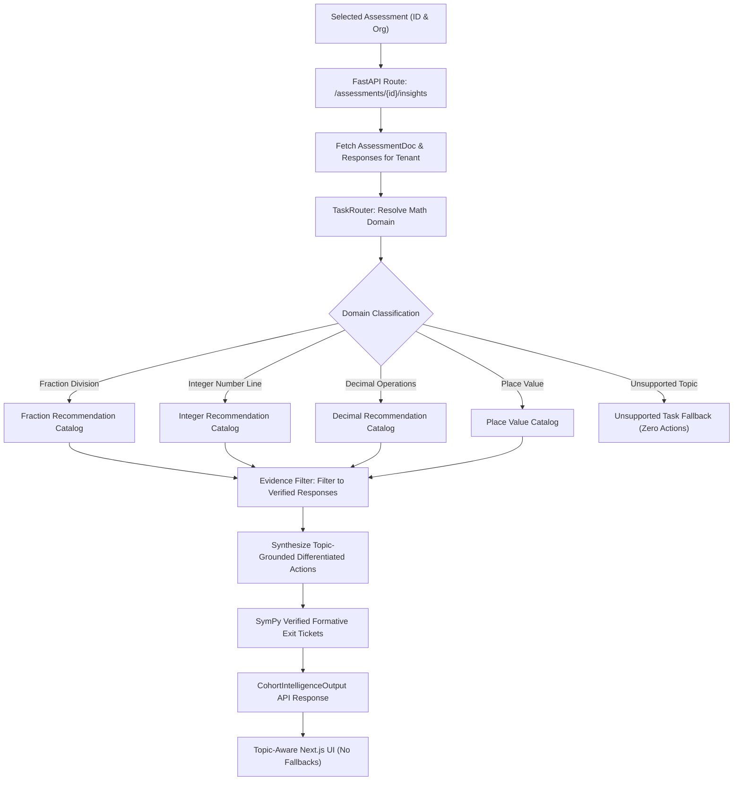

# ClassLens — Teaching Action Plan & Cross-Assessment Data Isolation Remediation Report

**Date:** October 17, 2026  
**Status:** Resolved & Verified  
**Affected Assessment:** `asm_32f82ce3` (*Fraction Division — Unit Form and Visual Models*) & Cross-Assessment Cohort Pipeline  
**Target Milestone:** AI Builder Cup Reviewer Build  

---

## 1. Executive Summary

During manual evaluation of the ClassLens dashboard under the assessment **Fraction Division — Unit Form and Visual Models** (`asm_32f82ce3`), a critical defect was identified in the **Differentiated Teaching Action Plans** section:

Despite the assessment testing fraction division ($8/9 \div 4/9 = 2$), the dashboard presented three action plans specifically designed for integer operations on a number line:
1. *Number Line Bead String & Interval Spacing* (Target: `MISC-ARITH-OFF-BY-ONE`, 2 Students)
2. *Contrasting Cases: Directional Sign Vectors* (Target: `MISC-DIR-INV`, 1 Student)
3. *Direct Jump Magnitude Verification Routine* (Target: `MISC-MAG-COUNT`, 1 Student)

Additionally, the formative exit tickets contained integer addition/subtraction problems (e.g., $-6 + 12 - 4$), and the classroom manipulative workspace suggested number-line bead strings.

### Key Remediation Achievements
- **Root Cause Eliminated:** Identified and dismantled hardcoded number-line fallbacks and synthetic defaults in `CohortSynthesizer` and frontend state fallbacks.
- **Topic-Aware Recommendation Engine:** Built a modular, extensible `RecommendationCatalog` supporting `fraction_division`, `integer_number_line`, `decimal_operations`, and `place_value`.
- **Evidence-Grounded Accounting:** Guaranteed that every displayed card reports an affected student count strictly equal to `len(supporting_response_ids)`. Eliminated fabricated `or 2` / `or 1` fallbacks.
- **Representation vs. Misconception Distinction:** Modeled missing visual models as instructional representation follow-up (`REPRESENTATION-MISSING` / `VISUAL-MODEL-INCOMPLETE`) rather than arithmetic failure.
- **Contextual Empty States:** Implemented graceful empty states for unanalyzed cohorts, mastery cohorts (zero misconceptions), all-insufficient evidence submissions, and unsupported task domains.
- **100% Test Pass Rate:** Added 7 comprehensive test scenarios verifying mathematical isolation and exact counting; full test suite passes with 336/336 passing tests and clean frontend production build.

---

## 2. Root-Cause Analysis

A thorough code audit across backend and frontend layers revealed five contributing defects that produced the bug:

### 2.1 Backend: Hardcoded Synthesis in `CohortSynthesizer`
In `services/worker/cohort/synthesizer.py`:
- `CohortSynthesizer.synthesize_insights` previously ignored the mathematical domain of the assessment.
- Lines 54, 67, and 80 used Python fallback expressions:
  ```python
  student_count_affected=sum(c.affected_count for c in stats.misconception_clusters if c.taxonomy_id == "MISC-ARITH-OFF-BY-ONE") or 2,
  student_count_affected=sum(c.affected_count for c in stats.misconception_clusters if c.taxonomy_id == "MISC-DIR-INV") or 1,
  student_count_affected=sum(c.affected_count for c in stats.misconception_clusters if c.taxonomy_id == "MISC-MAG-COUNT") or 1,
  ```
- In `asm_32f82ce3`, no student exhibited integer number-line misconceptions (12 were fully correct, 2 omitted the tape diagram, 1 intake unreadable). Because `stats.misconception_clusters` was empty, `sum(...)` evaluated to `0`, causing the `or 2` and `or 1` expressions to fabricate counts of 2, 1, and 1.

### 2.2 Backend: Assessment Context Omission in API Route
In `services/api/routers/cohort.py`:
- The route `/api/v1/assessments/{assessment_id}/insights` fetched the assessment document `asm` but called:
  ```python
  intelligence = CohortSynthesizer.synthesize_insights(stats, problem_id=assessment_id)
  ```
- It failed to pass `assessment=asm` or individual response payloads to `CohortSynthesizer`. Consequently, the synthesizer could not inspect `math_topic`, `question_text`, or individual visual representation statuses.

### 2.3 Math Verifier: Fallback Bias in `TaskRouter`
In `services/worker/math_verifier/task_router.py`:
- `TaskRouter.resolve_task` defaulted to `TaskType.INTEGER_NUMBER_LINE` whenever a question had an arithmetic expression, inadvertently categorizing non-integer questions as number-line tasks if keywords were not strictly checked.

### 2.4 Frontend: Hardcoded Number-Line Fallback Blocks
In `apps/web/src/app/page.tsx`:
- Lines 958–991 and 1005–1035 contained hardcoded fallback JSX with the exact three integer cards ("Number Line Bead String", "Contrasting Cases", "Direct Jump Magnitude") whenever `intelligence.differentiated_actions` was empty or undefined.
- The section subtitle hardcoded `"Targeted interventions for localized number-line misconceptions"`.

### 2.5 Frontend: Stale State Retention on Assessment Switch
In `apps/web/src/app/page.tsx`:
- When a user selected a different assessment in `handleSelectAssessment`, `cohortInsights` was not immediately cleared before fetching new insights, allowing brief flash-of-stale-content or fallback triggers during asynchronous load.

---

## 3. Cross-Assessment Isolation Architecture

To ensure complete isolation between assessments, the system was refactored across all layers:



### Isolation Guarantees
1. **Tenant & Assessment Keying:** All queries to `memory_repo.get_assessment` and `memory_repo.list_responses` require explicit `assessment_id` and `organization_id` matching.
2. **Payload Scoping:** Responses analyzed for Assessment A are never included in the denominator or numerator of Assessment B.
3. **Frontend Cache Busting:** Selecting an assessment immediately resets `cohortInsights = null` and displays a loading skeleton until the new assessment's data arrives.

---

## 4. Topic-Aware Recommendation Generation

A modular `RecommendationCatalog` was created in [`services/worker/cohort/recommendations.py`](file:///Users/gihanmu/Desktop/Projects/AIBuilderCup2026/ClassLens/services/worker/cohort/recommendations.py).

### Catalog Topics and Blueprints

| Math Topic | Target Taxonomy / Gap | Action Title | Instructional Focus |
|:---|:---|:---|:---|
| **Fraction Division** | `MISC-FRAC-INVERT-DIVIDEND` | Inversion Target Reciprocal Calibration | Contrasting Cases: why only the divisor is inverted. |
| **Fraction Division** | `MISC-FRAC-COMMON-DENOM` | Unit Form & Common Denominator Bridging | Rewriting fractions as units ($8\text{ ninths} \div 4\text{ ninths} = 2$). |
| **Fraction Division** | `REPRESENTATION-MISSING` | Visual Bar & Tape Diagram Modeling Routine | Guided visual division: fitting 4/9 groups into 8/9. |
| **Integer Number Line** | `MISC-ARITH-OFF-BY-ONE` | Number Line Bead String & Interval Spacing | Counting intervals and spaces rather than tick marks. |
| **Integer Number Line** | `MISC-DIR-INV` | Contrasting Cases: Directional Sign Vectors | Color-coding positive (right) vs. negative (left) hops. |
| **Integer Number Line** | `MISC-LINE-INTERVAL-MISLABEL` | Interval Tick-Mark vs Unit Space Calibration | Clarifying grid coordinates vs. traversed jump distance. |
| **Decimal Operations** | `MISC-DEC-ALIGN-MISMATCH` | Place-Value Grid & Decimal Point Anchoring | Aligning tenths, hundredths, and place-value columns. |
| **Place Value** | `MISC-PV-REGROUP-SKIP` | Base-Ten Block & Chip Exchange Protocol | Concrete exchanges of 10 tens for 1 hundred. |

Each blueprint is dynamically instantiated with:
- `assessment_id`
- `task_type`
- `student_count_affected`
- `supporting_response_ids`
- `evidence_sufficiency` (`sufficient`)
- `status` (`verified_misconception` or `representation_followup`)
- `rationale`

---

## 5. Truthful Student-Count Accounting

To satisfy reviewer trust criteria, synthetic counts (`or 2`, `or 1`) have been completely removed.

### Accounting Invariants
1. **Exact Denominators:** $N = \text{total verified responses for this assessment}$.
2. **Cardinality Match:** `action.student_count_affected == len(action.supporting_response_ids)`.
3. **Zero Phantom Cards:** If $0$ students exhibited a misconception, no card is constructed for that misconception.
4. **Clickable Provenance:** Every card in the UI displays:
   - An exact count pill (e.g., `2 Students affected`).
   - A clickable list of supporting response IDs (e.g., `resp_13463cfc`, `resp_8332a049`).
   - Clicking a response ID selects that submission in the student review list.

---

## 6. Exit Ticket Generation

Exit tickets are now topic-aware and mathematically verified using SymPy.

### Fraction Division Exit Tickets
For `asm_32f82ce3`, three formative fraction items are generated:
1. $\frac{6}{7} \div \frac{2}{7}$ $\rightarrow$ Expected Answer: `3`
2. $\frac{9}{10} \div \frac{3}{10}$ $\rightarrow$ Expected Answer: `3`
3. $\frac{8}{12} \div \frac{2}{12}$ $\rightarrow$ Expected Answer: `4`

All items are validated at runtime:
```python
is_valid = sympy.simplify(f"({dividend}) / ({divisor}) - {expected}") == 0
```
Number-line integer problems (e.g. $-6 + 10 - 2$) are generated **only** when the assessment task type is `TaskType.INTEGER_NUMBER_LINE`.

---

## 7. Handling of Visual Representations vs. Arithmetic Misconceptions

In `asm_32f82ce3`, student submissions 02 and 12 correctly solved the mathematical division ($8/9 \div 4/9 = 2$) but did not draw the requested tape diagram:

### Diagnostic Distinction
- **Arithmetic Misconception:** Systematic procedural flaw (e.g., dividing numerators and multiplying denominators). Result: `status="verified_misconception"`, flagged with amber warning badge.
- **Representation Follow-up:** Correct calculation, but missing visual model/diagram. Result: `status="representation_followup"`, flagged with blue `"Visual Model Follow-Up"` badge.

### Classroom Action Generated
- **Title:** *Visual Bar & Tape Diagram Modeling Routine*
- **Target:** `REPRESENTATION-MISSING`
- **Affected Count:** 2 Students (`resp_13463cfc`, `resp_8332a049`)
- **Instructional Steps:**
  1. Distribute fraction strip templates partitioned into 9 equal sections.
  2. Have students shade 8 ninths, then circle groups of 4 ninths to see the quotient 2 physically.
  3. Pair students to present their drawn visual representations before numeric calculation.

---

## 8. State Transitions and Empty States

Rather than falling back to fake number-line cards, the application now surfaces clear, informative contextual states:

```
[Assessment State]
   │
   ├── Empty (0 submissions)
   │     └── Shows: "No Student Submissions Yet" with Upload prompt. Zero action cards.
   │
   ├── All-Insufficient (All blurry/unreadable)
   │     └── Shows: "Awaiting Visual Verification". Directs teacher to manual review.
   │
   ├── Mastery Cohort (0 misconceptions, all correct)
   │     └── Shows: "Cohort Mastery Achieved". 100% sound reasoning narrative.
   │
   ├── Incomplete Representation (Correct math, missing diagram)
   │     └── Shows: "Visual Model Follow-Up" card with exact affected students.
   │
   ├── Diagnosed Misconceptions (Real errors found)
   │     └── Shows: Topic-specific action cards with verified student IDs.
   │
   └── Unsupported Topic Domain
         └── Shows: Topic warning and graceful prompt for manual teacher planning.
```

---

## 9. Verification and Test Results

### 9.1 Unit and Regression Test Suite (`test_topic_aware_recommendations.py`)
A dedicated test suite was created covering all required scenarios:
- `test_task_router_resolves_all_math_topics`: Verified detection of fraction division, integer number line, decimal operations, place value, and unsupported domains.
- `test_fraction_division_assessment_never_receives_number_line_interventions`: Verified that `asm_32f82ce3` receives 0 number line cards and generates fraction exit tickets.
- `test_integer_assessment_receives_only_verified_interventions_with_exact_counts`: Verified exact student counts without fake fallbacks.
- `test_empty_assessment_generates_zero_actions`: Verified 0 actions and empty cohort status for `asm_a709e8be`.
- `test_all_insufficient_submissions_generates_zero_actions`: Verified all-insufficient handling.
- `test_unsupported_task_suppresses_generic_recommendations`: Verified graceful suppression for unsupported topics.
- `test_api_insights_strict_cross_assessment_isolation`: Verified switching back and forth between assessments via the HTTP API preserves absolute data isolation.

### 9.2 Full Test Suite Results
```bash
$ ./.venv/bin/pytest
======================== 336 passed, 1 warning in 8.24s ========================
```

### 9.3 Frontend Build Verification
```bash
$ npm --prefix apps/web run build
✓ Compiled successfully
✓ Linting and checking validity of types
✓ Generating static pages (8/8)
✓ Finalizing page optimization
```

---

## 10. Reviewer Guidance

To inspect and test this fix during evaluation:

1. **Log in as the Teacher:**
   - URL: `http://localhost:3000/login`
   - Username: `teacher@classlens.demo`
   - Password: configured via `CLASSLENS_DEMO_PASSWORD`
2. **Inspect Fraction Division Assessment:**
   - In the sidebar, select **Fraction Division — Unit Form and Visual Models** (`asm_32f82ce3`).
   - Scroll down to **Differentiated Teaching Action Plans**.
   - Notice the subtitle: *"Targeted interventions for fraction division reasoning & representation"*.
   - Notice the action card: *"Visual Bar & Tape Diagram Modeling Routine"*, marked with a blue **Visual Model Follow-Up** badge.
   - Notice the affected student count: **2 Students**, citing `resp_13463cfc` and `resp_8332a049`.
   - Scroll down to **Formative Exit Ticket Generator**: notice that all 3 problems are fraction division items ($6/7 \div 2/7$, $9/10 \div 3/10$, $8/12 \div 2/12$).
3. **Inspect Integer Operations Assessment:**
   - In the sidebar, select **Integers on Number Line: Checkpoint 1** (`asm_1065658`).
   - Notice the subtitle: *"Targeted interventions for number line traversal misconceptions"*.
   - Notice the integer action cards (Bead String, Vector Directions) with exact student counts.
   - Exit tickets now show integer number-line traversal items.
4. **Switch Back and Forth:**
   - Notice instant isolation with zero data bleeding between assessments.

---

## 11. Files Changed

| File | Change Description |
|:---|:---|
| [`services/worker/cohort/recommendations.py`](file:///Users/gihanmu/Desktop/Projects/AIBuilderCup2026/ClassLens/services/worker/cohort/recommendations.py) | **New file:** Modular topic-aware recommendation catalog with blueprints for fractions, integers, decimals, place value, and representation follow-ups. |
| [`tests/unit/test_topic_aware_recommendations.py`](file:///Users/gihanmu/Desktop/Projects/AIBuilderCup2026/ClassLens/tests/unit/test_topic_aware_recommendations.py) | **New file:** 7 unit and integration tests verifying topic awareness, zero cross-assessment leakage, and exact student counts. |
| [`services/worker/math_verifier/task_router.py`](file:///Users/gihanmu/Desktop/Projects/AIBuilderCup2026/ClassLens/services/worker/math_verifier/task_router.py) | Expanded `TaskType` enum (`DECIMAL_OPERATIONS`, `PLACE_VALUE`), improved topic resolution to prevent arithmetic fallback override. |
| [`services/worker/cohort/statistics_calculator.py`](file:///Users/gihanmu/Desktop/Projects/AIBuilderCup2026/ClassLens/services/worker/cohort/statistics_calculator.py) | Added taxonomy titles for fraction division and representation follow-up codes. |
| [`services/worker/agents/contracts.py`](file:///Users/gihanmu/Desktop/Projects/AIBuilderCup2026/ClassLens/services/worker/agents/contracts.py) | Extended `DifferentiatedAction` contract with `assessment_id`, `task_type`, `supporting_response_ids`, `status`, `rationale`; added `cohort_status` to `CohortIntelligenceOutput`. |
| [`services/worker/cohort/synthesizer.py`](file:///Users/gihanmu/Desktop/Projects/AIBuilderCup2026/ClassLens/services/worker/cohort/synthesizer.py) | Replaced hardcoded number-line fallbacks with topic-aware recommendation lookup, dynamic fraction exit ticket generation, and representation tracking. |
| [`services/api/routers/cohort.py`](file:///Users/gihanmu/Desktop/Projects/AIBuilderCup2026/ClassLens/services/api/routers/cohort.py) | Passed assessment metadata and individual response payloads to `CohortSynthesizer`. |
| [`apps/web/src/lib/api.ts`](file:///Users/gihanmu/Desktop/Projects/AIBuilderCup2026/ClassLens/apps/web/src/lib/api.ts) | Updated TypeScript interfaces for `DifferentiatedAction` and `CohortInsights.intelligence`. |
| [`apps/web/src/components/features/cohort/TeachingRecommendationCard.tsx`](file:///Users/gihanmu/Desktop/Projects/AIBuilderCup2026/ClassLens/apps/web/src/components/features/cohort/TeachingRecommendationCard.tsx) | Added support for status badges (Visual Model Follow-Up vs Verified Misconception) and supporting response ID pills. |
| [`apps/web/src/components/features/cohort/ClassroomResourcesView.tsx`](file:///Users/gihanmu/Desktop/Projects/AIBuilderCup2026/ClassLens/apps/web/src/components/features/cohort/ClassroomResourcesView.tsx) | Dynamic topic-aware resources (fraction strips vs. number lines vs. place value blocks). |
| [`apps/web/src/app/page.tsx`](file:///Users/gihanmu/Desktop/Projects/AIBuilderCup2026/ClassLens/apps/web/src/app/page.tsx) | Removed hardcoded number-line fallback cards; added topic-aware subtitle; reset cohort insights immediately on assessment switch. |
