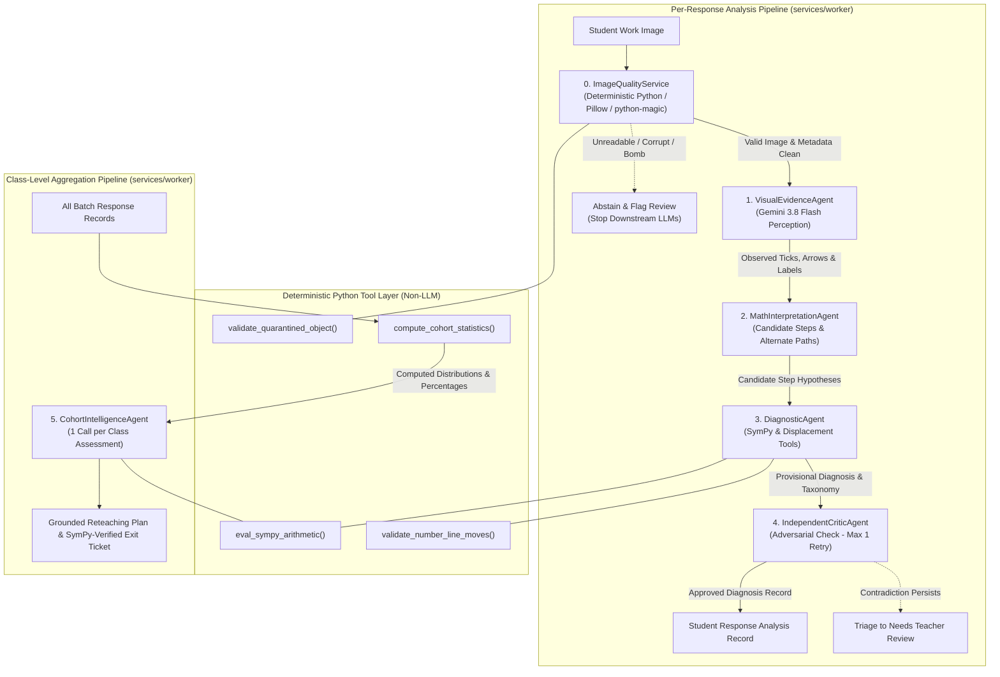

# Multi-Agent Design & Orchestration Specification — ClassLens

**Document ID:** ARC-AGT-002
**Version:** 1.2.0
**Date:** 2026-10-11

---

### Changelog (v1.2.0 — Final Technical-Validity Revision)
- Standardized definitive architecture to **1 Deterministic Python Service + 5 Bounded Google ADK Agents** (consolidating cohort insight and pedagogical action into `CohortIntelligenceAgent`).
- Pinned primary model to **Vertex AI Gemini 3.8 Flash (`gemini-3.8-flash`) in `asia-southeast1`** with dynamic vision tiling token model.
- Added comprehensive Pydantic schemas for all 5 ADK agents, including `CohortIntelligenceOutput`.
- Formalized uncertainty propagation rules, hallucination guardrails (prohibiting inferred student intent), and quantified the latency/cost impact of bounded Critic reinterpretation.

---

## 1. Multi-Agent Philosophy: Deterministic Core with Bounded Agentic Roles

ClassLens implements collaborative multi-agent reasoning using the Google Agent Development Kit (ADK) in Python.

We strictly avoid the anti-pattern of delegating deterministic computation to probabilistic LLMs. The architecture enforces a strict division:
- **Deterministic Computation (100% Python Code)**: Image validation, EXIF stripping, Pillow sharpness checks, SymPy exact rational arithmetic, geometry vector displacement calculations, cohort frequency counting, and Pydantic validation.
- **Probabilistic Reasoning (Bounded Google ADK Agents backed by `gemini-3.8-flash`)**: Multimodal handwriting perception, candidate step hypothesis generation, pedagogical error taxonomy mapping, adversarial criticism, and cohort narrative synthesis.



---

## 2. Definitive Agent Inventory & Boundaries

The pipeline comprises exactly **1 Deterministic Python Service + 5 Bounded Google ADK Agents**:

### Component 0: `ImageQualityService` (Deterministic Python Service — Non-LLM)
- **Runtime**: Pure Python 3.12 (`services/worker/intake/quality_service.py`), Pillow, `python-magic`.
- **Responsibilities**:
  1. Validates magic bytes against allowed MIME types (`image/jpeg`, `image/png`, `image/webp`).
  2. Enforces maximum file size (10 MB) and decompression bomb ceiling (`Image.MAX_IMAGE_PIXELS = 16_000_000`).
  3. Verifies dimensions ($\ge 300\times 300$ px and $\le 4096\times 4096$ px) and computes SHA256 integrity hash.
  4. Strips all EXIF metadata and normalizes images to a maximum dimension of 768 px.
  5. Computes Laplacian variance sharpness score and brightness histogram.
- **Abstention Rule**: If image is unreadable or corrupted, writes `quality_status = "unreadable"`, sets `needs_teacher_review = true`, and **halts downstream processing immediately** (0 LLM tokens consumed).

---

### Agent 1: `VisualEvidenceAgent` (Google ADK Multimodal Agent)
- **Model**: Vertex AI `gemini-3.8-flash` in `asia-southeast1`.
- **System Prompt**: Objective transcriber. Transcribes *only physically visible marks* on the paper: number line orientation, tick intervals, numeric labels, arrow start/end points, direction, circled values, and written expressions.
- **Hallucination Guardrail**: Strictly prohibited from guessing unobserved steps, interpolating missing arrows, or assuming student intent.
- **Allowed Tools**: None (Pure perception with structured Pydantic schema `VisualEvidenceOutput`).
- **Input**: Normalized image bytes (from `validated_images/`) + problem prompt.
- **Output Schema**: `VisualEvidenceOutput` (list of `VisualObservation`).

---

### Agent 2: `MathInterpretationAgent` (Google ADK Reasoning Agent)
- **Model**: Vertex AI `gemini-3.8-flash` in `asia-southeast1`.
- **Responsibilities**:
  1. Converts raw visual observations into candidate mathematical step sequences.
  2. Evaluates alternative valid mathematical representations (e.g. starting directly at $-6$ instead of $0$, or commutative grouping $12 - 4 - 6 = 2$, or curved bracket notation).
  3. Identifies whether visible marks represent complete or partial reasoning.
- **Hallucination Guardrail**: Prohibited from inventing missing addends. If a student wrote answer 2 with no number line jumps, outputs `reasoning_status = "incomplete"`.
- **Allowed Tools**: None (generates competing hypothesis structures).
- **Input**: `VisualEvidenceOutput` + problem context.
- **Output Schema**: `CandidateHypothesesOutput`.

---

### Agent 3: `DiagnosticAgent` (Google ADK Verification & Taxonomy Agent)
- **Model**: Vertex AI `gemini-3.8-flash` in `asia-southeast1` augmented with deterministic Python tools.
- **Responsibilities**:
  1. Calls `SymPyChecker` to evaluate exact rational arithmetic.
  2. Calls `NumberLineDisplacementCalculator` to compute displacement vectors $\Delta x_i = \text{end}_i - \text{start}_i$, comparing against target problem addends $(-6, +12, -4)$.
  3. Identifies the *first verifiable error step*.
  4. Maps detected errors to the standardized pedagogical taxonomy (e.g., `MISC-ARITH-OFF-BY-ONE`, `MISC-NUM-DIR-REVERSE`).
- **Deterministic Tools**:
  - `eval_sympy_arithmetic(expr_string, expected_value)`: exact SymPy rational arithmetic.
  - `validate_number_line_moves(start, moves[], expected_final)`: vector displacement calculator.
- **Input**: `CandidateHypothesesOutput` + rubric configuration.
- **Output Schema**: `DiagnosticOutput`.

---

### Agent 4: `IndependentCriticAgent` (Google ADK Adversarial Auditor Agent)
- **Model**: Vertex AI `gemini-3.8-flash` in `asia-southeast1`.
- **Responsibilities**:
  1. Adversarially audits the diagnosis against raw visual evidence.
  2. Checks for hallucinations, mathematical contradictions, or unsupported pedagogical labels.
  3. Verifies that the claimed error step is physically visible in the image observations.
- **Bounded Reinterpretation Specification**:
  - If a logical contradiction or evidence mismatch is found, Critic issues at most **ONE** targeted reinterpretation request back to `MathInterpretationAgent`.
  - *Latency & Cost Impact*: Bounded reinterpretation adds ~3,600 input tokens, ~800 output tokens (~$0.0057 USD), and $\approx 3.0$ seconds of execution time.
  - If contradiction persists on the second pass, Critic aborts the loop, sets `needs_teacher_review = true` with reason `critic_unresolved_discrepancy`, and preserves both hypotheses in the audit log.
- **Input**: `VisualEvidenceOutput` + `DiagnosticOutput`.
- **Output Schema**: `CriticAuditOutput`.

---

### Agent 5: `CohortIntelligenceAgent` (Google ADK Cohort Synthesis Agent — 1 per Batch)
- **Model**: Vertex AI `gemini-3.8-flash` in `asia-southeast1`.
- **Invocation**: Triggered once per assessment batch after all individual student response tasks reach terminal states.
- **Responsibilities**:
  1. Ingests deterministically computed class statistics from Python `compute_cohort_statistics()` (counts, percentages, error clusters, student IDs).
  2. Generates an executive pedagogical summary distinguishing systemic class-wide misconceptions from isolated slips.
  3. Generates 2 targeted, differentiated teaching actions (concrete manipulatives, worked examples).
  4. Generates a 3-question formative exit ticket and uses `SymPyChecker` to verify the mathematical validity of question stems and answer keys.
- **Guardrail**: The LLM is **never allowed to compute frequencies or percentages**. All quantitative facts are supplied as ground truth from Python.
- **Deterministic Tools**: `eval_sympy_arithmetic()`.
- **Input**: Computed `CohortStatistics` dictionary + rubric definitions.
- **Output Schema**: `CohortIntelligenceOutput`.

---

## 3. Typed Data Contracts (Pydantic v2 Schemas)

```python
from pydantic import BaseModel, Field
from typing import List, Optional, Literal
from enum import Enum
from datetime import datetime

class QualityStatus(str, Enum):
    CLEAR = "clear"
    FAINT_READABLE = "faint_readable"
    BLURRED = "blurred"
    ROTATED = "rotated"
    UNREADABLE = "unreadable"

class AnswerStatus(str, Enum):
    CORRECT = "correct"
    INCORRECT = "incorrect"
    UNDETERMINED = "undetermined"

class ReasoningStatus(str, Enum):
    SUPPORTED_CORRECT = "supported_correct"
    SUPPORTED_ERROR = "supported_error"
    INCOMPLETE = "incomplete"
    UNDETERMINED = "undetermined"

class VisualObservation(BaseModel):
    kind: Literal["number_line", "equation", "arrow_jump", "bracket_curve", "circled_result", "text_label"]
    value: str = Field(description="Transcribed value, label, or coordinate")
    confidence: float = Field(ge=0.0, le=1.0)
    start_pos: Optional[float] = None
    end_pos: Optional[float] = None
    direction: Optional[Literal["left", "right", "none"]] = None
    bounding_box: Optional[List[float]] = None

class VisualEvidenceOutput(BaseModel):
    quality_status: QualityStatus
    observations: List[VisualObservation] = []
    has_number_line: bool
    final_answer_marked: Optional[str] = None
    confidence: float = Field(ge=0.0, le=1.0)

class CandidateHypothesis(BaseModel):
    hypothesis_id: str
    starting_point: float
    strategy_description: str
    step_sequence: List[str]
    is_valid_alternative_path: bool
    confidence: float = Field(ge=0.0, le=1.0)

class CandidateHypothesesOutput(BaseModel):
    hypotheses: List[CandidateHypothesis]
    detected_strategy: str
    reasoning_completeness: Literal["complete", "partial", "incomplete"]

class VerifiedStep(BaseModel):
    step_number: int
    operation: str
    expected_result: float
    observed_result: Optional[float]
    is_correct: bool
    evidence_citation: str

class FirstSupportedError(BaseModel):
    step_number: int
    error_type: Literal["directional_sign", "magnitude_miscount", "arithmetic_slip", "misread_problem", "other"]
    observed_behavior: str
    expected_behavior: str
    explanation: str

class DiagnosticOutput(BaseModel):
    answer_status: AnswerStatus
    reasoning_status: ReasoningStatus
    inferred_final_answer: Optional[str] = None
    verified_steps: List[VerifiedStep] = []
    first_supported_error: Optional[FirstSupportedError] = None
    misconception_taxonomy_id: Optional[str] = None
    taxonomy_title: Optional[str] = None
    confidence: float = Field(ge=0.0, le=1.0)

class CriticAuditOutput(BaseModel):
    approved: bool
    confidence: float = Field(ge=0.0, le=1.0)
    evidence_grounded: bool
    contradiction_detected: bool
    reinterpretation_needed: bool
    discrepancy_notes: List[str] = []
    requires_teacher_review: bool
    teacher_review_reason: Optional[str] = None

class DifferentiatedAction(BaseModel):
    target_misconception_id: str
    action_type: Literal["concrete_manipulative", "worked_example", "guided_inquiry"]
    title: str
    instructional_steps: List[str]
    student_count_affected: int

class ExitTicketItem(BaseModel):
    question_number: int
    prompt: str
    target_misconception: str
    expected_answer: str
    sympy_verified: bool

class CohortIntelligenceOutput(BaseModel):
    executive_narrative: str
    dominant_misconceptions: List[str]
    differentiated_actions: List[DifferentiatedAction]
    formative_exit_ticket: List[ExitTicketItem]
    generated_at: datetime
```

---

## 4. Uncertainty Propagation & Teacher Escalation Rules

ClassLens enforces strict rules governing confidence calibration and human teacher escalation:

1. **Confidence Thresholding**: Every agent outputs an explicit `confidence: float` $\in [0.0, 1.0]$.
   - If `VisualEvidenceAgent.confidence < 0.70`, response is routed to teacher review.
   - If `DiagnosticAgent.confidence < 0.75`, response is routed to teacher review.
   - If `CriticAuditOutput.approved == False` after 1 reinterpretation attempt, response is routed to teacher review.
2. **Ambiguous Marking**: If a student marks two competing numbers, or if arrow heads are bidirectional, the system marks `reasoning_status = "undetermined"` and sets `needs_teacher_review = true`.
3. **Teacher Primacy**: Teachers possess unilateral override authority via the dual-pane UI. Every override is recorded in an immutable `audit_events` document for ethical governance and continuous model calibration.
