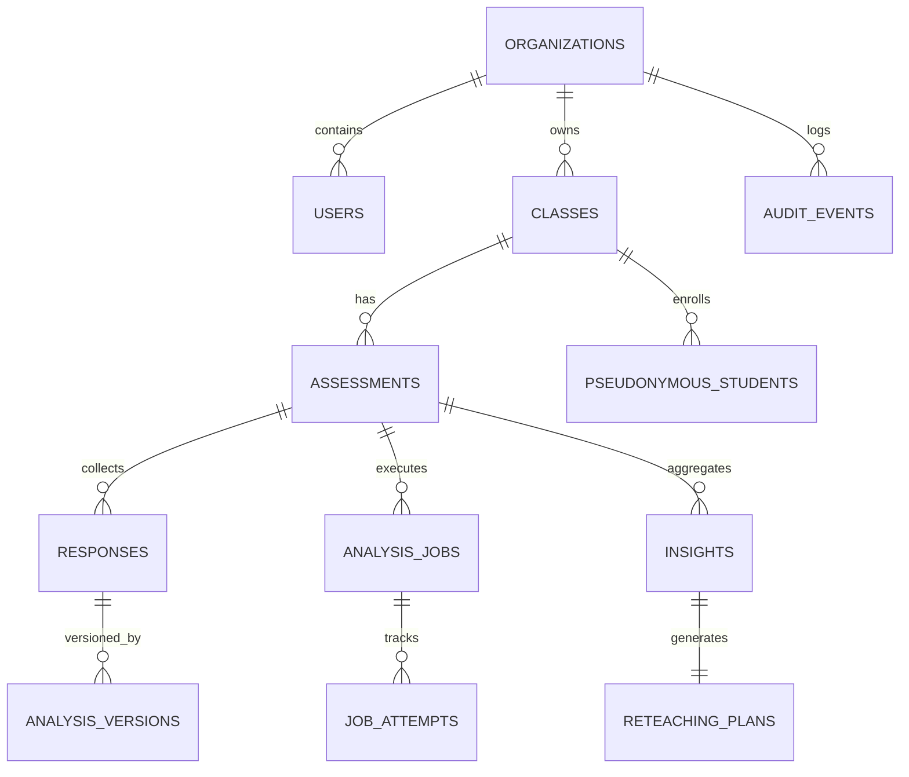

# Data Model & Schema Specification — ClassLens

**Document ID:** ARC-DAT-003
**Version:** 1.2.0
**Date:** 2026-10-11

---

### Changelog (v1.2.0 — Final Technical-Validity Revision)
- Formalized atomic task lease claim fields (`lease_holder`, `lease_expires_at`, `attempt_count`) on `ResponseDoc` for Cloud Tasks idempotency.
- Updated `upload_status` to support the quarantine lifecycle: `uploaded_unverified`, `validating`, `validated`, `rejected`.
- Added quarantine GCS path (`gcs_quarantine_uri`) and validated GCS path (`gcs_validated_uri`).
- Expanded `JobAttemptDoc` statuses to include terminal failure states (`FAILED_UNRECOVERABLE`, `FAILED_TIMEOUT`) and circuit breaker status (`PAUSED_CIRCUIT_BREAKER`).

---

## 1. Firestore Collection Hierarchy Overview

ClassLens models data hierarchically in Firestore Native Mode, scoped by organization to ensure strict multi-tenant isolation:

```
/organizations/{orgId}
    /users/{userId}
    /classes/{classId}
        /pseudonymous_students/{studentId}
        /assessments/{assessmentId}
            /responses/{responseId}
                /analysis_versions/{versionId}
            /analysis_jobs/{jobId}
                /job_attempts/{attemptId}
            /insights/{snapshotId}
            /reteaching_plans/{planId}
    /audit_events/{eventId}
```



---

## 2. Core Firestore Document Schemas (Pydantic v2 Models)

### 2.1 Collection: `/organizations/{orgId}`
```python
class OrganizationDoc(BaseModel):
    id: str  # Document ID (UUID)
    name: str  # e.g. "Cedar Girls' Secondary School"
    created_at: datetime
    retention_days: int = 30
    is_active: bool = True
```

### 2.2 Collection: `/organizations/{orgId}/users/{userId}`
```python
class UserDoc(BaseModel):
    id: str  # Document ID (UUID or Google UID)
    organization_id: str
    email: str
    name: str
    role: Literal["teacher", "admin", "reviewer", "demo_observer"]
    created_at: datetime
```

### 2.3 Collection: `/organizations/{orgId}/classes/{classId}`
```python
class ClassDoc(BaseModel):
    id: str  # Document ID (UUID)
    organization_id: str
    teacher_id: str
    name: str  # e.g. "Sec 1 Mathematics - Class 1E"
    grade_level: str  # e.g. "Grade 7"
    created_at: datetime
```

### 2.4 Collection: `/organizations/{orgId}/classes/{classId}/pseudonymous_students/{studentId}`
```python
class PseudonymousStudentDoc(BaseModel):
    id: str  # Document ID (e.g. "stu_01")
    class_id: str
    pseudonym_label: str  # e.g. "Student-01"
    created_at: datetime
```

### 2.5 Collection: `.../assessments/{assessmentId}`
```python
class QuestionConfig(BaseModel):
    problem_reference_id: str = "1065658"
    question_text: str
    latex_formula: str = "-6 + 12 - 4"
    expected_answer: str = "2"
    accepted_methods: List[str] = [
        "hop_from_zero",
        "direct_jump_from_negative_six",
        "commutative_rearrangement"
    ]
    step_rules: List[dict] = []

class AssessmentDoc(BaseModel):
    id: str  # Document ID (UUID)
    class_id: str
    organization_id: str
    title: str  # e.g. "Integers on Number Line: Checkpoint 1"
    status: Literal["draft", "ready", "processing", "review", "completed"]
    question: QuestionConfig
    total_responses: int = 0
    reviewed_responses: int = 0
    created_at: datetime
    updated_at: datetime
```

### 2.6 Subcollection: `.../assessments/{assessmentId}/responses/{responseId}`
```python
class ResponseDoc(BaseModel):
    id: str  # Document ID (UUID)
    assessment_id: str
    pseudonymous_student_id: str
    pseudonym_label: str  # e.g. "Student-01"
    source_filename: str
    gcs_quarantine_uri: str
    gcs_validated_uri: Optional[str] = None
    image_mime_type: str
    image_width: Optional[int] = None
    image_height: Optional[int] = None
    sha256_hash: Optional[str] = None
    upload_status: Literal["uploaded_unverified", "validating", "validated", "rejected"]
    task_status: Literal["PENDING", "RUNNING", "COMPLETED", "FAILED_INVALID_FORMAT", "FAILED_UNRECOVERABLE", "FAILED_TIMEOUT", "PAUSED_CIRCUIT_BREAKER"] = "PENDING"
    lease_holder: Optional[str] = None
    lease_expires_at: Optional[datetime] = None
    attempt_count: int = 0
    current_version: int = 1
    answer_status: Literal["correct", "incorrect", "undetermined"] = "undetermined"
    reasoning_status: Literal["supported_correct", "supported_error", "incomplete", "undetermined"] = "undetermined"
    teacher_review_status: Literal["unreviewed", "approved_as_is", "overridden", "marked_unreadable"] = "unreviewed"
    created_at: datetime
```

### 2.7 Subcollection: `.../responses/{responseId}/analysis_versions/{versionId}`
```python
class AnalysisVersionDoc(BaseModel):
    id: str  # Document ID (e.g. "v1")
    version_number: int
    quality_status: Literal["clear", "faint_readable", "blurred", "rotated", "unreadable"]
    observations: List[dict]  # VisualObservation objects
    candidate_interpretations: List[dict]  # Competing hypotheses
    inferred_final_answer: Optional[str]
    answer_status: Literal["correct", "incorrect", "undetermined"]
    reasoning_status: Literal["supported_correct", "supported_error", "incomplete", "undetermined"]
    verified_steps: List[dict]  # VerifiedStep objects
    first_supported_error: Optional[dict]  # FirstSupportedError object
    misconceptions: List[dict]  # MisconceptionFinding objects
    alternative_valid_methods: List[str]
    reinterpretation_triggered: bool = False
    critic_discrepancy_detected: bool = False
    needs_teacher_review: bool
    teacher_review_reason: Optional[str]
    critic_notes: Optional[str]
    execution_latency_ms: int
    tokens_consumed: int
    created_at: datetime
```

### 2.8 Subcollection: `.../assessments/{assessmentId}/analysis_jobs/{jobId}`
```python
class AnalysisJobDoc(BaseModel):
    id: str  # Document ID (UUID)
    assessment_id: str
    status: Literal["pending", "processing", "completed", "failed", "cancelled"]
    total_items: int
    completed_items: int = 0
    failed_items: int = 0
    idempotency_key: str
    created_at: datetime
    updated_at: datetime
```

### 2.9 Subcollection: `.../analysis_jobs/{jobId}/job_attempts/{attemptId}`
```python
class JobAttemptDoc(BaseModel):
    id: str
    job_id: str
    response_id: str
    attempt_number: int
    status: Literal["RUNNING", "COMPLETED", "FAILED_TRANSIENT", "FAILED_UNRECOVERABLE", "FAILED_TIMEOUT", "PAUSED_CIRCUIT_BREAKER"]
    worker_instance_id: str
    lease_expires_at: datetime
    error_message: Optional[str] = None
    timestamp: datetime
```

### 2.10 Subcollection: `.../assessments/{assessmentId}/insights/{snapshotId}`
```python
class MisconceptionCluster(BaseModel):
    taxonomy_id: str
    title: str
    affected_count: int
    affected_percentage: float
    teacher_confirmed_count: int
    ai_proposed_count: int
    sample_response_ids: List[str]

class ClassInsightDoc(BaseModel):
    id: str  # e.g. "current"
    assessment_id: str
    total_responses: int
    correct_count: int
    correct_percentage: float
    error_count: int
    error_percentage: float
    unreadable_count: int
    unreadable_percentage: float
    misconception_clusters: List[MisconceptionCluster]
    qualitative_summary: str
    created_at: datetime
```

### 2.11 Subcollection: `.../assessments/{assessmentId}/reteaching_plans/{planId}`
```python
class ReteachingPlanDoc(BaseModel):
    id: str  # e.g. "current"
    assessment_id: str
    summary: str
    differentiated_groups: List[dict]  # Target misconceptions & activities
    exit_ticket_items: List[dict]  # 3 SymPy-verified formative questions
    is_approved_by_teacher: bool = False
    created_at: datetime
```

### 2.12 Root Collection: `/organizations/{orgId}/audit_events/{eventId}`
```python
class AuditEventDoc(BaseModel):
    id: str  # Document ID (UUID)
    organization_id: str
    user_id: str
    action: Literal["OVERRIDE_DIAGNOSIS", "APPROVE_ANALYSIS", "DELETE_ASSESSMENT", "EXPORT_REPORT"]
    entity_type: str
    entity_id: str
    old_state: Optional[dict]
    new_state: Optional[dict]
    teacher_notes: Optional[str]
    ip_address: str
    timestamp: datetime
```

---

## 3. Atomic Transactions & Lease Semantics

### 3.1 Worker Atomic Task Lease Claim
When a worker receives `/tasks/analyze-response`:
1. Executes an atomic Firestore transaction on `responses/{responseId}`:
   - Reads document. If `task_status == "COMPLETED"`, transaction commits with no-op; worker returns HTTP 200.
   - If `task_status == "RUNNING"` and `lease_expires_at > now()`, transaction commits with no-op; worker returns HTTP 200.
   - If `task_status in ["PENDING", "FAILED_TRANSIENT"]` or (`task_status == "RUNNING"` and `lease_expires_at <= now()`):
     - Sets `task_status = "RUNNING"`.
     - Sets `lease_holder = worker_instance_id`.
     - Sets `lease_expires_at = now() + timedelta(seconds=300)`.
     - Increments `attempt_count += 1`.
2. Worker performs image validation, multi-agent analysis, and persists `analysis_versions/v{N}`.
3. Second transaction marks `task_status = "COMPLETED"`, updates `answer_status` and `reasoning_status`, and increments `AnalysisJobDoc.completed_items += 1`.

### 3.2 Atomic Teacher Review Override
When a teacher submits an override:
1. Transaction reads `responses/{responseId}` and `assessments/{assessmentId}`.
2. Updates `responses/{responseId}` with `teacher_review_status = "overridden"` and corrected fields.
3. Appends an `AuditEventDoc` to `/organizations/{orgId}/audit_events`.
4. Atomically increments `assessments/{assessmentId}.reviewed_responses += 1`.
