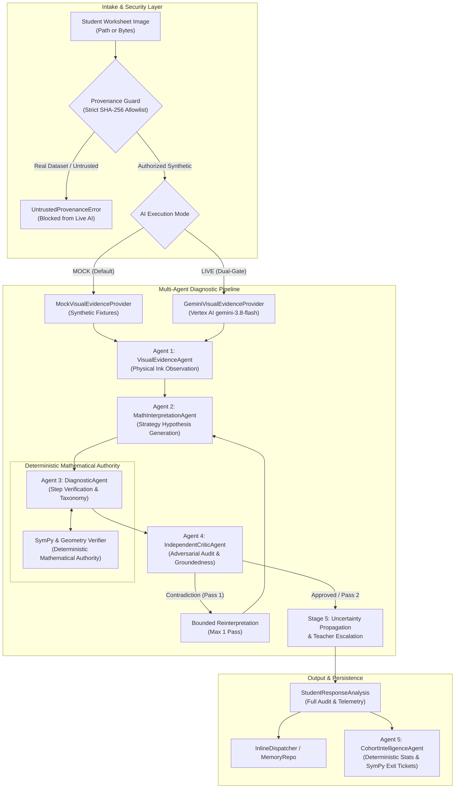

# Gate 4A: Live Gemini Integration into the Multi-Agent Pipeline

## 1. Executive Summary

**Gate 4A** integrates the validated Google Cloud Vertex AI Gemini multimodal vision capability into the ClassLens multi-agent pipeline. It bridges the initial handwriting feasibility evaluation (Gate 3) into the production agent architecture while strictly preserving the project's foundational architectural guarantees:

1. **Decoupled Responsibilities**: Gemini performs perceptual handwriting extraction (`VisualEvidenceAgent`), while deterministic SymPy tools remain the sole, absolute authority on mathematical correctness (`DiagnosticAgent`).
2. **Offline-First Default**: The system operates 100% offline in mock mode by default. Zero live Gemini API calls are made during development, continuous integration, or test execution.
3. **Dual-Gate Authorization**: Live AI inference requires two independent opt-in controls (`CLASSLENS_AI_MODE=live` and `CLASSLENS_LIVE_INFERENCE_ENABLED=true`).
4. **Strict Synthetic Provenance Guard**: Live inference is restricted exclusively to pre-approved, server-side validated synthetic fixtures (`case_01`, `case_02`, `case_03`). Real student dataset images and arbitrary client uploads are cryptographically blocked from transmission.
5. **Architectural Continuity**: Downstream agent contracts, SymPy verifiers, critic audits, and teacher escalation rules remain 100% backward-compatible.

---

## 2. Multi-Agent Pipeline Architecture

ClassLens employs a sequential five-agent pipeline orchestrated with bounded adversarial critique. The diagram below illustrates how Gemini visual extraction integrates into the system:



---

## 3. Component Details & Design Contracts

### 3.1 VisualEvidenceProvider Protocol

The visual evidence extraction interface is abstracted into a runtime-checkable protocol (`services/worker/agents/provider.py`):

```python
@runtime_checkable
class VisualEvidenceProvider(Protocol):
    last_tokens: int
    last_cost_usd: Optional[float]
    last_latency_ms: int
    last_telemetry: Optional[Dict[str, Any]]

    def extract_evidence(
        self,
        response_id: str,
        image_source: Optional[Union[str, Path, bytes]] = None,
        high_res_mode: bool = False,
        confidence_override: Optional[float] = None,
        **kwargs: Any,
    ) -> VisualEvidenceOutput: ...
```

#### Provider Implementations:
- `MockVisualEvidenceProvider`: Wraps `MockAgentAdapter.get_visual_evidence()`. Consumes 0 tokens, $0.00 cost, and returns deterministic fixture data.
- `GeminiVisualEvidenceProvider`: Interacts with Vertex AI via `GeminiVisionAdapter`. Enforces server-side provenance validation, streams in-memory image bytes, and maps structured responses into `VisualEvidenceOutput`.

### 3.2 Decoupled Schema Mapping (`gemini_schema_to_visual_evidence`)

A fundamental requirement of Gate 4A is **decoupling physical visual observation from mathematical correctness**:

| Gemini Schema Field (`GeminiVisualEvidenceSchema`) | Mapped ClassLens Field (`VisualEvidenceOutput`) | Decoupling Rationale |
|---|---|---|
| `image_quality` | `quality_status` | Translates perceptual clarity (clear, faint, blurred, low-contrast, unreadable). |
| `number_line.observed_hops` | `observations` (`kind="arrow_jump"`) | Reports start, end, direction, and written magnitude verbatim. Does **not** assume correct intervals. |
| `visible_final_answer.value` | `final_answer_marked` & `observations` (`kind="circled_result"`) | Transcribes the numeral in the answer box verbatim without grading correctness. |
| `ambiguities` | `ambiguities` (string list) | Preserves identified ambiguities (e.g., missing arrowheads, smudges). |
| `requires_teacher_review` | `requires_teacher_review` | Propagates perceptual uncertainty directly to Stage 5 escalation. |
| `raw_extraction` | `raw_extraction` | Retains full upstream structured output for auditing and provenance. |

### 3.3 SymPy as the Sole Mathematical Authority

Downstream agents (`MathInterpretationAgent`, `DiagnosticAgent`, `IndependentCriticAgent`) never trust LLM arithmetic:

1. `MathInterpretationAgent` uses observed hops to identify student strategies (`hop_from_zero`, `direct_start`, `commutative`).
2. `DiagnosticAgent` passes all observed displacements to `validate_number_line_moves()`:
   - Evaluates arithmetic via SymPy (`SymPyChecker.verify_equality()`).
   - Analyzes interval displacements and direction consistency.
   - Accurately distinguishes between interval mislabeling (`MISC-LINE-INTERVAL-MISLABEL`), arithmetic slip (`MISC-ARITH-SLIP`), and directional reversal (`MISC-NUM-DIR-REVERSE`).
3. `IndependentCriticAgent` verifies that the diagnostic conclusion is grounded in physical marks and flags contradictions or compensatory errors.

---

## 4. Privacy, Security & Cost Controls

### 4.1 Server-Side Provenance Guard (`services/worker/security/provenance_guard.py`)

To eliminate the risk of inadvertent transmission of real student PII or raw research dataset files:

1. **Path Resolution Confinement**: Resolves canonical realpaths (`Path.resolve(strict=True)`), preventing directory traversal (`..`) and symlink escaping.
2. **Dataset Path Blacklist**: Hard-rejects any path containing `dataset/`, `drawedumath`, or `mathwriting`.
3. **Cryptographic SHA-256 Allowlist**: Verifies that the file's content matches pre-computed SHA-256 hashes of authorized synthetic fixtures:
   - `case_01_canonical_correct.png`: `3dd01287f3763a11c6b54d45edfacbc39b6318819fb975e9dc5e74dbd57e98d6`
   - `case_02_off_by_one_error.png`: `78ff2a0627485b2fc5a4080389b078c4b1c3842de0cf34f15ddacb99b1db3232`
   - `case_03_ambiguous_incomplete.png`: `9add38ac12542444a7ffe435f8e68cdea8d6bf99c6ce708657241306d88431cc`
4. **Byte-Level Validation**: In live mode, arbitrary client-uploaded bytes not matching the allowlist are rejected (`verify_synthetic_bytes()`).

### 4.2 In-Memory Streaming & Zero Cloud Storage

All image processing utilizes `types.Part.from_bytes(data=image_bytes, mime_type=mime_type)` via the Google Gen AI SDK (`google-genai`). Images are never staged in Google Cloud Storage (GCS) buckets, ensuring zero persistent cloud footprint.

### 4.3 Circuit Breaker & Usage Accounting

The `GeminiVisionAdapter` enforces:
- **Call Budget Ceiling**: Enforces `max_calls` (default: 3). Calling beyond the limit raises `RuntimeError("Gate 4A Call Budget Exceeded")`.
- **Zero Automatic Retries**: Exactly one single attempt is made per image.
- **Published Pricing Schedule**: Tracks input/output tokens and calculates local cost estimates based on official Vertex AI pricing (`gemini-3.8-flash`: $0.75 / $3.75 per million tokens).
- **Typed Exception Hierarchy**: `GeminiAuthenticationError`, `GeminiQuotaError`, `GeminiTimeoutError`, `GeminiModelError`.

---

## 5. Verification & Test Suite Summary

The Gate 4A implementation was verified with comprehensive automated tests running 100% offline:

| Test Suite | Test Count | Pass Rate | Key Verification Areas |
|---|---|---|---|
| `tests/unit/test_gate4a_integration.py` | 17 | 100% | Dual-gate authorization, provenance guard, allowlist matching, schema translation, pricing lookup, circuit breaker. |
| `tests/integration/test_gate4a_pipeline.py` | 8 | 100% | Pipeline execution with stubbed Gemini provider across Cases 1, 2, and 3; SymPy mathematical authority; bounded critic retry; cohort analysis; dispatcher persistence. |
| Existing Baseline Tests | 145 | 100% | Core image intake, SymPy verifiers, mock fixtures, REST API endpoints, review overrides, and audit trails. |
| **Total Test Suite** | **170** | **100%** | **Full offline verification across all layers.** |

In addition, the Gate 3 evaluation harness (`scripts/evaluate_gemini_handwriting.py`) was verified in dry-run mode, achieving 3/3 (100%) schema conformance and mathematical alignment.
