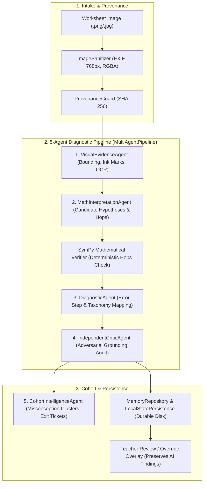

# ClassLens — Gate 4C Architecture & Evaluation Inventory

**Document Version:** 1.0.0  
**Date:** 2026-10-12  
**Scope:** Gate 4C (AI Reliability, Benchmarking & Evaluation)  
**Target Branch:** `main`

---

## 1. System Architecture Overview

ClassLens is an AI-assisted handwritten mathematics assessment platform specifically engineered to diagnose secondary-school student mathematical reasoning from number-line worksheets. Unlike black-box automated grading systems, ClassLens disaggregates evaluation across five distinct, auditable agent roles and combines probabilistic visual perception with deterministic SymPy computational verification.

---

## 2. Multi-Agent Role & Responsibility Matrix

| Agent Name | Primary Responsibility | Deterministic vs Probabilistic | Output Schema |
|---|---|---|---|
| **1. VisualEvidenceAgent** | Detects physical handwriting, numbers, number-line grids, interval tick marks, hop arcs, and circled final answers. Assesses contrast and legibility. | Probabilistic (Gemini / Mock Vision Adapter) | `VisualExtractionOutput` |
| **2. MathInterpretationAgent** | Translates visual ink markings into candidate mathematical solution paths, starting points, and hop sequences ($0 \to -6 \to 6 \to 2$). | Probabilistic (Gemini / Mock Strategy Adapter) | `CandidateHypothesesOutput` |
| **SymPy Verifier (Engine)** | Independently computes ground-truth displacements, tests algebraic equivalence, validates interval magnitudes, and detects contradictions without LLM hallucination. | **Strictly Deterministic** (`sympy.sympify`, geometry) | `VerifiedStep` array, `VerificationStatus` |
| **3. DiagnosticAgent** | Classifies solution into `AnswerStatus` and `ReasoningStatus`, isolates the earliest demonstrably flawed step, and maps procedural errors to a rigorous misconception taxonomy. | Rule-assisted Probabilistic | `DiagnosticOutput` |
| **4. IndependentCriticAgent** | Adversarial validation agent. Scrutinizes diagnostic assertions against visible physical ink strokes; flags ungrounded conjectures, hallucinated intermediate hops, and contradictions. | Adversarial Audit (Heuristic + LLM) | `CriticAuditOutput` |
| **5. CohortIntelligenceAgent** | Synthesizes cohort-wide patterns, clusters validated misconceptions, suppresses unverifiable submissions from false-positive clusters, and generates formative exit tickets. | Deterministic Aggregator + Synthesis | `CohortIntelligenceOutput` |

---

## 3. Evaluation Safeguards & Semantics

### A. Three-Way Separation of Concerns
1. **Observed on Worksheet**: Direct transcription of visible marks; no inferred intent.
2. **Mathematically Interpreted Strategy**: Candidate hypotheses about the student's method.
3. **Verified by SymPy Engine**: Algebraic truth of each hop independent of student claims.

### B. Uncertainty & Abstention Handling
- **Faint / Obscured Handwriting**: Classified as `QualityStatus.UNREADABLE` or `EvidenceSufficiency.INSUFFICIENT`.
- **Misconception Suppression**: The system strictly **withholds** assigning a taxonomy ID if intermediate hops are unverifiable. It never invents a procedural error when ink is missing.
- **Heuristic Confidence Indicator**: Confidence scores are heuristic threshold indicators (`min(visual, diag, 0.65)` for uncertain cases), not claimed as empirical probability distributions.
- **Mandatory Educator Escalation**: Submissions with degraded visual evidence, compensatory intermediate errors, or adversarial critic contradictions are routed to the educator attention queue.

### C. Durable Persistence & Data Isolation
- **Educator Decision Precedence**: Teacher reviews (`approved_as_is`, `overridden`, `marked_unreadable`) override display verdicts but **never** overwrite or mutate the underlying AI analysis data (`analysis_data`).
- **Local Persistence**: State is partitioned by organization ID (`local-data/store/{org_id}_state.json`) and committed via atomic rename (`os.replace`) to guarantee survival across server restarts.
- **Benchmark Isolation**: Synthetic benchmarks (`asm_synthetic_cases`) are clearly partitioned from active student checkpoints (`asm_1065658`) to prevent synthetic metrics from contaminating real classroom reports.

---

## 4. Current Test & Benchmark Infrastructure Inventory

| Component | Path | Coverage |
|---|---|---|
| **Synthetic Test Cases** | `dataset/synthetic_cases/` | Case 1 (Canonical Sound), Case 2 (Off-by-One Interval), Case 3 (Ambiguous & Incomplete). |
| **13 Problem #1065658 Cases** | `services/worker/fixtures/problem_1065658_fixtures.py` | 13 structured mock observation fixtures mirroring real secondary-school student worksheet submissions. |
| **Mathematical Verifier Tests** | `tests/unit/test_math_verifier.py` | 36 unit tests validating SymPy checks, hop geometry, commutative jumps, and interval arithmetic. |
| **Image Intake Tests** | `tests/unit/test_image_intake.py` | EXIF stripping, resolution bounds, RMS contrast, and decompression bomb protection. |
| **Gate 4B Dashboard Tests** | `tests/unit/test_teacher_dashboard_gate4b.py` | Synthetic benchmark retrieval, teacher override persistence, tenant isolation, and cohort aggregation. |
| **Gate 4B.2 Persistence Tests** | `tests/unit/test_persistence_gate4b2.py` | Crash-proof restart survival, metric calculation consistency, and heuristic confidence validation. |

---

## 5. Gate 4C Objectives & Roadmap

Gate 4C introduces an **independent, versioned benchmark dataset and automated evaluation harness** to mathematically measure, reproduce, and audit the reliability of the diagnostic pipeline:

1. **Versioned Benchmark Dataset (`v1.0.0`)**: 18+ independently authored ground-truth test cases across 6 distinct categories (Canonical Correct, Procedural Errors, Off-by-One/Interval Mislabels, Arithmetic Slips, Ambiguous/Insufficient Evidence, and Adversarial/Compensatory cases).
2. **Deterministic Evaluation Runner**: Programmatically runs benchmark cases in mock mode, calculates exact semantic metrics (accuracy, precision, recall, false-positive misconception rate, abstention rate, critic effectiveness), and exports structured JSON and Markdown reports.
3. **Critic Fault-Injection Suite**: Injects synthetic diagnostic flaws (hallucinated hops, ignored contradictions, unjustified certainty) to verify that the Independent Critic reliably intercepts invalid diagnoses.
4. **Developer AI Evaluation UI**: Interactive dashboard under `Design & Testing` displaying benchmark overview, metric cards with explicit numerators/denominators, category filters, and failed-case diff inspection.
