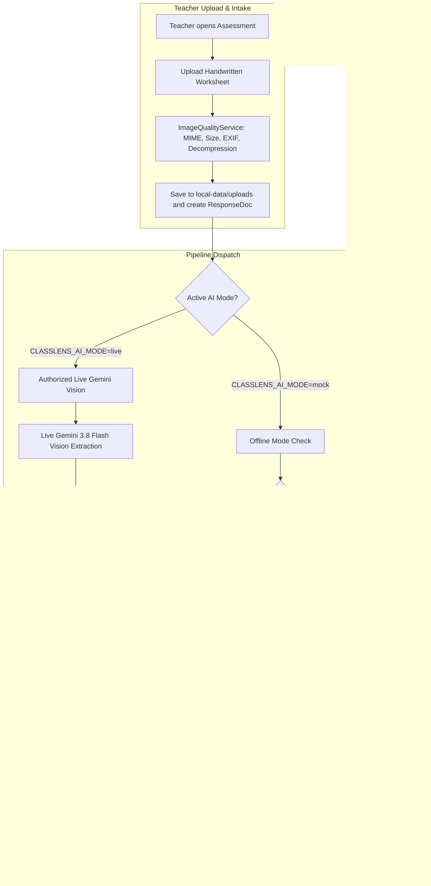

# ClassLens — Gate 5: Product Gap Analysis & Implementation Architecture

**Document ID:** CL-ARCH-GATE5-GAP-001  
**Version:** 1.0.0  
**Date:** 2026-10-12  
**Milestone:** Gate 5 — Competition MVP & End-to-End Teacher Workflow  
**Working Branch:** `main`  
**Spending Authorization:** $0.00 USD (Offline Mock Mode strictly enforced)  

---

## 1. Executive Overview

ClassLens provides transparent, evidence-grounded assessment of handwritten student mathematical reasoning for Singapore Secondary 1 Mathematics. Gates 4A through 4C established:
- Multimodal visual evidence extraction architecture (Gate 4A)
- Dual-pane teacher dashboard, inspection modal, and persistent teacher overrides (Gate 4B, 4B.1, 4B.2)
- 18-case ground-truth benchmark suite, 17 standardized reliability metrics, Critic Agent fault injection, and developer reliability lab (Gate 4C)

The objective of **Gate 5** is to transform ClassLens from a curated synthetic demonstration into an **end-to-end teacher workflow**:
1. Teachers create or select assessments.
2. Teachers upload unseen handwritten student worksheets (single or batch).
3. Worksheets are validated with strict security (size, MIME, decompression bomb, EXIF stripping).
4. Submissions are associated with students and assessments, persisting across restarts.
5. In offline mode, the system **honestly differentiates** between curated synthetic demonstrations and unseen uploaded worksheets without fabricating fake diagnoses.
6. Teachers inspect original handwriting, SymPy verification, Critic findings, and execute override decisions.
7. Cohort insights and evidence-grounded teaching actions update transparently.

---

## 2. Product Gap Matrix

| Functional Area | Current Status (Gate 4C) | Gate 5 Gap | Resolution Architecture |
|---|---|---|---|
| **Assessment Creation** | Partial backend route (`POST /assessments`), no persistence to disk, no frontend UI. | Teachers cannot create new assessments via UI; created assessments lost on restart. | Add `create_assessment` persistence in `MemoryRepository` / `LocalStatePersistence`; build frontend Create Assessment modal with topic/question/grade fields. |
| **Worksheet Upload** | `ImageQualityService` exists in worker intake with full security; NO upload endpoint in API; NO upload UI. | Teachers cannot upload handwritten worksheets. | Add `POST /api/v1/assessments/{id}/upload` multipart endpoint; save files to `local-data/uploads/{org_id}/`; add drag-and-drop batch upload component in frontend. |
| **Image Serving** | `get_response_image` only looks in `dataset/` and `TRUSTED_SYNTHETIC_DIR`. | Uploaded images cannot be served or previewed. | Extend `get_response_image` to check `local-data/uploads/` with path-traversal sanitization. |
| **Student ID Mapping** | Hardcoded `Student-01` to `Student-13`. | Multi-upload has no mapping between uploaded images and student identifiers. | Build automatic + editable student identifier mapper in upload UI; generate pseudonymous IDs (`stu_...`). |
| **Demonstration Modes** | Mock mode returns canned fixtures for `MOCK_FIXTURES`. | Unseen uploaded images might be assigned canned fixtures or crash. | **Strict Mode Differentiation**: Unseen uploaded images in offline mode are flagged as `AWAITING_LIVE_ANALYSIS` with clear truthful banner: *"Image uploaded successfully. Live visual analysis is required to interpret this new worksheet."* |
| **Analysis Progress** | Instant or mock delay without visible stage transitions. | Teachers do not see clear, genuine processing stages. | Multi-stage progress indicator: Preparing worksheet → Visual intake → Mathematical reasoning → SymPy verification → Critic audit → Finalizing. |
| **Student Inspection** | Comprehensive dual-pane modal (`StudentInspectionModal`). | Does not have explicit empty/pending state for unanalyzed or `AWAITING_LIVE_ANALYSIS` uploads. | Add unanalyzed inspection view showing high-resolution preview, intake quality scores, and live-analysis requirement callout. |
| **Teacher Review** | Persistent in `local-data/store/{org_id}_state.json`. | Works for demo responses, but untested on dynamic custom assessments and uploads. | Ensure dynamic responses and audit events are cleanly saved and restored for custom assessments. |
| **Cohort Insights** | Aggregates completed responses in `asm_1065658`. | Custom assessments without completed analyses might crash or display stale metrics. | Ensure graceful empty states for new assessments with pending/awaiting submissions; isolate synthetic cases from genuine cohorts. |
| **Competition Demo** | Single landing page with hero banner. | No explicit choice between "Explore Synthetic Demo" and "Upload Your Own Worksheet". | Add clear "Explore ClassLens Demo" guidance with two distinct, transparent paths. |

---

## 3. Truthful Demonstration Mode Architecture

### Truthfulness Guarantees:
1. **Zero Hallucinated Interpretations:** ClassLens will NEVER assign a canned diagnosis, fake intermediate hops, or a synthetic score to an unseen handwritten worksheet in offline mock mode.
2. **Transparent Callout:** When a teacher inspects an uploaded worksheet in offline mode, the system clearly states that live multimodal vision is required to transcribe the ink strokes.
3. **Reproducible Demo Mode:** Curated demonstration checkpoints (`asm_1065658` and `asm_synthetic_cases`) remain fully operational for instant, offline judge demonstrations.

---

## 4. Implementation Plan by Checkpoints

- **Checkpoint A:** Product Gap Analysis (this document).
- **Checkpoint B:** Assessment and Submission Intake
  - Backend: `create_assessment` persistence, `POST /api/v1/assessments/{id}/upload` multipart endpoint, image storage in `local-data/uploads/`, image delivery.
  - Frontend: Assessment creation modal, multi-file upload modal with preview and student mapping.
- **Checkpoint C:** Pipeline Integration
  - Truthful offline behavior for unseen uploads (`AWAITING_LIVE_ANALYSIS`).
  - Integration with `inline_dispatcher` and `ImageQualityService`.
- **Checkpoint D:** Teacher Workflow Integration
  - Update `StudentInspectionModal` for uploaded submissions.
  - Teacher override and audit logging on custom assessments.
  - Cohort insights empty/pending states for custom assessments.
- **Checkpoint E:** Demo Experience & Final Acceptance
  - "Explore ClassLens Demo" entry point.
  - Full test suite execution and Next.js build.
  - Browser acceptance screenshots.
  - Roadmap update and final structured report.
