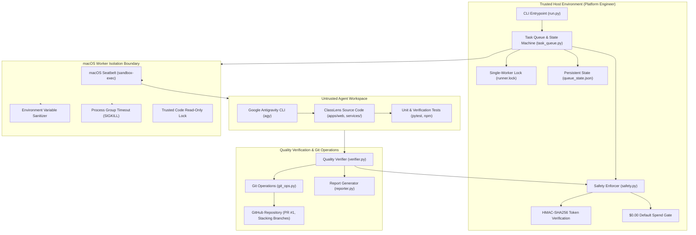
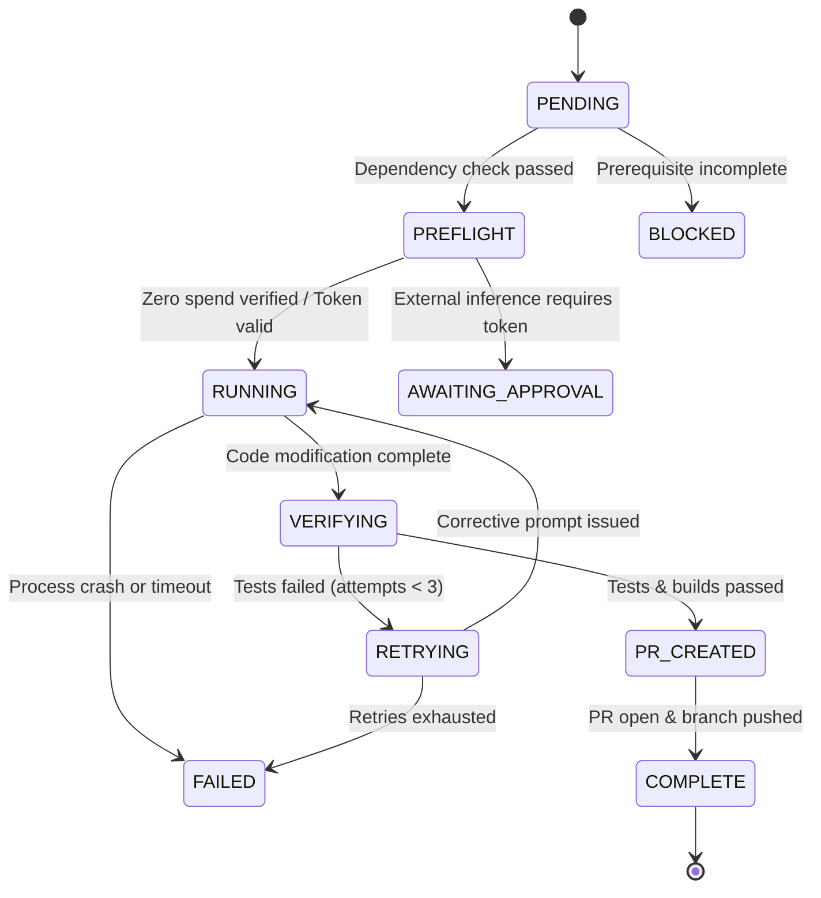

# ClassLens — Autonomous Execution Architecture

**Document Version:** 1.0.0  
**Phase:** Gate AUTO-1 (Secure Autonomous Development Execution)  
**System:** ClassLens (AI Builder Cup 2026)  
**Classification:** Internal Technical Architecture & DevSecOps Specification  

---

## 1. Executive Overview

The ClassLens Autonomous Development Workflow provides a zero-trust, unattended software engineering execution environment. It takes structured, version-controlled task specifications (`TASK-*.yaml`), invokes an isolated coding agent, executes deterministic offline test suites and builds, enforces cryptographic spending and file-boundary policies, and produces structured pull requests and audit reports.

The architecture strictly decouples **trusted platform orchestration** from the **untrusted coding-agent execution workspace**, ensuring that an agent cannot mutate security enforcers, forge approval tokens, exceed spending boundaries, or exfiltrate host credentials.

---

## 2. System Architecture Diagram

---

## 3. Core Architectural Components

### 3.1 Trusted Orchestrator vs. Untrusted Workspace

The ClassLens repository is divided into two distinct security zones:

| Component | Security Zone | Permissions | Responsibility |
|---|---|---|---|
| `automation/runner/` | **Trusted** | Read-Only to Agent | Contains Python orchestrator, safety enforcers, isolation wrappers, and git managers. |
| `automation/approvals/` | **Trusted** | Read-Only to Agent | Stores human-issued, HMAC-signed approval tokens. |
| `.github/workflows/` | **Trusted** | Read-Only to Agent | CI pipelines and security tripwires. |
| `automation/tasks/` | **Trusted / Supervised** | Validated via Schema | Task specifications and acceptance criteria. |
| `apps/web/` | **Untrusted Workspace** | Agent Writable (if scoped) | Next.js frontend source code. |
| `services/` | **Untrusted Workspace** | Agent Writable (if scoped) | FastAPI backend, mathematical verifiers, and worker services. |
| `tests/` | **Untrusted Workspace** | Agent Writable (if scoped) | Unit, integration, and evaluation test suites. |

### 3.2 Task Queue & State Machine Lifecycle

The unattended task queue (`automation/runner/task_queue.py`) enforces a strict, non-reversible state machine for all development tasks:

#### Lifecycle State Definitions:
1. **`PENDING`**: Task registered in queue state; awaiting prerequisite dependency resolution.
2. **`PREFLIGHT`**: Verifies prerequisites, cost boundaries, and approval tokens before spawning processes.
3. **`RUNNING`**: Coding agent executing inside isolated Seatbelt sandbox.
4. **`VERIFYING`**: Running offline Pytest test commands, Next.js production builds, and secret scanning.
5. **`PR_CREATED`**: Feature branch committed, pushed to origin, and pull request generated.
6. **`COMPLETE`**: Quality gates verified; task marked complete.
7. **`BLOCKED`**: Task dependencies are missing or unresolved.
8. **`AWAITING_APPROVAL`**: Task requests metered cloud inference without a valid HMAC approval token.
9. **`RETRYING`**: Verification failure encountered; bounded corrective prompt initiated (max 3 attempts).
10. **`FAILED`**: Safety policy violation, unrecoverable exception, or retry exhaustion.

### 3.3 Concurrency Control & Recovery

- **Single-Worker Working Tree Lock:** Uses kernel-level non-blocking file locking (`fcntl.flock` on `automation/queue/runner.lock`). If another process attempts concurrent execution on the working tree, it aborts immediately with `QueueLockError`, preventing race conditions and repository corruption.
- **Atomic State Persistence:** The task queue persists state changes to `automation/queue/queue_state.json` via atomic file replacements (write to `.tmp` followed by atomic rename).
- **Interrupted Run Recovery:** When the runner boots or when `--recover` is invoked, `recover_interrupted_tasks()` detects any tasks left in transient `RUNNING` or `VERIFYING` states (e.g. from a machine reboot or killed process) and safely transitions them to `RETRYING` or `FAILED`, preserving all audit history.

---

## 4. Safety & Policy Enforcement Matrix

| Policy Dimension | Enforcement Mechanism | Failure Action |
|---|---|---|
| **External Spending Cap** | Enforced by `SafetyEnforcer.validate_cost_authorization()`. Default limit: `$0.00`. | Execution halted immediately; status set to `AWAITING_APPROVAL` or `SAFETY_VIOLATION`. |
| **Approval Authenticity** | Cryptographic HMAC-SHA256 signature verification using host secret `CLASSLENS_APPROVAL_SECRET`. | Self-issued or tampered tokens rejected with `SafetyViolationError`. |
| **Token Replay Prevention** | Internal call counter tracks token usage against `max_authorized_calls`. | Repeated token usage beyond allowance rejected. |
| **Prohibited Operations** | Regex pre-flight check intercepts `gcloud run deploy`, `terraform apply`, `CLASSLENS_AI_MODE=live`. | Command rejected before subprocess execution. |
| **File Scope Boundaries** | Post-execution `git status` diff checked against `task.allowed_file_changes`. | Out-of-scope edits trigger immediate git revert and failure. |
| **Secret Scanning** | High-entropy regex scanner checks for Google API keys, private keys, GitHub PATs. | Commit blocked; finding logged to report. |

---

## 5. Verification & Report Factuality

All reports generated by the autonomous runner distinguish between:
1. **Observed Facts:** Concrete evidence collected directly from process return codes, stdout/stderr streams, file system state, git commit SHAs, and test execution results.
2. **Inferred Conclusions:** High-level deductions, proposed fixes, or strategic recommendations synthesized from observed facts.

This distinction ensures human engineering reviewers can audit autonomous agent performance with complete transparency.
