# ClassLens — Autonomous Roadmap Execution Specification

**Document Version:** 1.0.0  
**Phase:** Gate AUTO-1 (Secure Autonomous Development Execution)  
**System:** ClassLens (AI Builder Cup 2026)  
**Target Roadmap:** Gate 4B → Gate 4C → Gate 5 → Gate 6 → Gate 7  

---

## 1. Roadmap Overview & Dependency Graph

The approved ClassLens development roadmap progresses through five sequential quality gates following the completion and acceptance of Gate AUTO-1 infrastructure:

```mermaid
flowchart LR
    AUTO1["Gate AUTO-1: Secure Autonomous Execution\n(Current Infrastructure Gate)"]
    G4B["Gate 4B: Teacher Dashboard &\nAI Analysis Integration\n(TASK-GATE-4B.yaml)"]
    G4C["Gate 4C: Reliability &\nEvaluation Harness\n(TASK-GATE-4C.yaml)"]
    G5["Gate 5: Complete Teacher Workflow &\nMulti-Student Intake\n(TASK-GATE-5.yaml)"]
    G6["Gate 6: Security Hardening &\nDeployment Readiness\n(TASK-GATE-6.yaml)"]
    G7["Gate 7: AI Builder Cup Showcase &\nSubmission Package\n(TASK-GATE-7.yaml)"]

    AUTO1 -->|Acceptance & PR Merge| G4B
    G4B -->|Verification & PR Merge| G4C
    G4C -->|Verification & PR Merge| G5
    G5 -->|Verification & PR Merge| G6
    G6 -->|Verification & PR Merge| G7
```



---

## 2. Gate Specifications & Acceptance Criteria

### Gate 4B: Teacher Dashboard & AI Analysis Integration
- **Specification:** [`automation/tasks/TASK-GATE-4B.yaml`](file:///Users/gihanmu/Desktop/Projects/AIBuilderCup2026/ClassLens/automation/tasks/TASK-GATE-4B.yaml)
- **Objective:** Transform the existing teacher dashboard into an evidence-grounded review experience connecting multi-agent visual reasoning with human educator review.
- **Key Deliverables:**
  1. 5 core overview metrics (Class Accuracy, Process vs Product Divergence, Top Misconception, Evidence Grounding Rate, Review Queue count).
  2. Evidence-first dual-pane student inspection modal with zoom and pan controls.
  3. 3-way separation of concerns (physical marks vs interpreted strategy vs SymPy verification).
  4. Teacher review & override panel with persistent audit history.
  5. Cohort intelligence excluding ambiguous cases (Synthetic Case 3) from confirmed clusters.
  6. Full responsive layout (desktop, tablet, mobile).
- **Cost Profile:** $0.00 USD (deterministic synthetic datasets).

---

### Gate 4C: Reliability, Benchmark Suite & Evaluation Harness
- **Specification:** [`automation/tasks/TASK-GATE-4C.yaml`](file:///Users/gihanmu/Desktop/Projects/AIBuilderCup2026/ClassLens/automation/tasks/TASK-GATE-4C.yaml)
- **Objective:** Establish an automated evaluation harness and regression benchmark suite measuring extraction accuracy, SymPy verification precision, and misconception diagnosis reliability.
- **Key Deliverables:**
  1. Standardized benchmark scoring metrics (Grounding Precision, Step Accuracy, Misconception F1).
  2. Uncertainty calibration validating 100% detection of ambiguous/insufficient cases.
  3. Adversarial regression test cases for degraded or messy handwriting.
  4. Formatted benchmark report generated to `docs/benchmarks/gate-4c-results.md`.
- **Cost Profile:** $0.00 USD (offline evaluation fixtures).

---

### Gate 5: Complete End-to-End Teacher Workflow & Multi-Student Intake
- **Specification:** [`automation/tasks/TASK-GATE-5.yaml`](file:///Users/gihanmu/Desktop/Projects/AIBuilderCup2026/ClassLens/automation/tasks/TASK-GATE-5.yaml)
- **Objective:** Implement full classroom roster management, multi-student worksheet intake, asynchronous batch analysis, and exportable instructional summaries.
- **Key Deliverables:**
  1. Multi-student class roster data model and repository.
  2. Batch upload intake supporting drag-and-drop file ingestion.
  3. Asynchronous worker queue processing multi-worksheet batches.
  4. Exportable class summary reports (CSV and printable PDF formats).
  5. Targeted instructional grouping and reteaching action plans.
- **Cost Profile:** $0.00 USD (local batch processing).

---

### Gate 6: Security Hardening, Scalability & Cloud Deployment Readiness
- **Specification:** [`automation/tasks/TASK-GATE-6.yaml`](file:///Users/gihanmu/Desktop/Projects/AIBuilderCup2026/ClassLens/automation/tasks/TASK-GATE-6.yaml)
- **Objective:** Production containerization, least-privilege IAM policies, security middleware, and Cloud Run infrastructure manifests.
- **Key Deliverables:**
  1. Multi-stage Dockerfiles for FastAPI backend and Next.js frontend.
  2. Security middleware (strict CSP, CORS origin whitelisting, rate limiting).
  3. Terraform infrastructure-as-code manifests for Cloud Run and Cloud Storage (dry-run validated).
  4. Least-privilege IAM definitions for runtime service accounts.
  5. Prometheus metrics endpoint (`/metrics`) and structured JSON audit logging.
- **Cost Profile:** $0.00 USD (Terraform plan/validate only; zero paid cloud provisioning).

---

### Gate 7: AI Builder Cup 2026 Interactive Demonstration & Submission Package
- **Specification:** [`automation/tasks/TASK-GATE-7.yaml`](file:///Users/gihanmu/Desktop/Projects/AIBuilderCup2026/ClassLens/automation/tasks/TASK-GATE-7.yaml)
- **Objective:** Assemble the final competition showcase package, including interactive guided demo mode, curated case walkthroughs, video narrative script, and submission package.
- **Key Deliverables:**
  1. Interactive guided demo mode in Next.js UI with feature walkthrough tours.
  2. Visualizer displaying side-by-side comparison between ungrounded LLM hallucinations vs ClassLens verified analysis.
  3. Rehearsal script and video storyboard.
  4. Local one-click demo launch script (`scripts/demo-launch.sh`).
  5. Final submission README and architecture documentation.
- **Cost Profile:** $0.00 USD.

---

## 3. Unattended Roadmap Execution Commands

The autonomous task queue (`automation/run.py`) supports executing individual tasks or the complete sequence with concurrency locking and dependency validation:

### Single Gate Execution:
```bash
# Execute Gate 4B via deterministic runner (dry-run verification)
python3 automation/run.py --task TASK-GATE-4B --dry-run

# Execute Gate 4B live automation (creates feature branch & PR)
python3 automation/run.py --task TASK-GATE-4B
```

### Full Roadmap Queue Execution:
```bash
# Execute sequential pipeline from Gate 4B through Gate 7
python3 automation/run.py --queue TASK-GATE-4B TASK-GATE-4C TASK-GATE-5 TASK-GATE-6 TASK-GATE-7
```

### Querying Queue Status:
```bash
# Inspect lifecycle states and PR URLs for all roadmap tasks
python3 automation/run.py --status
```
