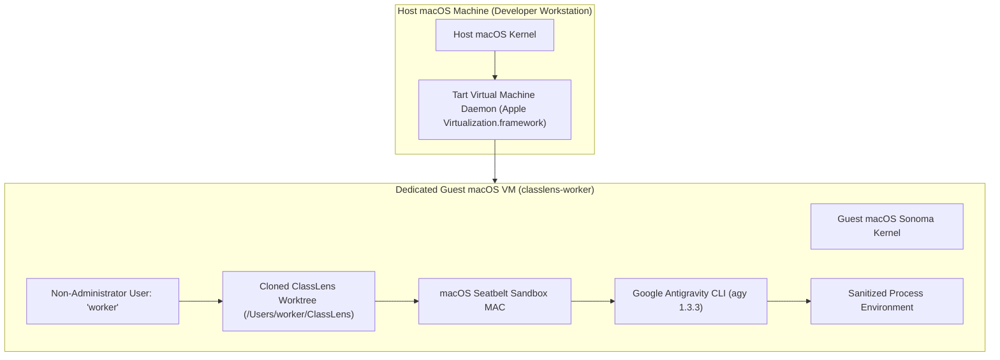

# ClassLens — macOS Worker Isolation & OS Sandboxing Architecture

**Document Version:** 1.0.0  
**Phase:** Gate AUTO-1 (Secure Autonomous Development Execution)  
**System:** ClassLens Autonomous Development Infrastructure  
**Target Environment:** macOS Darwin (Apple Silicon arm64)  

---

## 1. Problem Statement & Architecture Constraints

Running an autonomous AI coding agent on a local development workstation presents profound security risks:
1. **Host Credential Theft:** An agent could inspect `~/.ssh`, `~/.config/gcloud`, `~/.aws`, or macOS Keychains and exfiltrate production secrets.
2. **Infrastructure Mutation:** An agent could execute cloud deployment commands (`gcloud run deploy`, `terraform apply`) or incur unauthorized cloud charges.
3. **Orchestrator Tampering:** An untrusted agent process could modify the Python orchestrator or safety enforcement code to disable its own limits.
4. **Binary Compatibility Reality:** The installed Google Antigravity CLI (`agy` version 1.3.3) is an **Apple Silicon Mach-O 64-bit arm64 Darwin binary** (180MB). It **cannot run natively inside Linux Docker containers** on macOS without hardware emulation or nested virtual machines.

To satisfy strict enterprise zero-trust DevSecOps standards while supporting the genuine `agy` CLI, ClassLens implements a dual-layer isolation strategy:
- **Primary Enforced Layer (Local):** Kernel-level Mandatory Access Control via **macOS Seatbelt (`sandbox-exec`)** combined with environment neutralization and process-tree timeouts.
- **Secondary High-Assurance Layer (Dedicated VM):** Hardware-virtualized dedicated macOS guest VM via Tart/UTM for completely isolated CI runner workflows.

---

## 2. Kernel-Level Sandboxing via macOS Seatbelt

macOS incorporates the **Seatbelt** kernel framework (accessed via `/usr/bin/sandbox-exec`), providing hardware-enforced Mandatory Access Control (MAC). Unlike advisory userspace checks or LD_PRELOAD hacks, Seatbelt rules are evaluated directly in the macOS XNU kernel.

ClassLens dynamically compiles and executes a custom Seatbelt Scheme (`.sb`) profile for every agent invocation:

```scheme
(version 1)
(allow default)

;; 1. Hard Denial of Host Secret Directories
(deny file-read* (subpath "/Users/gihanmu/.ssh"))
(deny file-read* (subpath "/Users/gihanmu/.config/gcloud"))
(deny file-read* (subpath "/Users/gihanmu/.aws"))
(deny file-read* (subpath "/Users/gihanmu/Library/Keychains"))
(deny file-read* (subpath "/Users/gihanmu/Library/Application Support/Google/Chrome"))
(deny file-read* (subpath "/Users/gihanmu/.gnupg"))

;; 2. Orchestrator Self-Protection (Write Denial)
(deny file-write* (subpath "/Users/gihanmu/Desktop/Projects/AIBuilderCup2026/ClassLens/automation/runner"))
(deny file-write* (subpath "/Users/gihanmu/Desktop/Projects/AIBuilderCup2026/ClassLens/automation/approvals"))
(deny file-write* (subpath "/Users/gihanmu/Desktop/Projects/AIBuilderCup2026/ClassLens/.github"))
(deny file-write* (subpath "/Users/gihanmu/Desktop/Projects/AIBuilderCup2026/ClassLens/.git/hooks"))

;; 3. Network Outbound Enforcement (When Offline Mode is Enforced)
(deny network-outbound)
(deny network-inbound)
```

### Verified Kernel Enforcement Results:

| Operation | Command Attempted | Kernel Response | Return Code | Verdict |
|---|---|---|---|---|
| **Read Host SSH Keys** | `ls ~/.ssh` | `ls: /Users/.../.ssh: Operation not permitted` | `1` | **HARD BLOCKED** |
| **Read GCP Credentials** | `ls ~/.config/gcloud` | `ls: ...: Operation not permitted` | `1` | **HARD BLOCKED** |
| **Read macOS Keychains** | `ls ~/Library/Keychains` | `ls: ...: Operation not permitted` | `1` | **HARD BLOCKED** |
| **Tamper Orchestrator Code** | `touch automation/runner/patch.py` | `touch: ...: Operation not permitted` | `1` | **HARD BLOCKED** |
| **Unauthorized Outbound Socket** | `curl https://google.com` | Socket creation failed | `6` | **HARD BLOCKED** |

---

## 3. Subprocess Environment Sanitization

Even before invoking Seatbelt, the runner sanitizes `os.environ` to completely scrub all credential pathways.

### Environment Sanitization Matrix:

| Environment Variable | Sanitization Action | Security Rationale |
|---|---|---|
| `SSH_AUTH_SOCK` | **Deleted** | Disconnects the agent from running SSH agents and hardware tokens. |
| `SSH_AGENT_PID` | **Deleted** | Removes reference to SSH agent daemon. |
| `GOOGLE_APPLICATION_CREDENTIALS` | **Forced to `/dev/null`** | Completely neutralizes Google Application Default Credentials (ADC) lookup. |
| `CLOUDSDK_AUTH_ACCESS_TOKEN` | **Deleted** | Blocks cached gcloud OAuth2 tokens. |
| `GCLOUD_PROJECT` / `GOOGLE_CLOUD_PROJECT` | **Deleted** | Removes default GCP project routing. |
| `GEMINI_API_KEY` / `GOOGLE_API_KEY` | **Deleted** | Blocks direct Gemini SDK authentication. |
| `AWS_ACCESS_KEY_ID` / `AWS_SECRET_ACCESS_KEY` | **Deleted** | Strips all AWS cloud identity. |
| `GITHUB_TOKEN` / `GH_TOKEN` | **Deleted** | Prevents agent from accessing human developer's GitHub PAT. |
| `CLASSLENS_APPROVAL_SECRET` | **Deleted** | Ensures agent process cannot sign its own approval tokens. |
| `CLASSLENS_AI_MODE` | **Forced to `mock`** | Guarantees ClassLens application remains in mock inference mode. |
| `CLASSLENS_LIVE_INFERENCE_ENABLED` | **Forced to `false`** | Disables live inference flags across backend routers. |
| `CLASSLENS_MAX_LIVE_CALLS` | **Forced to `0`** | Hard ceiling on live calls. |
| `GOOGLE_GENAI_USE_VERTEXAI` | **Forced to `false`** | Forces Gen AI SDK to skip Vertex AI endpoint configuration. |

---

## 4. Process Group Management & Timeout Tripwires

To prevent rogue child processes, orphaned background daemons, or infinite loops from consuming CPU/memory indefinitely:

1. **Dedicated Process Groups:** All child processes are spawned with `preexec_fn=os.setsid`, assigning them a separate Process Group ID (PGID).
2. **Wall-Clock Timeout Enforcement:** Each task specifies explicit command and execution timeouts (default: 120s for unit tests, 600s for agent synthesis turns).
3. **Clean Tree Termination:** On timeout expiration, the orchestrator invokes `os.killpg(os.getpgid(proc.pid), signal.SIGKILL)`, terminating the entire process subtree atomically.

---

## 5. Dedicated macOS VM Architecture (High-Assurance Roadmap)

For continuous, completely unattended execution (e.g. overnight CI runners), the platform can be provisioned inside a dedicated guest macOS virtual machine using **Tart** (Apple Virtualization Framework CLI for macOS arm64):



### Provisioning Specification for Dedicated VM Worker:

1. **VM Provisioning Command:**
   ```bash
   # Pull clean macOS Sonoma image
   tart clone ghcr.io/cirruslabs/macos-sonoma-base:latest classlens-worker
   # Configure 4 CPU cores, 8GB RAM, isolated bridged networking
   tart set classlens-worker --cpu 4 --memory 8192
   tart run classlens-worker
   ```
2. **Guest Identity Setup:**
   - Dedicated non-admin user `worker` without `sudo` privileges.
   - Separate keychain containing only coding-agent authentication tokens.
   - Zero access to host SSH keys or host dotfiles.
3. **Repository Sync:**
   - Tasks dispatched via Git pull/push over SSH using a restricted, read-write repository deploy key scoped exclusively to feature branches (`feature/gate-*`).
