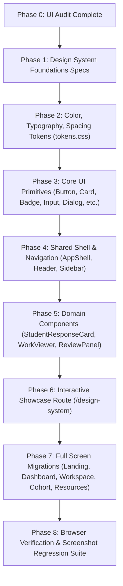

# ClassLens — UI Architecture & Design System Audit

**Date**: 2026-10-11
**Auditor**: Principal Product Designer & Design Systems Architect
**Source of Truth**: `docs/wireframes/mockup.png` & `apps/web/public/logos/logo.png`
**Application**: `apps/web` (Next.js 14.2.35, React 18.3.1, Tailwind CSS 3.4.16, TypeScript 5.7.2)

---

## 1. Executive Summary

ClassLens has completed its core functional sprints (deterministic math engine, image intake, multi-agent orchestration, REST API, cohort statistics). However, the frontend currently exhibits characteristics of an initial engineering prototype:
1. **Ad-hoc Styling**: Unsystematic Tailwind classes with arbitrary radii (`rounded-lg`, `rounded-xl`, `rounded-2xl`), arbitrary colors (`slate-100` through `slate-900`, `indigo-500` through `indigo-700`, `rose-100` through `rose-900`), and inconsistent padding.
2. **Monolithic Page Layout**: A single 420-line `page.tsx` containing layout headers, metric counters, student card grids, modal wrappers, and tab logic.
3. **Divergence from Mockup Direction**: The reference mockup (`docs/wireframes/mockup.png`) establishes a warm, welcoming, educational aesthetic featuring:
   - Warm-cream surfaces (`#FFF9ED`) and soft pastels (mint `#D8F4E8`, soft purple `#F1ECFF`, warm yellow `#FFF3D6`).
   - Primary interactive brand color: Rich educational purple (`#5145F5`).
   - Vibrant marketing/illustration coral accent: (`#F76543`).
   - Strong dark-navy typography: (`#10182B`) with clear hierarchy.
   - Structured persistent sidebar navigation (Dashboard, Assessments, Students, Analysis, Class Insights, Settings).
   - Dedicated views for Assessment Submissions, Multimodal Student Review, Class Insights & Misconception Distribution, and Ready-to-Use Classroom Resources (Exit Tickets).

---

## 2. Route Inventory

| Route | File Path | Current Purpose | Current Deficiencies | Target Architecture |
|---|---|---|---|---|
| `/` | `src/app/page.tsx` | Monolithic Dashboard + Review Modal + Cohort view | Mixes landing, overview, student cards, modal triggers, and cohort tabs in one client component. | Redesigned with modular tabs/views: Welcome/Landing, Dashboard, Class Insights, Classroom Resources, and Assessment switcher. |
| `/design-system` | *To be created* | None | Design system is not inspectable in browser. | Interactive design token and component showcase in development mode. |
| `/_not-found` | Next.js internal | Default 404 | Unstyled default page. | Styled branded 404 with navigation back to Dashboard. |

---

## 3. Existing Component Inventory

| Component | Path | Lines | Responsibilities | Issues & Redundancies | Verdict |
|---|---|---|---|---|---|
| `RootLayout` | `src/app/layout.tsx` | 56 | Top header, offline banner, children wrapper | Hardcoded header; lacks sidebar navigation; banner styles not tokenized. | **Refactor into `AppShell`** |
| `AssessmentDashboardPage` | `src/app/page.tsx` | 425 | Main assessment view, stats, student grid, tabs | Hardcoded layout, bespoke metric cards, duplicate button styles, inlined card compositions. | **Refactor into Modular Views** |
| `ResponseReviewModal` | `src/components/inspection/ResponseReviewModal.tsx` | 231 | Modal dialog, header, split layout, tab switching | Bespoke dialog container without Radix/ARIA focus lock; manual mobile tab state. | **Refactor with `Dialog` Primitive** |
| `ImageViewerCanvas` | `src/components/inspection/ImageViewerCanvas.tsx` | 215 | Zoom/pan controls, image rendering, SVG hop overlays | Good SVG math, but custom toolbar buttons; lack of standard keyboard shortcuts. | **Refactor into `StudentWorkViewer`** |
| `DiagnosticSummaryCard` | `src/components/inspection/DiagnosticSummaryCard.tsx` | 85 | Answer & reasoning status summary | Hardcoded badge colors; duplicate alert logic. | **Refactor into `AnswerStatus` & `ReasoningStatus`** |
| `ErrorLocalizationCard` | `src/components/inspection/ErrorLocalizationCard.tsx` | 95 | First-error step callout, taxonomy tag, observed vs expected | High quality content; lacks design token borders and accessible badges. | **Refactor into `MisconceptionCard`** |
| `StepBreakdownList` | `src/components/inspection/StepBreakdownList.tsx` | 88 | List of student hop steps with validity badges | Bespoke card styling; inconsistent badge sizes. | **Refactor into `ReasoningStepCard`** |
| `TeacherReviewForm` | `src/components/inspection/TeacherReviewForm.tsx` | 135 | Review radio actions, notes, submit button | Buttons look like tabs; lacks accessible radio-group semantics. | **Refactor into `TeacherReviewPanel`** |
| `AuditTrailDrawer` | `src/components/inspection/AuditTrailDrawer.tsx` | 87 | Audit event log drawer | Ad-hoc card list; missing formal drawer animation and semantic tokens. | **Refactor with `Drawer` Primitive** |
| `MisconceptionBarChart` | `src/components/cohort/MisconceptionBarChart.tsx` | 148 | Horizontal progress bars, accessible table | Solid screen-reader table; colors are hardcoded; lacks mockup's warm educational card container. | **Keep & Refactor Tokens** |
| `ReteachingActionCards` | `src/components/cohort/ReteachingActionCards.tsx` | 165 | 3 differentiated action cards + exit tickets | Merges teaching actions with exit tickets; lacks mockup's friendly icons and student count pills. | **Split into `TeachingRecommendationCard` & `ExitTicketCard`** |

---

## 4. Design Inconsistencies & Duplicated Patterns

1. **Button Inconsistency**:
   - Primary buttons: `bg-indigo-600 hover:bg-indigo-700` vs `bg-indigo-500` vs `bg-slate-900`.
   - Border radius on buttons: `rounded-lg` (8px), `rounded-md` (6px), `rounded-full` (pill).
   - Heights: 34px, 38px, 42px, and 48px scattered arbitrarily.
   - Missing states: Pressed (`active`) and focus-visible rings have inconsistent offsets.
2. **Badge Inconsistency**:
   - Status indicators mixed with decorative category tags.
   - Text sizes vary between `text-[10px]`, `text-xs`, and `text-sm`.
   - Inconsistent padding: `px-2 py-0.5`, `px-2.5 py-1`, `px-3 py-1`.
3. **Card Inconsistency**:
   - Radii: `rounded-xl` (12px), `rounded-2xl` (16px), `rounded-3xl` (24px) without clear hierarchy.
   - Shadows: `shadow-sm`, `shadow-md`, `shadow-2xl` used inconsistently.
4. **Color Tokens Absence**:
   - Direct Tailwind utilities (`text-slate-800`, `bg-indigo-50`, `border-rose-200`) prevent centralized rebranding and accessible theme auditing.
   - The primary purple (`#5145F5`), educational yellow (`#FFCF78`), coral (`#F76543`), mint (`#D8F4E8`), and dark navy (`#10182B`) from the reference mockup are not systematically tokenized.

---

## 5. Responsive Behavior Audit

| Viewport | Current Behavior | Deficiencies Identified | Target Behavior |
|---|---|---|---|
| **Mobile (390×844)** | Single-column cards stack; inspection modal switches between image and diagnosis tabs. | Header overflows horizontally; cards take excessive vertical space; filter pills scroll off-screen without indicator. | App shell provides collapsible mobile header; review modal offers clear persistent action bar; typography scales to mobile tokens. |
| **Tablet (768×1024)** | Two-column card grid; modal renders in dual columns. | Modal content feels squeezed; image viewer canvas height is rigid; sidebar navigation is absent. | Responsive adaptive grid (2-column on tablet, 3-column on desktop); modal auto-adjusts aspect ratios. |
| **Desktop (1440×900)** | Four-column grid; wide centered review modal. | Layout feels sparse and generic; lacks sidebar navigation; top header is detached from educational workflow. | Structured two-tier shell (persistent collapsible sidebar + content workspace); 4-metric summary bar; spacious review workspace. |

---

## 6. Accessibility & Usability Issues

1. **Status by Color Alone**: Some student response cards communicate correct/incorrect purely through green or red badges without distinct icons or ARIA labels.
2. **Keyboard Navigation in Review Actions**: The three review actions (Approve, Override, Unreadable) are styled buttons rather than a semantic `<fieldset>` with `role="radiogroup"`.
3. **Focus Indicators**: Focus outlines are currently globally set to `outline: 2px solid #4f46e5`, which has insufficient contrast when focused on dark purple buttons or dark surfaces.
4. **Accessible Charting**: The bar chart contains an expandable table, but missing `aria-describedby` linkage from the visual chart container.
5. **Touch Targets**: Several compact control buttons (e.g. image canvas zoom in/out, modal close) fall below the 44×44px minimum touch target guideline on touch screens.

---

## 7. Migration Sequence

Proceeding directly to Phase 1 (Documentation of Foundations) and Phase 2 (Design Tokens Implementation).
