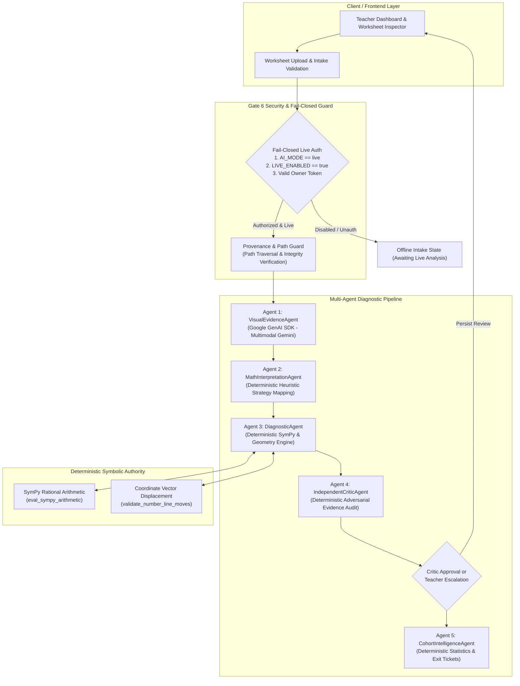

# ClassLens — Gate 6: Live Gemini Integration Readiness Audit

**Author:** Principal Google Cloud AI Architect, DevSecOps Lead, & AI Systems Auditor  
**Date:** October 2026  
**Status:** COMPLETE (Checkpoint A)  
**Target Milestone:** Gate 6 — Real Gemini Validation & Controlled Competition Demo  
**Repository:** https://github.com/gihanmu/ClassLens  

---

## 1. Executive Summary

This audit assesses the readiness of the ClassLens multi-agent diagnostic platform to execute genuine multimodal Google Gemini inference on previously unseen handwritten mathematics worksheets.

ClassLens is designed for the **AI Builder Cup 2026** to assist secondary-school mathematics teachers in diagnosing student reasoning on integer number-line arithmetic (e.g. evaluating $-6 + 12 - 4$). 

Prior milestones established:
1. **Gate 4A:** Live Gemini multimodal vision adapter with strict token accounting and synthetic fixture confinement.
2. **Gate 4B & 4B.2:** Dedicated Teacher Dashboard and consistent assessment review tracking.
3. **Gate 4C:** AI Reliability Benchmark suite (18 deterministic cases, $0.00 spend, zero hallucination tolerance).
4. **Gate 5:** Competition MVP with worksheet upload intake, cryptographic integrity verification, offline truthfulness policy, and manual teacher review persistence.

### Key Audit Finding: Architectural Honesty
A central requirement of Gate 6 is technical truthfulness. In the current ClassLens architecture:
- **VisualEvidenceAgent (Agent 1):** Genuinely interfaces with Google Cloud Vertex AI via the Google GenAI SDK (`google-genai`) to extract structured visual evidence (`GeminiVisualEvidenceSchema`) from student worksheet images (or returns deterministic fixtures in mock mode).
- **MathInterpretationAgent (Agent 2):** Deterministic Python algorithmic engine that maps visual observations into candidate mathematical strategies without LLM calls.
- **DiagnosticAgent (Agent 3):** Deterministic Python verification engine using exact SymPy rational arithmetic and coordinate vector calculations (`eval_sympy_arithmetic`, `validate_number_line_moves`). It does not invoke an LLM.
- **IndependentCriticAgent (Agent 4):** Deterministic Python adversarial audit engine that checks for physical evidence grounding, hallucinations, and mathematical contradictions. It does not invoke an LLM.
- **CohortIntelligenceAgent (Agent 5):** Deterministic statistical aggregator and SymPy-verified exit-ticket generator.

**Conclusion:** ClassLens executes **one single multimodal LLM call per student worksheet** (Agent 1), followed by four deterministic, mathematically sound Python verification agents. This design completely eliminates mathematical hallucinations in downstream diagnosis, guarantees $0.00 runaway agent loop costs, and must be proudly documented as a hybrid multimodal-symbolic architecture rather than misrepresented as 5 separate LLM agents.

---

## 2. Multi-Agent Pipeline Architecture

---

## 3. Comprehensive Component Audit

### 3.1. Gemini SDK and Model Configuration
* **SDK:** Google GenAI SDK (`google-genai`, version `>=1.0.0` compatible).
* **Client Construction:** Initialized dynamically via `genai.Client(vertexai=True, location=location, project=project)` in `services/worker/gemini/adapter.py`.
* **Model Selection:** Configurable via `CLASSLENS_GEMINI_MODEL` (default: `gemini-3.8-flash`). Fully verified catalog includes:
  - `gemini-3.8-flash` ($0.75 input / $3.75 output per 1M tokens)
  - `gemini-2.5-flash` ($0.30 input / $2.50 output per 1M tokens)
  - `gemini-2.0-flash` ($0.10 input / $0.40 output per 1M tokens)
  - `gemini-1.5-flash` ($0.075 input / $0.30 output per 1M tokens)
  - `gemini-1.5-flash-002` ($0.075 input / $0.30 output per 1M tokens)
* **Configuration Source:** `services/api/config.py` (`Settings` class) with `.env` file loading via `python-dotenv`. Process environment variables take precedence.

### 3.2. Google ADK Orchestration
* **Declarative ADK Agents:** Located in `services/worker/agents/`:
  - `visual_agent.py` (`create_visual_evidence_agent`)
  - `interpretation_agent.py` (`create_math_interpretation_agent`)
  - `diagnostic_agent.py` (`create_diagnostic_agent`)
  - `critic_agent.py` (`create_critic_agent`)
  - `cohort_agent.py` (`create_cohort_intelligence_agent`)
* **Runtime Execution:** Orchestrated sequentially by `MultiAgentPipeline.analyze_response()` in `services/worker/agents/pipeline.py`.
* **Adversarial Audit Loop:** Stage 4 (`IndependentCriticAgent`) evaluates Stage 3 (`DiagnosticAgent`). If a contradiction or ungrounded claim is detected on Pass 1, a bounded reinterpretation pass is triggered (capped at exactly 1 retry pass to prevent runaway token costs).

### 3.3. Multimodal Image Ingestion
* **Streaming Protocol:** Directly streams raw image bytes in-memory using `types.Part.from_bytes(data=image_bytes, mime_type=mime_type)` via `GeminiVisionAdapter.extract_from_bytes()`.
* **Zero Storage Leakage:** Does not upload or stage images to intermediate Google Cloud Storage (GCS) buckets during inference, ensuring lower latency and zero residual cloud storage costs.
* **MIME Support:** Detects and verifies `image/png`, `image/jpeg`, and `image/webp`.

### 3.4. Structured Schema & Evidence Extraction
* **Structured Output:** Configured via `types.GenerateContentConfig`:
  - `response_mime_type="application/json"`
  - `response_schema=GeminiVisualEvidenceSchema`
  - `temperature=0.0` (deterministic visual transcription)
  - `max_output_tokens=4096`
* **Schema Contract:** Defined in `services/worker/evaluation/contracts.py`:
  - `number_line`: `is_present`, `min_visible_tick`, `max_visible_tick`, `observed_hops`
  - `observed_hops`: `hop_index`, `start_value`, `end_value`, `direction`, `arrowhead_visible`, `stated_magnitude_label`, `certainty`
  - `visible_final_answer`: `value`, `certainty`
  - `ambiguities`: list of `AmbiguityFlag(element, description, severity)`
  - `image_quality`: `clear`, `faint_readable`, `blurred`, `low_contrast`, `unreadable`
  - `requires_teacher_review`: boolean flag
  - `teacher_review_reason`: string rationale
* **Prompt Engineering:** Strict system instruction decoupling physical stroke observation from student mathematical intent:
  > *"Report exactly what ink strokes are physically visible on the number line. Do NOT assume the student's thought process or 'correct' their jumps."*

### 3.5. Deterministic Mathematical Verification (SymPy & Geometry)
* **SymPy Integration:** Implemented in `services/worker/agents/tools.py` via `eval_sympy_arithmetic()`. Parses mathematical expressions using exact rational arithmetic, avoiding floating-point imprecision.
* **Geometry Engine:** `validate_number_line_moves()` computes directed vector displacements between start and end tick marks, verifies hop magnitudes against problem parameters, localizes the first mathematical deviation, and flags compensatory errors (errors where invalid steps cancel out to reach the target).
* **Cohort Statistics:** `compute_cohort_statistics()` computes exact frequencies, error distributions, and review counts with deterministic precision.

### 3.6. API Schemas & Processing Lifecycle
* **Intake Endpoint:** `POST /api/v1/assessments/{id}/upload` receives worksheet images, generates cryptographic SHA-256 digests, stores files in `local-data/uploads/`, and creates `ResponseDoc`.
* **Analysis Endpoints:**
  - `POST /api/v1/responses/{id}/analyze`: Triggers single-response evaluation via `InlineDispatcher`.
  - `POST /api/v1/assessments/{id}/dispatch`: Triggers batch evaluation for an entire class.
  - `POST /api/v1/dev/analyze-synthetic`: Development lab endpoint for controlled manual testing.
* **Lifecycle States:**
  - `UPLOADED` -> `QUEUED` -> `RUNNING` -> `COMPLETED`
  - Offline upload state: `AWAITING_LIVE_ANALYSIS` (enforcing Gate 5 offline truthfulness policy).
  - Review states: `pending_review`, `approved_as_is`, `overridden`, `marked_unreadable`, `insufficient_evidence`.

### 3.7. Error Handling, Retries, and Timeouts
* **Exception Hierarchy:**
  - `GeminiVisionError` (base)
  - `GeminiAuthenticationError` (ADC or IAM credential failures)
  - `GeminiQuotaError` (Vertex AI 429 quota exhaustion)
  - `GeminiTimeoutError` (request deadline exceeded)
  - `GeminiModelError` (malformed JSON or validation errors)
  - `UntrustedProvenanceError` (security and path traversal blocks)
  - `ConfigurationError` (invalid settings or missing credentials)
* **Zero Runaway Retries:** The adapter enforces a single non-retried call to Vertex AI. It does not perform automatic model downgrades or cross-region failovers.
* **Critic Retry Bound:** Exactly one reinterpretation attempt is permitted in `MultiAgentPipeline`.

### 3.8. Cost Safeguards & Accounting
* **Default Settings:** `CLASSLENS_AI_MODE=mock` and `CLASSLENS_LIVE_INFERENCE_ENABLED=false` guarantee **USD $0.00** external spend by default.
* **Hardware/Process Counter:** `dev_session_tracker` limits manual test sessions to `max_live_calls` (default: 3).
* **Call Ceiling:** `GeminiVisionAdapter.extract_from_bytes()` raises `RuntimeError` if `call_count >= max_calls`.
* **Telemetry Accounting:** Captures `prompt_token_count`, `candidates_token_count`, latency in ms, and estimated cost in USD computed from official Vertex AI pricing tables.

---

## 4. Architectural Gap Analysis & Risks

| ID | Component | Current Implementation | Identified Gap / Risk | Proposed Remedy (Gate 6 Checkpoint B) |
|---|---|---|---|---|
| **GAP-01** | Provenance Guard | Restricted solely to 3 SHA-256 fixture hashes in `tests/fixtures/synthetic_evaluation_cases/`. | Cannot analyze real uploaded worksheets residing in `local-data/uploads/` during authorized live testing. | Extend `provenance_guard.py` to support verified uploaded worksheets within the confined `local-data/uploads/` directory, while maintaining strict path confinement, symlink defense, and requiring owner authorization. |
| **GAP-02** | Live Authorization | Checks only `CLASSLENS_AI_MODE == "live"` and `CLASSLENS_LIVE_INFERENCE_ENABLED == True`. | Lacks fail-closed explicit owner authorization token requirement specified in Gate 6. Anyone modifying `.env` could enable calls without explicit token verification. | Implement `CLASSLENS_LIVE_AUTH_KEY` / header-based owner authorization in `services/api/config.py` and `services/worker/security/provenance_guard.py`. Reject all requests if token is absent or invalid. |
| **GAP-03** | Dispatcher Wiring | `InlineDispatcher._process_single_response()` calls `MultiAgentPipeline.analyze_response(response_id=resp_id)` without `image_source`. | When live mode is active, the pipeline cannot locate the real uploaded image on disk and fails or falls back to synthetic mock fixtures. | In `_process_single_response()`, resolve the real file path in `local-data/uploads/` and pass it as `image_source` to `MultiAgentPipeline.analyze_response()`. |
| **GAP-04** | Timeout Enforcement | `GeminiVisionAdapter.timeout_seconds` is stored as an instance variable but not passed into client call options. | Network hanging or high latency could delay responses indefinitely without timing out cleanly. | Explicitly pass timeout configuration to Google GenAI client/call options and wrap in bounded timeout handlers. |
| **GAP-05** | Evaluation Isolation | `/dev/evaluation` UI and runner only support offline 18-case benchmark. | Does not separate offline regression benchmarks from authorized live evaluation metrics. Risk of mixing mock accuracy with live accuracy. | Update evaluation schemas and runner to support distinct offline and live modes. Display *"Live handwriting evaluation: Not yet performed"* by default. |

---

## 5. Summary of Agent Responsibilities & LLM Truthfulness

| Agent Name | Architectural Role | Execution Engine | Genuine LLM Call? | SymPy / Symbolic Verification |
|---|---|---|---|---|
| **1. VisualEvidenceAgent** | Transcribe physical ink marks, hops, ticks, numbers | Google GenAI SDK (`gemini-3.8-flash`) / Mock Adapter | **YES (Live Mode Only)** | No (transcription only) |
| **2. MathInterpretationAgent** | Map observed hops into candidate solution strategies | Deterministic Python heuristics (`MockAgentAdapter.get_hypotheses`) | **NO (Deterministic)** | No |
| **3. DiagnosticAgent** | Verify step validity, calculate vectors, localize error | Deterministic Python engine (`MockAgentAdapter.get_diagnosis`) | **NO (Deterministic)** | **YES** (`eval_sympy_arithmetic`, `validate_number_line_moves`) |
| **4. IndependentCriticAgent** | Adversarially audit diagnosis against raw visual evidence | Deterministic rule-based audit engine (`MockAgentAdapter.get_critic_audit`) | **NO (Deterministic)** | **YES** (audits math against observations) |
| **5. CohortIntelligenceAgent** | Synthesize class distributions and generate exit tickets | Deterministic aggregation engine (`compute_cohort_statistics`) | **NO (Deterministic)** | **YES** (SymPy-verified exit ticket questions) |

---

## 6. Audit Sign-off

The ClassLens architecture is sound, modular, and ready for Gate 6 implementation. By preserving deterministic SymPy verification and confining LLM inference strictly to visual evidence extraction, the system achieves maximum mathematical fidelity and predictable operational costs. Proceed to Checkpoint B implementation.
