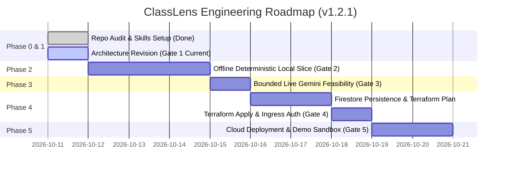

# Implementation Roadmap & Milestone Plan — ClassLens

**Document ID:** PLN-RDM-001
**Version:** 1.2.1
**Date:** 2026-10-11

---

### Changelog (v1.2.1 — Final Technical-Validity Revision)
- Harmonized roadmap milestones with the unified **5-stage approval gate sequence** in `docs/review/implementation-gates.md`.
- Clarified that Milestone 2 deterministic Python tools validate structured mathematical observations and synthetic fixtures, not raw handwritten pixels.
- Added application quota (`MAX_TEST_RESPONSES = 13`) and $0.50 stop-on-threshold circuit breaker to Milestone 3 feasibility test, documenting residual billing risk.
- Clarified that Playwright accessibility tests in Milestone 5 are automated checks, not proof of full WCAG 2.2 AA compliance.

---

## 1. Project Implementation Phases

---

## 2. Detailed Milestone Backlog & Checkpoints

### Milestone 0: Audit & Skills Verification (COMPLETED)
- [x] Audit workspace, file tree, datasets (`dataset/` with 188 problems, 2,030 images).
- [x] Identify primary focus problem (`problem_1065658`: $-6 + 12 - 4 = 2$, 13 student responses).
- [x] Install and pin 16 project-scoped Google skills in `.agents/skills/` and `skills-lock.json`.
- [x] Produce `docs/google-skills-inventory.md`.

### Milestone 1: Final Architecture Correction & Technical Validity (CURRENT - GATE 1)
- [x] Perform final technical-validity review on Gemini 3.8 Flash models, Singapore regional availability, and dynamic vision tiling tokens.
- [x] Reconcile Cloud Tasks at-least-once delivery, persistent Firestore job states, and atomic lease claims.
- [x] Formalize signed upload quarantine boundaries and prompt injection defense realism.
- [x] Standardize multi-agent inventory to 1 deterministic Python service + 5 bounded ADK agents.
- [x] Reconcile cost models across low, expected, and high scenarios, adding worker pre-inference kill switch.
- [x] Align roadmap milestones and approval gates.
- [ ] **AWAIT USER APPROVAL OF GATE 1 BEFORE ANY CODE WRITING OR CLOUD CALLS**.

### Milestone 2: Offline Deterministic Local Vertical Slice (Authorized by Gate 1)
> [!IMPORTANT]
> **Deterministic Tools Validate Structured Math Data, NOT Raw Handwriting**: Milestone 2 validates software plumbing, data contracts, and UI rendering using synthetic observation vectors and mocked LLM responses. Deterministic Python tools (`SymPyChecker`, `NumberLineDisplacementCalculator`) operate on structured mathematical data, not raw image pixels. Actual handwriting comprehension from pixels is evaluated in Milestone 3.
- [ ] Initialize repository structure (`apps/web`, `services/api`, `services/worker`, `tests/unit/`).
- [ ] Implement deterministic Python tools:
  - `SymPyChecker`: verified rational arithmetic on structured expressions.
  - `NumberLineDisplacementCalculator`: arrow displacement vectors, interval consistency, tick label intervals on structured vector fixtures.
  - `ImageQualityService`: Pillow-based contrast/sharpness check and EXIF stripping.
- [ ] Implement Bounded ADK Agent Pipeline with mock adapters:
  - `VisualEvidenceAgent`, `MathInterpretationAgent`, `DiagnosticAgent`, `IndependentCriticAgent`.
- [ ] Implement Next.js 15 teacher interface:
  - Dual-pane image viewer (zoom, pan, rotate).
  - Step-by-step reasoning card with dual indicators.
  - First-error localization card with misconception badge.
  - Teacher Approve / Override toggle with audit event tracking.
- [ ] Run automated unit tests with 100% pass (`pytest tests/unit/`).

### Milestone 3: Bounded Live Gemini Feasibility Test (Authorized by Gate 2 -> Gate 3)
- [ ] Prepare live evaluation harness in `tests/evaluation/`.
- [ ] Obtain explicit user approval for live inference calls.
- [ ] Enforce application-level quota: `MAX_TEST_RESPONSES = 13`, `MAX_RETRIES = 1`, `MAX_OUTPUT_TOKENS = 1024`.
- [ ] Implement stop-on-threshold circuit breaker: test runner aborts if cumulative estimated spend hits **$0.50 USD**.
- [ ] Execute live Gemini 3.8 Flash inference strictly on the 13 responses of `problem_1065658/` (estimated budget: $\approx \$0.12 – \$0.14\text{ USD}$).
- [ ] Measure empirical token usage via SDK `client.models.count_tokens()`.
- [ ] Measure empirical P50 and P95 response latency against target SLOs (P50 $\le 3.5$s, P95 $\le 6.0$s).
- [ ] Document residual billing risk (in-flight HTTP requests cannot be canceled mid-generation).

### Milestone 4: Secure Persistence & Cloud Infrastructure (Authorized by Gate 3 -> Gate 4)
- [ ] Implement Firestore Native repository layer with local emulator.
- [ ] Implement Google Identity Services (GIS) auth and session cookies (`HttpOnly; Secure; SameSite=Lax`).
- [ ] Draft Terraform stacks in `infra/terraform/` for `asia-southeast1`.
- [ ] Generate and review `terraform plan`.
- [ ] Await user authorization before executing `terraform apply`.

### Milestone 5: Cloud Deployment & Hackathon Demo Hardening (Authorized by Gate 4 -> Gate 5)
- [ ] Deploy containerized API, Worker, and Web frontend to Cloud Run in `asia-southeast1`.
- [ ] Configure Cloud Tasks queue (`classlens-analysis-queue`).
- [ ] Build Guided Judge Sandbox with explicit toggle between **Precomputed Demonstration Mode** (instant, zero-latency fixture data) and **Live Analysis Mode**.
- [ ] Run automated accessibility linters (`@axe-core/playwright`). Note: automated scans verify code rules, but do not prove full WCAG 2.2 AA compliance.
- [ ] Execute double-blind adjudicated evaluation on Problem #1065658.

---

## 3. Explicit Approval Gates

Detailed acceptance criteria for Gates 1 through 5 are maintained in [implementation-gates.md](file:///Users/gihanmu/Desktop/Projects/AIBuilderCup2026/ClassLens/docs/review/implementation-gates.md).
