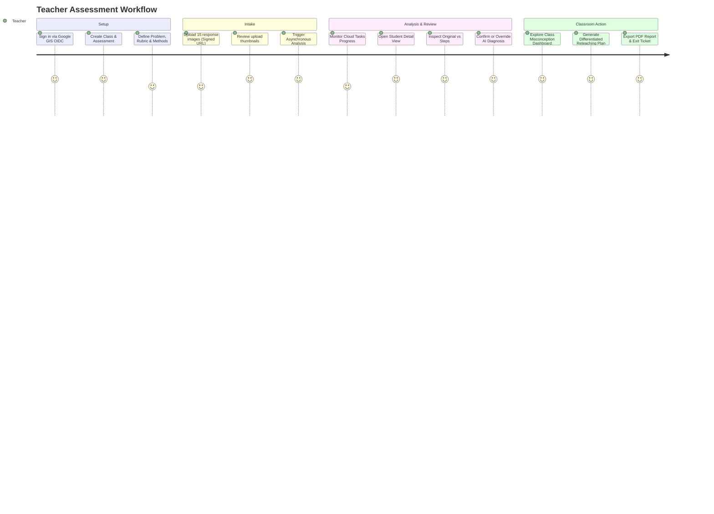

# Personas and User Journeys — ClassLens

**Document ID:** REQ-USR-002
**Version:** 1.1.0
**Date:** 2026-10-11

---

### Changelog (v1.1.0)
- Clarified that demo student responses represent isolated anonymous submission samples, not real continuous school classes.
- Added strict read-only sandbox enforcement for Persona E (Demo Judge / Observer).
- Integrated Google Identity Services (GIS) OIDC authentication workflow for Persona A.
- Reconciled asynchronous status reporting with Cloud Tasks polling/SSE.

---

## 1. User Personas

### Persona A: Sarah Lim — Secondary Mathematics Teacher (Primary User)
- **Background**: Teaches Grade 7 (Sec 1) mathematics to 4 classes (140 students). Spends 6–8 hours weekly grading handwritten homework and formative assessments.
- **Pain Point**: "I can see half my class got question 4 wrong, but I don't have time to categorize *why* each student failed. Some had negative sign errors, some counted tick marks incorrectly, and some guessed the right answer with flawed reasoning. I need to know how to split them into re-teaching groups tomorrow morning."
- **Goals**: Rapidly upload response photos, review AI findings with zero cognitive friction, understand class misconception distribution, and obtain ready-to-teach differentiated activities.

### Persona B: David Tan — School Head of Department (HOD) / Organization Admin
- **Background**: Mathematics department head overseeing 12 teachers. Responsible for curriculum alignment, academic interventions, and school data protection policies.
- **Pain Point**: Needs high-level visibility into curriculum bottlenecks without violating student data privacy or micromanaging teachers.
- **Goals**: Provision teacher accounts, enforce 30-day retention policies on student images, monitor platform adoption, and review audit logs for data exports.

### Persona C: Dr. Elena Rostova — Curriculum Specialist & AI Quality Reviewer
- **Background**: Mathematics education researcher and AI evaluator evaluating model fidelity on real student handwriting.
- **Pain Point**: Generative AI tools often hallucinate non-existent mathematical work or misdiagnose creative alternative methods as errors.
- **Goals**: Access anonymized evaluation benchmarks, inspect agreement rates between AI output and adjudicated ground truth, analyze false positive rates, and maintain the error taxonomy.

### Persona D: Marcus Vance — Platform Operator / DevOps Engineer
- **Background**: Cloud infrastructure engineer maintaining GCP uptime, cost budgets, and security posture.
- **Pain Point**: Sudden traffic surges when teachers upload batches simultaneously; risk of unbounded Gemini API token costs or memory spikes.
- **Goals**: Terraform-automated deployment, Cloud Run autoscaling with concurrency limits, Cloud Tasks dead-letter queue monitoring, and zero credentials in code.

### Persona E: Judge / Invited Observer (Hackathon Demo User)
- **Background**: AI Builder Cup 2026 judge evaluating the project live during a 5-minute presentation.
- **Pain Point**: No time to register accounts, configure cloud buckets, or wait for asynchronous processing.
- **Goals**: Single-click access to a curated, pre-loaded assessment (Problem #1065658), inspect live or pre-computed multi-agent traces in a **strictly read-only sandbox**, explore the teacher review screen, and evaluate the generated reteaching plan.
- **Security Boundary**: Demo observer cannot mutate records, upload files, or trigger unbounded paid inference.

---

## 2. End-to-End User Journeys & Acceptance Criteria

### Journey 1: Teacher Complete Assessment Lifecycle (Sarah Lim)

#### Detailed Steps & Edge Cases:
1. **Creation**:
   - Teacher inputs: Question prompt, LaTeX equation (`-6 + 12 - 4`), expected final answer (`2`), and accepted methods (Number line movement starting at 0, or starting directly at -6).
   - *Edge Case*: Question has multiple valid intermediate states. Teacher toggles "Accept alternative start point".
2. **Batch Upload**:
   - Teacher drags 15 photo files (JPEG/PNG, mobile camera photos).
   - System requests V4 signed upload URLs from FastAPI, validates MIME signatures, strips EXIF data, and assigns pseudonymous IDs (`Student-01` through `Student-15`).
   - *Edge Case*: Image is upside down or faint. Teacher uses built-in 90-degree rotate button before triggering analysis.
3. **Async Analysis & Status**:
   - Teacher clicks "Analyze Batch". System creates an `AnalysisJob` in Firestore and enqueues tasks in Cloud Tasks.
   - UI polls `/api/v1/assessments/{id}/status` or listens to SSE (`3/15 completed...`).
   - Teacher can navigate away; tasks execute asynchronously in the background worker.
4. **Per-Response Inspection**:
   - Side-by-side view: original student image on left (with pan/zoom), AI reasoning cards on right.
   - Shows:
     - Observable elements (drawn number line, arrows, endpoint markers).
     - Verified steps with green checkmarks or red exclamation marks.
     - First supported error: *"Arrow from -6 to +5 has displacement +11, but +12 was required."*
     - Misconception classification: `MISC-ARITH-OFF-BY-ONE` (Confidence: 88%).
   - Teacher Action: Teacher clicks "Approve Interpretation" or clicks "Edit Diagnosis" to select a different category and add an audit note.
5. **Class Misconception Dashboard**:
   - Visual breakdown:
     - 8/13 Correct reasoning ($61.5\%$).
     - 3/13 Magnitude / interval errors ($23.1\%$).
     - 2/13 Incomplete or unreadable ($15.4\%$).
   - Clearly states denominator ($N=13$) and separates AI-proposed from teacher-verified counts.
6. **Reteaching Plan Generation**:
   - One-click generated pedagogical plan:
     - Tier 1 (Conceptual): Number line magnitude counting using color-coded hops.
     - Tier 2 (Practice): Directed exit ticket with 3 targeted problems.
   - Teacher can edit text inline and click "Export Classroom PDF".

---

### Journey 2: Guided Hackathon Demo Mode (Demo Judge)

1. **Entry**: Judge visits public URL. A banner offers: *"Explore Curated Demo: Problem #1065658 (Integer Summation on Number Line)"*.
2. **Interaction**:
   - Judge clicks "Launch Live Demo".
   - The app instantly displays pre-loaded, de-identified responses from DrawEduMath.
   - Judge clicks "Run Multi-Agent Trace" to see the live step-by-step handoff between Intake Service, Visual Evidence Agent, Mathematical Interpretation Agent, Diagnosis Agent, and Critic Agent.
   - Judge tests the Teacher Override toggle to demonstrate human-in-the-loop auditability.
   - Judge inspects the generated Reteaching Plan and Exit Ticket.
3. **Safety Guarantee**: The demo mode runs in a sandboxed, read-only session; no real student PII is exposed and cloud spend is strictly prevented.
