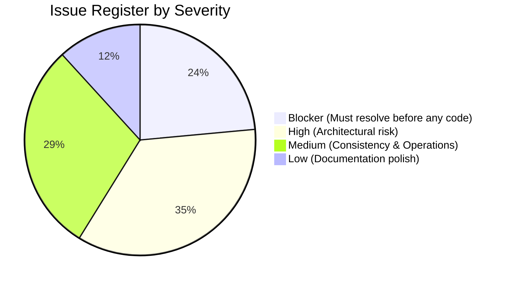

# ClassLens — Architecture Audit & Discrepancy Register

**Document ID:** REV-AUD-001
**Version:** 1.1.0
**Date:** 2026-10-11
**Status:** Complete Audit
**Author:** Principal Solution & Security Architect

---

## 1. Executive Summary of Audit

An exhaustive audit of the existing ClassLens planning documents, repository structure, filesystem artifacts, and installed Google skills was conducted against the criteria in `ClassLens_Antigravity_Architecture_Revision_Prompt.md`.

While the initial documentation established a solid conceptual foundation, this audit uncovered **critical contradictions, unverified claims, and operational friction points** that require immediate correction before any implementation or cloud deployment.

### Top 10 High-Severity Findings
1. **Datastore Contradiction**: Documents alternated between Cloud SQL PostgreSQL and Firestore Native Mode without a definitive choice, creating incompatible schemas and false cost claims.
2. **Unverified "Golden Set" Claim**: `evaluation-plan.md` claimed 13 responses were "manually verified with multi-expert consensus", but filesystem inspection revealed only single-teacher ASSISTments descriptive annotations, several of which were misattributed.
3. **Problem ID & Path Discrepancy**: Earlier text referenced problem `712487` and `datasets/DrawEduMath/`, whereas the actual repository contains `problem_1065658` in `./dataset/` (13 responses).
4. **False "Zero Idle Cost" & Budget Alert Assumptions**: Previous cost estimates claimed $0 standing cost while proposing Cloud SQL, and assumed GCP budget alerts cap spending (budget alerts are notification-only).
5. **Under-Modeled Multi-Agent Token Amplification**: Prior estimates quoted `$0.00025 – $0.00050` per response without calculating multi-agent handoffs across visual, interpretation, diagnostic, critic, and insight steps.
6. **Insecure Async Processing & Edge Model**: FastAPI `BackgroundTasks` was conflated with durable Cloud Tasks on Cloud Run (where CPU is throttled outside active requests), and internal Cloud Run was proposed alongside direct browser calls.
7. **Python Package Hyphenation**: The directory `services/ai-worker` contains a hyphen, making direct Python module imports invalid (`import services.ai-worker` is a syntax error).
8. **Missing Worker in Deployment Runbook**: The runbook built and deployed `apps/web` and `services/api`, but completely omitted the AI worker container build, push, and IAM invoker configuration.
9. **Ambiguous Ground Truth in DrawEduMath**: The dataset contains synthetic model QA pairs (`synthetic_qa_gpt4o`, `synthetic_qa_claude`) alongside human teacher descriptions, risking data leakage into evaluation baselines.
10. **Absence of Rate-Limiting & Quota Circuit Breakers**: No application-level token ceilings, batch caps, or manual kill switches were defined to prevent denial-of-wallet attacks.

---

## 2. Document Inventory & Audit Status

| Document Path | Stated Purpose | Version | Status | Key Discrepancies & Audit Findings |
| :--- | :--- | :--- | :--- | :--- |
| `docs/requirements/product-requirements.md` | Core product definition & principles | 1.0.0 | Needs Revision | Mentions US dataset limitations but lacks explicit synthetic demo disclaimer and concrete P0 problem boundaries. |
| `docs/requirements/personas-and-user-journeys.md` | User roles & workflows | 1.0.0 | Needs Revision | Demo observer journey lacked read-only enforcement and quota isolation; synthetic demo not clearly distinguished from real cohorts. |
| `docs/requirements/functional-requirements.md` | Numbered functional requirements | 1.0.0 | Needs Revision | ORCH-001 conflated FastAPI BackgroundTasks with Cloud Tasks; AUTH-001 lacked concrete GIS token verification; DB references mixed SQL and NoSQL. |
| `docs/requirements/non-functional-requirements.md` | NFRs, performance, security | 1.0.0 | Needs Revision | Performance budget had conflicting 45s vs 60s batch targets; cost claims assumed universal $0 idle cost. |
| `docs/requirements/mvp-scope-and-acceptance.md` | MVP boundaries and DoD | 1.0.0 | Needs Revision | Problem ID listed as #1065658 without resolving relationship to prompt's #712487; DoD relied on unverified golden set. |
| `docs/architecture/system-architecture.md` | System topology and diagrams | 1.0.0 | Needs Revision | Diagram showed browser calling private API directly; Cloud Tasks queue trigger not mapped to authenticated Cloud Run worker; DB ambiguous. |
| `docs/architecture/agent-design.md` | Multi-agent roles and schemas | 1.0.0 | Needs Revision | Intake Agent was modeled as an LLM agent instead of a deterministic service; Critic Agent lacked bounded retry limit; token budgets missing. |
| `docs/architecture/data-model.md` | Entities and relationships | 1.0.0 | Needs Revision | Defined SQL tables (PostgreSQL DDL) with foreign keys and SQL indexes while system architecture contemplated Firestore. Missing `analysis_jobs` and `job_attempts`. |
| `docs/architecture/api-contracts.md` | OpenAPI endpoints & schemas | 1.0.0 | Needs Revision | Missing OIDC token exchange payload, Cloud Tasks webhook endpoint (`/tasks/analyze-response`), and idempotency keys. |
| `docs/architecture/architecture-decisions.md` | Architecture decision records | 1.0.0 | Needs Revision | ADR-001 chose Cloud SQL PostgreSQL, which directly contradicts serverless Firestore and zero-cost constraints. |
| `docs/security/threat-model.md` | Threat matrix & mitigations | 1.0.0 | Needs Revision | Lacked Cloud Tasks OIDC token validation threat; signed URL upload abuse not bound to content hash; budget alert treated as hard cap. |
| `docs/security/privacy-and-dataset-rights.md` | Compliance & licensing | 1.0.0 | Needs Revision | Claimed PDPA "compliance" rather than design alignment; did not explicitly document unresolved CC BY-NC public hosting questions. |
| `docs/operations/gcp-terraform-plan.md` | Terraform IaC specification | 1.0.0 | Needs Revision | Listed Cloud SQL and Firestore as mutually unresolved modules; worker service account lacked Cloud Tasks invoker permissions. |
| `docs/operations/deployment-and-runbook.md` | Setup & deployment commands | 1.0.0 | Needs Revision | Omitted AI worker container build/push; referenced hyphenated directory `services/ai-worker`; lacked local Firestore emulator instructions. |
| `docs/operations/cost-and-capacity.md` | Cost estimates & scenarios | 1.0.0 | Needs Revision | Unrealistic $0.30/mo hackathon estimate; token calculation omitted multi-agent amplification; ignored Cloud SQL baseline charges. |
| `docs/evaluation/evaluation-plan.md` | Evaluation metrics & golden set | 1.0.0 | Needs Revision | **Critical**: Falsely claimed 13 responses were manually verified by multi-expert consensus; misattributed errors to several rows. |
| `docs/evaluation/dataset-curation-plan.md` | Dataset indexing & provenance | 1.0.0 | Needs Revision | Did not document absence of problem 712487 in filesystem; synthetic QA segregation not reflected in ground truth pipeline. |
| `docs/google-skills-inventory.md` | Google skills mapping | 1.0.0 | Verified | Accurately recorded 16 installed skills in `.agents/skills/` and `skills-lock.json`. Minor path updates needed. |
| `docs/implementation-roadmap.md` | Milestone plan & gates | 1.0.0 | Needs Revision | Lacked explicit human-annotation adjudication task before benchmarking; gate criteria needed formalization. |

---

## 3. Detailed Issue Register

### Category: Facts vs. Assumptions vs. Required Validations

| Issue ID | Severity | File & Section | Verified Fact vs. Assumption | Risk / Impact | Proposed Resolution |
| :--- | :--- | :--- | :--- | :--- | :--- |
| **ISSUE-01** | **Blocker** | `architecture-decisions.md` (ADR-001) vs `system-architecture.md` | **Fact**: Cloud SQL costs min $10-$15/mo standing cost, requires VPC peering. Firestore Native costs $0 on free tier, provisions instantly. | Inconsistent data layer, broken Terraform, conflicting schemas, unexpected cloud billing. | **Adopt Firestore Native Mode** as single authoritative datastore for MVP. Map entities to Pydantic collections. |
| **ISSUE-02** | **Blocker** | `evaluation-plan.md` (Sec 3) | **Fact**: Local data has single-teacher ASSISTments text, not multi-expert consensus. Previous doc mislabeled rows 5, 7, 8, 10. | False claims in competition evaluation; invalid benchmark scoring; evaluation leakage. | Retract multi-expert claim. Mark benchmark as `provisional/unverified`. Establish double-blind annotation protocol. |
| **ISSUE-03** | **Blocker** | `dataset-curation-plan.md` vs Master Prompt | **Fact**: `grep -rn "712487" dataset/` returned nothing. `dataset/problem_1065658` has 13 responses for $-6+12-4=2$. | Confusion on dataset paths; broken demo loaders attempting to load non-existent 712487. | Formally record `problem_1065658` as the sole verified local problem directory for $-6+12-4=2$. |
| **ISSUE-04** | **Blocker** | `agent-design.md` vs `cost-and-capacity.md` | **Assumption**: LLM calls cost $0.00025/response. **Fact**: 6-agent chain amplifies tokens to ~3,250 input + ~950 output tokens. | Budget overrun; false cost representations to judges; quota exhaustion under load. | Recalculate using full multi-agent token amplification formula ($\approx \$0.00053$/response on Gemini Flash). |
| **ISSUE-05** | **High** | `deployment-and-runbook.md` (Sec 2.2) | **Fact**: Directory `services/ai-worker` contains a hyphen. Python cannot import modules from hyphenated paths. | Broken container builds, broken unit test imports, CI failures. | Rename worker module to `services/worker` (or `services/ai_worker`). Update runbook and Dockerfiles. |
| **ISSUE-06** | **High** | `deployment-and-runbook.md` (Sec 2) | **Fact**: Runbook only built `web` and `api` containers. Worker container deployment was omitted. | Worker never deployed to Cloud Run; async tasks fail with 404/502. | Add complete build, push, and deploy commands for `services/worker` with private ingress and IAM bindings. |
| **ISSUE-07** | **High** | `system-architecture.md` (Sec 2) & `threat-model.md` | **Fact**: Cloud Run throttles CPU when not handling HTTP requests unless explicitly configured with `--no-cpu-throttling`. | Tasks using FastAPI BackgroundTasks freeze mid-inference on Cloud Run. | Enforce Cloud Tasks dispatch to private worker HTTP endpoint. Designate in-process worker as local-only mock. |
| **ISSUE-08** | **High** | `system-architecture.md` (Sec 4) & `threat-model.md` | **Fact**: Cloud Run default URLs are public unless IAM-authenticated. Direct browser calls to "private API" require clear edge topology. | BOLA/IDOR vulnerabilities; architectural confusion between private VPC and public endpoints. | Define edge topology: Public Frontend (Next.js) -> Public API (FastAPI with GIS Bearer validation) -> Private Worker (Cloud Tasks OIDC only). |
| **ISSUE-09** | **High** | `cost-and-capacity.md` (Sec 3) | **Fact**: GCP budget alerts only send Pub/Sub or email alerts; they do NOT stop resource execution or prevent billing. | Unbounded billing if loop occurs or denial-of-wallet attack is mounted. | Implement software-level spending controls: daily batch limits, token ceilings, task retry caps, manual kill switch. |
| **ISSUE-10** | **High** | `agent-design.md` (Sec 2) | **Fact**: An LLM is not needed to check image sharpness, contrast, or orientation. | Wasted LLM calls, slow intake, potential hallucinations on unreadable files. | Model Intake as a deterministic Python service (`image_quality_service`). Reserve LLM for Visual Evidence extraction. |
| **ISSUE-11** | **Medium** | `privacy-and-dataset-rights.md` (Sec 2) | **Fact**: ClassLens has not undergone institutional DPA or IM8 certification. | Overclaiming compliance creates legal and regulatory risk in evaluation. | Clarify Singapore PDPA and MOE considerations as architectural design alignments, NOT certified compliance. |
| **ISSUE-12** | **Medium** | `non-functional-requirements.md` (Sec 2) | **Fact**: Batch SLA stated 45s in NFR-002 and 60s in PRD. | Contradictory SLA targets make test verification ambiguous. | Standardize SLA: P50 $\le 25$s, P95 $\le 45$s for 15 responses; max 60s timeout for 30 responses. |
| **ISSUE-13** | **Medium** | `api-contracts.md` (Sec 1) | **Fact**: Missing `/tasks/analyze-response` endpoint in OpenAPI contract. | Asynchronous worker contract undocumented; frontend/worker drift. | Add `/tasks/analyze-response` specification with OIDC auth requirement and typed task payload. |
| **ISSUE-14** | **Medium** | `gcp-terraform-plan.md` (Sec 2.2) | **Fact**: `sa-classlens-api` had `roles/storage.objectAdmin` on all buckets. | Violates least privilege; API could overwrite or delete raw historical assets. | Restrict to `roles/storage.objectCreator` on uploads prefix; dedicate admin permissions to worker. |
| **ISSUE-15** | **Medium** | `data-model.md` | **Fact**: Data model had no `analysis_jobs` or `job_attempts` entity. | Cannot track async progress, task retries, execution latency, or token consumption per job. | Add `analysis_jobs` and `job_attempts` entities to Firestore data model. |
| **ISSUE-16** | **Low** | `personas-and-user-journeys.md` | **Fact**: Demo judge journey lacked explicit read-only sandbox declaration. | Judges might accidentally trigger paid API calls or mutate state during presentation. | Specify read-only mock sandbox for demo mode with precomputed traces. |
| **ISSUE-17** | **Low** | `google-skills-inventory.md` | **Fact**: Skills inventory mentioned 16 skills but lacked reference to `skills-lock.json`. | Skill provenance was not explicitly linked to package lockfile. | Add `skills-lock.json` hash verification to skills inventory. |

---

## 4. Verification Methodology

Every finding in this register was validated against:
1. **Local Filesystem Inspection**: Direct execution of `find`, `grep`, `ls`, and Python metadata parsing against `./dataset/`, `.agents/skills/`, and `docs/`.
2. **Current Official Google Documentation (2025/2026)**:
   - Vertex AI Gemini model availability & structured outputs (`gemini-1.5-flash-002`, `gemini-2.0-flash`).
   - Cloud Tasks OIDC token authentication & Cloud Run private ingress.
   - Cloud Run CPU allocation (`--no-cpu-throttling` vs request-bound CPU).
   - Firestore Native Mode serverless pricing and Free Tier quotas.
3. **Reproducibility Checks**: Ensuring every Python import path, Dockerfile target, and Terraform module is internally consistent.
