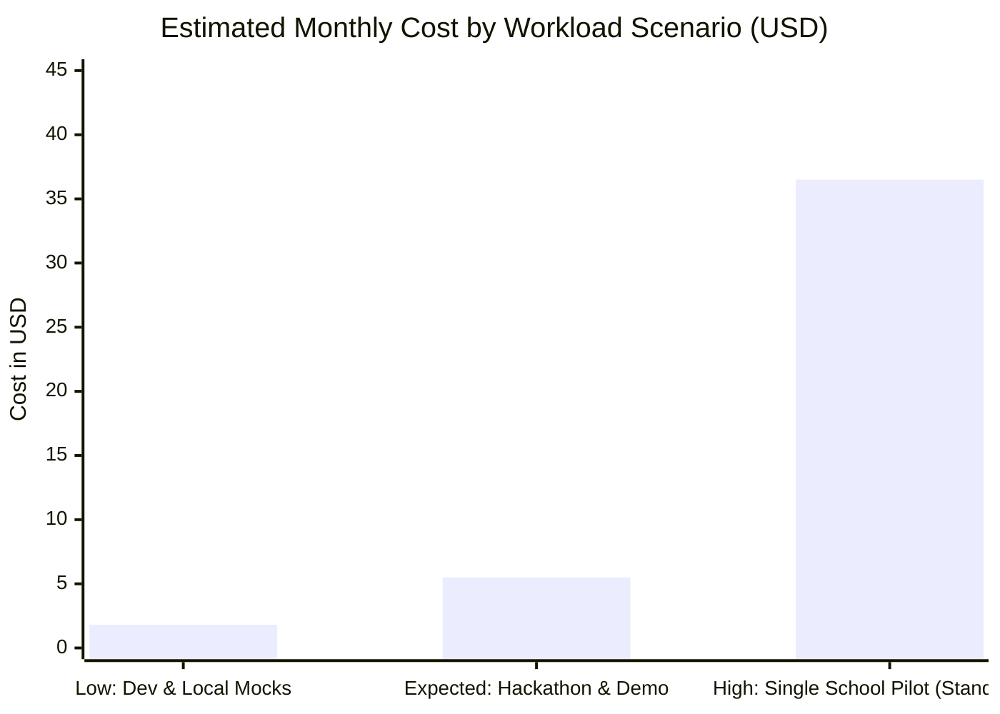
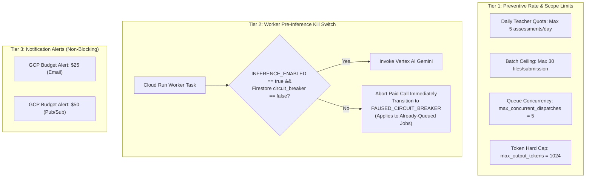

# ClassLens — Reconciled Financial Cost Model & Spending Safeguards

**Document ID:** REV-CST-006
**Version:** 1.2.1
**Date:** 2026-10-11
**Status:** Verification Complete (Final Technical-Validity Revision)
**Currency:** USD ($)

---

## 1. Vertex AI Pricing & Multi-Agent Token Amplification Formula

### 1.1 Verified Vertex AI Pricing (`asia-southeast1` — Singapore)
Official Vertex AI Gemini 3.8 Flash (`gemini-3.8-flash`) pricing as of late 2026:
- **Introductory Pricing Tier (effective through December 31, 2026)**:
  - **Input Tokens**: $0.75 per 1,000,000 tokens ($0.00000075 / token) for prompts $\le 128\text{k}$.
  - **Output Tokens**: $3.75 per 1,000,000 tokens ($0.00000375 / token). Output token rate applies to reasoning/thinking tokens.
- **Standard Tier (effective post-2026)**:
  - **Input Tokens**: $1.50 per 1,000,000 tokens ($0.00000150 / token).
  - **Output Tokens**: $7.50 per 1,000,000 tokens ($0.00000750 / token).

> [!NOTE]
> **Retirement of Historical Pricing**: Prior documentation references to Gemini 1.5 Flash ($0.075 / $0.30) and Gemini 2.0 Flash are retired. Gemini 1.5 Flash is decommissioned, and Gemini 2.0 Flash shut down on June 1, 2026. All financial modeling is updated to the active Gemini 3.8 Flash rate card.

### 1.2 Dynamic Vision Tiling & Image Token Model
Vertex AI does not assign a static 258 tokens to a $1024\times 1024$ image. Instead, images are preprocessed dynamically:
- Images $\le 384\times 384$ px consume **258 tokens** (single base tile).
- Images larger than $384\times 384$ px are partitioned into $768\times 768$ (or $512\times 512$) patches at 258 tokens each, plus an overview thumbnail tile (258 tokens).
- **ClassLens Preprocessing Rule**: Images are normalized by `ImageQualityService` to a maximum dimension of $768$ px. This bounds vision input to approximately **2 to 3 tiles ($\approx 516 – 774$ vision tokens)**.
- Unscaled $1024\times 1024$ px images yield $\approx 1,120 – 1,290$ vision tokens.
- **Verification Caveat**: *All token counts in this model are analytical estimates based on Vertex AI tiling specifications. Actual token consumption will be measured and calibrated using SDK `client.models.count_tokens()` during the Phase 2 live feasibility test.*

---

## 2. Multi-Agent Pipeline Token Footprint & Cost Breakdown

### 2.1 Per-Response Sequential Pipeline (Base Execution)

| Pipeline Component | Agent / Service | Input Token Breakdown (Estimated) | Output Token Breakdown (Estimated) | Step Cost (USD, Intro Tier) |
| :--- | :--- | :--- | :--- | :--- |
| **Stage 0: Intake** | `ImageQualityService` (Python) | 0 (Local Pillow / python-magic) | 0 (In-memory metadata) | $0.000000 |
| **Stage 1: Perception** | `VisualEvidenceAgent` | 774 (Tiled Image) + 650 (System & Prompt) = **1,424** | **450** (JSON `VisualObservation`) | $0.002756 |
| **Stage 2: Interpretation**| `MathInterpretationAgent` | 700 (Context & Prompt) + 450 (Observations) = **1,150** | **350** (Candidate Hypotheses) | $0.002175 |
| **Stage 3: Diagnosis** | `DiagnosticAgent` + Tools | 0 for SymPy/Geometry tools; 500 (Prompt) + 350 (Steps) = **850** | **300** (Diagnosis & Taxonomy) | $0.001763 |
| **Stage 4: Critic** | `IndependentCriticAgent` | 500 (Prompt) + 450 (Obs) + 300 (Verdict) = **1,250** | **150** (Critic Verdict JSON) | $0.001500 |
| **Base Total Per Student** | — | **~4,674 input tokens** | **~1,250 output tokens** | **~$0.008194 USD** |

### 2.2 Bounded Critic Reinterpretation Impact
When the Critic detects an evidential contradiction or unsupported leap:
- A single targeted reinterpretation prompt is dispatched to `MathInterpretationAgent` (+1,300 input, +350 output), followed by `DiagnosticAgent` (+950 input, +300 output) and `CriticAgent` verification (+1,350 input, +150 output).
- Additional cost per reinterpretation attempt: **$0.005700 USD** (adding $\approx 3.0$ seconds of processing latency).
- Assuming a **15% reinterpretation rate** on ambiguous handwriting across a classroom cohort, the weighted retry cost add-on is $0.15 \times \$0.005700 = \mathbf{\$0.000855\text{ USD}}$.
- **Expected Cost Per Single Response**: $\$0.008194 + \$0.000855 = \mathbf{\$0.009049\text{ USD}}$ ($\approx 0.905\text{ cents}$).

### 2.3 Cohort Intelligence Synthesis (Once Per 15-Student Assessment)
- **Component**: `CohortIntelligenceAgent` (1 call per batch).
- **Inputs**: Computed cohort statistics from Python `compute_cohort_statistics()` (counts, percentages, misconception clusters, student IDs) + rubric context = **~1,800 input tokens**.
- **Outputs**: Cohort performance narrative + 2 differentiated reteaching plans + 1 SymPy-verified 3-question exit ticket = **~900 output tokens**.
- **Cohort Step Cost**: $(1,800 \times \$0.00000075) + (900 \times \$0.00000375) = \mathbf{\$0.004725\text{ USD}}$.

### 2.4 Reconciled 15-Response Classroom Assessment Batch Cost
For a standard classroom batch of 15 student responses with a 15% Critic retry rate:

1. **Exact Mathematical Expectation ($15 \times 0.15 = 2.25$ retries)**:
   $$\text{Base Responses} = 15 \times \$0.008194 = \$0.122910$$
   $$\text{Expected Retries} = 2.25 \times \$0.005700 = \$0.012825$$
   $$\text{Cohort Intelligence Agent} = 1 \times \$0.004725 = \$0.004725$$
   $$\mathbf{\text{Total Expected Batch Cost}} = \$0.122910 + \$0.012825 + \$0.004725 = \mathbf{\$0.14046\text{ USD}}\ (\approx 14.05\text{ cents})$$

2. **Discrete Scenario Sensitivity**:
   - *Discrete 2 Retries (13.3% rate)*: $(15 \times \$0.008194) + (2 \times \$0.005700) + \$0.004725 = \mathbf{\$0.13891\text{ USD}}$ (~13.89 cents).
   - *Discrete 3 Retries (20.0% rate)*: $(15 \times \$0.008194) + (3 \times \$0.005700) + \$0.004725 = \mathbf{\$0.14461\text{ USD}}$ (~14.46 cents).
   - *Zero Retries (Best case, 100% clean handwriting)*: $(15 \times \$0.008194) + \$0.004725 = \mathbf{\$0.12764\text{ USD}}$ (~12.76 cents).

---

## 3. Infrastructure Standing & Operational Costs

| GCP Component | Resource Allocation | Regional Free Tier Availability (`asia-southeast1`) | Standing Monthly Cost (USD) |
| :--- | :--- | :--- | :--- |
| **Firestore Native** | Serverless Document Store | Global Free Tier: 1 GiB data, 50k reads/day, 20k writes/day | **$0.00** (Within Free Tier) |
| **Cloud Run (Web, API, Worker)** | 3 services, 1 vCPU, 1 GiB RAM, zero-scale idle | Global Free Tier: 2M requests/mo, 360k vCPU-sec/mo | **$0.00** (Within Free Tier during dev) |
| **Cloud Tasks** | 1 Regional Queue (`classlens-analysis-queue`) | Global Free Tier: First 1,000,000 tasks/month free | **$0.00** (Within Free Tier) |
| **Cloud Storage** | 2 Private Regional Buckets (~5 GB total storage) | **NO Free Tier in Singapore** (Standard free tier applies only to US regions: `us-central1`, `us-east1`, `us-west1`). Billed at $0.023/GB-mo. | **$0.15 – $0.35** (Storage + Class A/B ops) |
| **Artifact Registry** | Container storage for 3 images (~1.2 GB total) | $0.10 / GB-month | **$0.12** |
| **Cloud Logging & Trace** | Structured logs with PII redaction (~1 GB/mo) | Global Free Tier: First 50 GiB/month free | **$0.00** (Within Free Tier) |
| **Total Standing Baseline Cost** | — | — | **~$0.30 – $1.50 USD / month** |

---

## 4. Workload Scenarios & Sensitivity Analysis

### Scenario 1: Low Workload — Local Development & Deterministic Fixtures
- **Assumptions**: 100% deterministic local mocks for daily coding. 1 bounded live feasibility test on Problem #1065658 (13 student responses) executed once.
- **Gemini Inference**: $13 \times \$0.00905 + \$0.0047 = \$0.12$
- **GCP Standing Storage & Registry**: ~$1.50
- **Total Low Scenario**: **$1.50 – $2.50 USD / month**

### Scenario 2: Expected Workload — AI Builder Cup Hackathon & Live Judging
- **Assumptions**: 20 demonstration runs, 300 student responses analyzed with Gemini 3.8 Flash introductory pricing, 15% critic retries, demo sandbox active.
- **Gemini Inference**: $(300 \times \$0.00905) + (20 \times \$0.0047) = \$2.81$
- **Cloud Run Compute & Egress**: ~$1.20
- **Standing Storage & Registry**: ~$1.50
- **Total Expected Scenario**: **$4.50 – $7.50 USD / month**

### Scenario 3: High Workload — Single School Pilot under Standard Pricing Post-2026
- **Assumptions**: 5 teachers, 20 assessments/month (600 responses/month), post-introductory standard rate ($1.50 / $7.50), unscaled 1024px images (~1,290 vision tokens), 30% critic retries, max output tokens.
- **Unit Cost**: ~$0.0225 per response.
- **Gemini Inference**: $600 \times \$0.0225 = \$13.50$
- **Cloud Run Compute (Over free tier buffer)**: ~$12.00
- **Storage, Registry & Egress**: ~$6.50
- **Total High Scenario**: **$25.00 – $40.00 USD / month**

---

## 5. Cost and Capacity Safeguards (Multi-Tier Governance)

> [!CAUTION]
> **No Guarantees of Absolute Financial Containment**: Software controls, quotas, and cloud alerts mitigate accidental overspend, but no public cloud system can promise absolute zero-risk financial containment against severe credential compromise or zero-day exploitation. Architectural safeguards are structured into defense-in-depth tiers:

### 5.1 Worker Pre-Inference Kill Switch Specification
To guarantee that already-queued Cloud Tasks cannot drain API credits when spending limits are approached:
1. Immediately before every single call to Vertex AI (`client.models.generate_content`), the worker evaluates:
   - Environment variable `INFERENCE_ENABLED` (must be `true`).
   - Cached Firestore configuration document `system_config/circuit_breakers` field `inference_enabled` (must be `true`, TTL 10 seconds).
2. If disabled, the worker immediately aborts the inference call, sets task state to `PAUSED_CIRCUIT_BREAKER`, and acknowledges the task with HTTP 200 (preventing retries from executing paid inference).
3. If the request was part of an authorized mock/demo run, it serves precomputed fixture data without incurring external API costs.

### 5.2 Phase 3 Live Feasibility Test Spend Governance & Residual Billing Risk
For the live feasibility test on Problem #1065658:
- **Estimated Budget**: $\approx \$0.12 – \$0.14\text{ USD}$ total.
- **Enforced Application Quotas**: The test harness hardcodes `MAX_TEST_RESPONSES = 13`, `MAX_RETRIES = 1`, and `MAX_OUTPUT_TOKENS = 1024`.
- **Stop-on-Threshold Circuit Breaker**: The test runner tracks cumulative tokens in real time; if cumulative estimated spend reaches **$0.50 USD**, the execution halts immediately with a `CircuitBreakerTrippedError`.
- **Residual Billing Risk**: Because Vertex AI bills on API request completion and does not support sub-dollar hard spending limits at the GCP billing account layer, in-flight requests cannot be canceled mid-generation. The application-level ceilings constrain maximum potential exposure to $< \$1.00\text{ USD}$.
