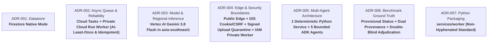

# ClassLens — Architecture Decision Register & Reconciled ADRs

**Document ID:** REV-DEC-002
**Version:** 1.2.0
**Date:** 2026-10-11
**Status:** Approved for Review (Final Technical-Validity Revision)

---

## 1. Summary of Decisions

This register formalizes the definitive architectural choices across seven core areas where earlier planning documents contained ambiguity, outdated model IDs, or mutually exclusive options.

---

## 2. Reconciled Architectural Decision Records

### Reconciled ADR-001: Datastore Selection — Firestore Native Mode

- **Decision**: **Adopt Google Cloud Firestore Native Mode** as the single, authoritative datastore for the ClassLens MVP. Completely retire the Cloud SQL PostgreSQL proposal.
- **Alternatives Rejected**:
  - *Cloud SQL for PostgreSQL*: Rejected due to minimum standing cost of $\approx \$10 – \$15/\text{mo}$ (`db-f1-micro`), 7–10 minute Terraform provisioning delay, VPC peering complexity, and unnecessary overhead for 10–30 response classroom batches.
  - *DynamoDB / AWS / Supabase*: Rejected due to Google Cloud-exclusive mandate.
- **Trade-offs & Rationale**:
  - **Zero Standing Cost**: Firestore Native offers a generous free tier (1 GiB storage, 50,000 document reads/day, 20,000 document writes/day), resulting in true \$0 baseline cost when the system is idle.
  - **Document Structure**: Student responses contain nested observations, coordinate lists, verified steps, and candidate hypotheses. Storing these as rich JSON documents in Firestore is vastly cleaner than maintaining 8 normalized SQL tables or querying JSONB via SQL.
  - **ACID Transactions**: Firestore provides serializable atomic transactions on up to 500 documents, enabling safe teacher review overrides and atomic cohort progress counter updates.
  - **Local Development**: Supported out-of-the-box by the official Google Cloud Firestore Emulator (`gcloud beta emulators firestore start`) and a Python in-memory repository mock.

---

### Reconciled ADR-002: Asynchronous Orchestration & Reliability — Cloud Tasks + Private Cloud Run Worker

- **Decision**: **Google Cloud Tasks HTTP queue dispatching to a private Cloud Run Worker service (`services/worker`) with at-least-once delivery semantics, application-level idempotency, and atomic lease claims**.
- **Delivery Semantics & Reliability Model**:
  - **At-Least-Once Delivery**: Cloud Tasks guarantees *at-least-once* execution. Network hiccups, slow HTTP acks, or container lifecycle events can result in duplicate task deliveries.
  - **Application-Level Idempotency**:
    1. *Deduplication Keys*: Tasks are named deterministically: `projects/{p}/locations/{r}/queues/{q}/tasks/resp_{response_id}_{version}`. Cloud Tasks enforces task name deduplication within the queue for 1 hour.
    2. *Atomic Lease Claim*: Upon delivery, the Worker executes a Firestore atomic transaction on `student_responses/{response_id}`:
       - If `status == "COMPLETED"`, the worker immediately logs the duplicate delivery and returns HTTP 200 without executing AI inference or updating class statistics.
       - If `status == "RUNNING"` and `lease_expires_at > now()`, another worker is actively processing the task; the worker returns HTTP 200 to acknowledge and avoid concurrent duplicate execution.
       - If `status == "RUNNING"` and `lease_expires_at <= now()`, a previous attempt crashed/timed out; the worker reclaims the lease, increments `attempt_count`, sets `lease_expires_at = now() + 300s`, and proceeds.
  - **Retry Limits & Timeouts**: `max_attempts: 3`, exponential backoff (`min_backoff: 5s`, `max_backoff: 60s`, `max_doublings: 3`). Worker HTTP timeout is 120 seconds.
  - **Terminal Failure States**: Tasks failing 3 attempts transition to `FAILED_UNRECOVERABLE` or `FAILED_TIMEOUT`. Corrupted images fail immediately with `FAILED_INVALID_FORMAT` without retry.
  - **Duplicate Delivery Protection for Cohort Stats**: Class statistics are never updated incrementally per response. Cohort aggregation is an independent batch task executed only after all responses reach terminal states, guarded by an idempotency version hash.
  - **Service Identity & Ingress**: Cloud Tasks uses service account `sa-classlens-tasks@<project>.iam.gserviceaccount.com` to sign OIDC tokens with audience matching the Cloud Run Worker URL (`https://classlens-worker-<hash>-<region>.a.run.app`). The Cloud Run Worker ingress is configured to `--ingress all` with `--no-allow-unauthenticated` (IAM-authenticated private access), granting invocation rights strictly to `sa-classlens-tasks`.

---

### Reconciled ADR-003: Model Selection, Token Budgeting & Regional Placement

- **Decision**: **Vertex AI Gemini 3.8 Flash (`gemini-3.8-flash`) in `asia-southeast1` (Singapore)** as the primary workhorse model for multimodal vision, mathematical interpretation, and cohort synthesis. `gemini-3.8-pro` is designated as an optional fallback for highly ambiguous, degraded handwriting.
- **Official Documentation & Lifecycle Verification (October 2026)**:
  - *Gemini 1.5 Flash / Pro*: Deprecated and retired on Vertex AI. Historical pricing ($0.075 / $0.30) is obsolete.
  - *Gemini 2.0 Flash*: Shutdown completed June 1, 2026.
  - *Gemini 3.7 Flash*: Launched Feb 2025; scheduled retirement date is January 28, 2027.
  - *Gemini 3.8 Flash*: Current production General Availability (GA) model on Vertex AI. Fully supported in `asia-southeast1` via regional endpoint `https://asia-southeast1-aiplatform.googleapis.com`. Features native multimodal input, structured Pydantic JSON output (`response_mime_type="application/json"`), and fast reasoning.
- **Pricing & Token Footprint Model**:
  - *Introductory Pricing (through Dec 31, 2026)*: **$0.75 per 1,000,000 input tokens** ($0.00000075/token); **$3.75 per 1,000,000 output tokens** ($0.00000375/token). Output rate applies to reasoning/thinking tokens.
  - *Standard Tier (post-2026)*: $1.50 / 1M input, $7.50 / 1M output.
  - *Vision Tiling Model*: Vertex AI dynamically tiles images. Images $\le 384\times 384$ px consume 258 tokens; larger images are partitioned into $768\times 768$ tiles at 258 tokens each plus an overview tile. Normalizing student work to max dimension 768px yields $\approx 516 – 774$ vision tokens (unscaled 1024px images yield $\approx 1,120 – 1,290$ tokens).
  - *Token Status*: All token figures are modeled estimates based on tiling specifications; exact tokens must be empirically measured via SDK `client.models.count_tokens()` during Phase 2 live feasibility tests.
  - *Reconciled Pipeline Footprint (Per Response)*:
    - Base analysis: ~4,674 input tokens + ~1,250 output tokens = **~$0.00819 USD** (~0.82 cents).
    - Expected with 15% Critic retry: **~$0.00901 USD** (~0.90 cents).
    - Cohort Intelligence Agent (1x per 15-student batch): ~1,800 input + ~900 output = **~$0.00473 USD**.
    - **Total Expected Assessment Cost (15 students)**: **~$0.138 USD** (~14 cents per entire class).

---

### Reconciled ADR-004: Edge Topology, Authentication & Zero-Trust Boundaries

- **Decision**: **Public Next.js Frontend -> Public FastAPI Backend (Google Identity Services cookie auth + CSRF) -> Signed Upload Quarantine -> IAM-Authenticated Private Cloud Run Worker**.
- **Cryptographic Enforcement vs Post-Upload Server-Side Validation**:
  - *Cryptographically Enforced by Signed URL*: HTTP method (`PUT`), exact GCS quarantine path (`raw_quarantine/{assessment_id}/{response_id}.bin`), 15-minute expiration timestamp, and `Content-Type` header signature.
  - *Post-Upload Server-Side Validation Required*: True file format verification (via `python-magic` magic bytes), file size limit (<10 MB), image dimensions ($\ge 300\times 300$ and $\le 4096\times 4096$), decompression bomb ceiling (`Image.MAX_IMAGE_PIXELS = 16M`), SHA256 integrity hash, and tenant ownership.
  - *Quarantine State Machine*: Uploads land in `raw_quarantine/` with status `UPLOADED_UNVERIFIED`. Analysis agents are strictly blocked from reading unvalidated files. The Worker sanitizes images, strips EXIF, and moves valid files to `validated_images/` with status `VALIDATED`. Invalid files move to `quarantine_rejected/` with status `REJECTED`.
- **Client Session & CSRF Security**:
  - Google Identity Services (GIS) ID tokens exchanged at `/api/v1/auth/google` for a server session stored in an `HttpOnly; Secure; SameSite=Lax` cookie (`__session`).
  - State-changing API endpoints (`POST`, `PUT`, `DELETE`) enforce double-submit CSRF cookie validation and require the custom header `X-Requested-With: ClassLens`.
- **Image Retrieval Security**:
  - Images in GCS buckets are private with Uniform Bucket-Level Access. The frontend never accesses raw GCS URLs. Images are retrieved via short-lived (5-minute) signed GET URLs issued by authorized backend endpoints after verifying teacher ownership.
- **Prompt Injection Defense Realism**:
  - Multi-layered defense (data segregation, structured JSON schema, deterministic SymPy check, Independent Critic verification, teacher escalation) significantly constrains prompt injection aimed at grading manipulation.
  - *Residual Risk Disclosure*: Structured output and SymPy do **NOT** provide a mathematical guarantee of complete immunity against adversarial visual confusion. Adversarial handwriting can confuse transcription, alter tick mark extraction, or trigger false abstentions (`unreadable`).
- **Private Cloud Run Access vs VPC Networking**:
  - The Cloud Run Worker uses `--no-allow-unauthenticated` and verifies Google IAM OIDC tokens (`roles/run.invoker`). This constitutes **IAM-authenticated private access** over Google's secure backbone, not private network connectivity (VPC Service Controls / private internal IP).

---

### Reconciled ADR-005: Definitive Multi-Agent Architecture & Deterministic Guardrails

- **Decision**: **A 6-component architecture comprising exactly 1 Deterministic Python Service + 5 Bounded Google ADK Agents**.
  0. **`ImageQualityService`** (Deterministic Python / Pillow / python-magic — Non-LLM):
     - Validates MIME magic bytes, enforces 10 MB limit and 16M pixel limit, strips EXIF, detects rotation/contrast, normalizes image to max dim 768px. Halts pipeline on unreadable files.
  1. **`VisualEvidenceAgent`** (Google ADK Agent / `gemini-3.8-flash`):
     - Extracts purely observable visual marks: number lines, tick marks, labels, arrow start/end points, circled answers.
     - Strictly prohibited from guessing unobserved steps, interpolating missing arrows, or assuming student intent.
  2. **`MathInterpretationAgent`** (Google ADK Agent / `gemini-3.8-flash`):
     - Hypothesizes candidate mathematical steps represented by visual marks. Evaluates valid alternative strategies (e.g. starting at $-6$, commutative grouping $12 - 4 - 6 = 2$, bracket notation). Prohibited from guessing missing steps.
  3. **`DiagnosticAgent`** (Google ADK Agent / `gemini-3.8-flash` with Python Tools):
     - Calls deterministic `SymPyChecker` (exact rational arithmetic) and `NumberLineDisplacementCalculator` (displacement vectors $\Delta x_i$). Localizes the first supported error and maps it to the standard taxonomy (`MISC-ARITH-OFF-BY-ONE`, etc.).
  4. **`IndependentCriticAgent`** (Google ADK Agent / `gemini-3.8-flash`):
     - Adversarially audits diagnosis against raw visual evidence. Checks for hallucinations, mathematical contradictions, or unsupported pedagogical labels.
     - Bounded Reinterpretation: If a contradiction is detected, allows at most **ONE** targeted reinterpretation request back to `MathInterpretationAgent` (adding ~1,300 input tokens, ~350 output tokens, ~3.0s latency, and ~$0.0054 USD). If contradiction persists, flags `needs_teacher_review: true` with reason `critic_unresolved_discrepancy`.
  5. **`CohortIntelligenceAgent`** (Google ADK Agent / `gemini-3.8-flash` — 1 call per assessment batch):
     - Consolidates class insights and teaching strategies. Takes deterministically computed class statistics from Python `compute_cohort_statistics()` (counts, percentages, error clusters). Generates cohort narrative, differentiated action plans, and a 3-question formative exit ticket verified with SymPy.
- **Uncertainty Propagation**: Each agent emits confidence scores $[0.0, 1.0]$. If confidence $< 0.75$, or if visual marks are ambiguous, the response transitions to `needs_teacher_review: true`.

---

### Reconciled ADR-006: Evaluation Ground Truth Protocol & Retraction of Unverified Claims

- **Decision**: **Formally classify the 13 responses in `dataset/problem_1065658` as `Provisional / Single-Rater Benchmark`**. Maintain separate provenance categories for original teacher notes vs synthetic annotations.
- **Provenance Separation**:
  - *Original Teacher Annotations*: `teacher_description` and `teacher_qa_pairs_json` from a single ASSISTments teacher provide descriptive evidence, not verified consensus.
  - *Synthetic Annotations*: `synthetic_qa_gpt4o_json` and `synthetic_qa_claude_json` are strictly excluded from golden benchmark evaluation to prevent LLM self-evaluation leakage.
- **Answer Correctness vs Reasoning Correctness**:
  - Evaluations strictly separate `answer_status` (correctness of final number) from `reasoning_status` (mathematical validity of visible number line hops). For example, Row 11 has final answer correct $+2$, but reasoning is incomplete/empty; Row 4 has final answer $+2$ via two compensatory magnitude errors.
- **Test Separation**: Tier 1 (deterministic unit tests), Tier 2 (real-image golden evaluations), Tier 3 (cross-problem holdout tests). Proposed accuracy thresholds ($\ge 90\%$) are explicit design targets, never described as achieved results prior to adjudication.

---

### Reconciled ADR-007: Python Service Packaging & Module Naming

- **Decision**: **Standardize Python worker packaging to `services/worker/`**. Prohibit hyphenated module directory names across the repository to maintain strict PEP 8 import compliance and cross-package `pytest` compatibility.
