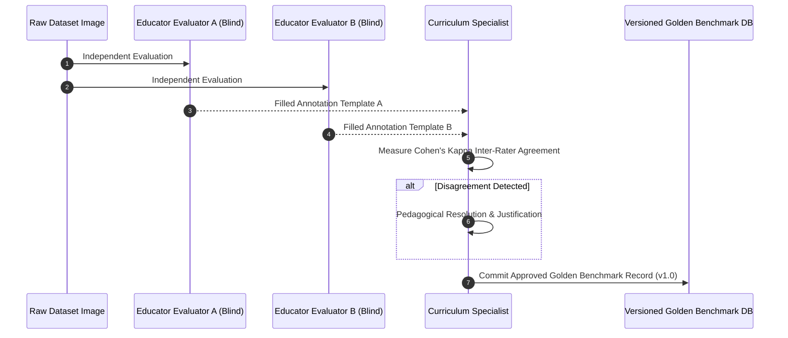

# ClassLens — Evaluation Readiness & Benchmark Adjudication Protocol

**Document ID:** REV-EVL-005
**Version:** 1.2.0
**Date:** 2026-10-11
**Status:** Audit & Adjudication Protocol Complete (Final Technical-Validity Revision)

---

## 1. Audit of DrawEduMath Problem #1065658: Retracting Unverified Claims

A thorough programmatic and semantic audit of `dataset/problem_1065658/problem_metadata.json` was conducted to establish true ground truth status.

### 1.1 Summary of Findings & Provenance Categories
- **Provenance Category A: Original Teacher Descriptive Annotations**: The source dataset contains `teacher_description` and `teacher_qa_pairs_json` from a single ASSISTments teacher. These provide qualitative evidence of what was observed on the page; they do **not** represent a standardized, multi-expert consensus benchmark.
- **Provenance Category B: Synthetic Model Annotations**: The repository contains `synthetic_qa_gpt4o_json` and `synthetic_qa_claude_json`. These are synthetic artifacts produced by third-party LLMs and are **strictly excluded** from golden benchmark evaluation to prevent LLM self-evaluation leakage.
- **Provisional Benchmark Status**: All 13 cases are formally classified as **`Provisional / Single-Rater Benchmark`**.
- **No Unmeasured Claims**: Performance thresholds (e.g. $\ge 90\%$ accuracy) are strictly defined as **engineering target specifications**, never described as achieved benchmark results prior to post-adjudication evaluation.

---

## 2. Actual Dataset Evidence: Problem #1065658 Audit Table

The table below contrasts actual source metadata against prior flawed assumptions across all 13 responses, explicitly separating **final answer correctness** from **reasoning correctness**:

| Row Index | Image Filename | Actual Teacher Description & QA Evidence | Final Answer Status | Visible Reasoning Status | Reconciled Provisional Ground Truth Status & Test Assertion |
| :--- | :--- | :--- | :--- | :--- | :--- |
| **Row 0** | `04255753-*.jpeg` | Intervals of 2 from -12 to 12. Arrows: $0 \to -6 \to +6 \to +2$. Circled 2. "No error in student response." | `correct` (2) | `correct` | **`supported_correct`**: Standard hops from zero ($0 \to -6 \to +6 \to +2$). |
| **Row 1** | `0a70eabf-*.jpeg` | Horizontal line -9 to 10. Circled 2. Arrows $0 \to -6 \to +6 \to +2$. "No errors in student response." | `correct` (2) | `correct` | **`supported_correct`**: Standard hop from zero. |
| **Row 2** | `2292f546-*.jpeg` | Graph paper, line -7 to 10. Arrows end at 2. "Student makes no error, final answer inferred from terminal position." | `correct` (2) | `correct` | **`supported_correct`**: Final answer inferred from arrow terminal; absence of circle around 2 accepted. |
| **Row 3** | `2b804ad7-*.png` | Digitally drawn bracket curves. $0 \to -6$, curved blue arrow to 6, green arrow to 2. "Makes no errors." | `correct` (2) | `correct` | **`supported_correct`**: Bracket curve notation accepted as valid representation. |
| **Row 4** | `56005c1c-*.png` | Line from -6 to +5 (magnitude 11 instead of 12); line from +5 to +2 (magnitude -3 instead of -4). Answer stops at 2. | `correct` (2) | **`error`** (Compensatory) | **`supported_error`** (`MISC-ARITH-OFF-BY-ONE`): Correct final answer achieved via two compensating magnitude errors. First error on Step 2. |
| **Row 5** | `80545ef3-*.jpeg` | Lined paper. "Student makes an error... draws a line that hops with a magnitude of 11 instead of 12." | `incorrect` (1) | **`error`** | **`supported_error`**: Magnitude off-by-one error (hopped 11 units instead of 12). |
| **Row 6** | `8cbadb4e-*.jpeg` | Modeling on number line correct, but student circled **+3** as final answer instead of +2. | **`incorrect`** (3) | `correct` | **`supported_error`**: Number line reasoning correct, but terminal mark/label incorrect (+3 vs +2). |
| **Row 7** | `8ef9d302-*.png` | Digital drawing. Student circled 2. "There is no error in the student's response." | `correct` (2) | `correct` | **`supported_correct`**: Standard execution pass (correcting prior false error label). |
| **Row 8** | `a5c95313-*.png` | Student mislabeled integers on number line ($0, 1, 2, 4, 5, 6...$ skipping 3). | `incorrect` | **`error`** | **`supported_error`** (`MISC-LINE-INTERVAL-MISLABEL`): Detects irregular tick interval labels. |
| **Row 9** | `b4214e02-*.png` | Digitally drawn. Student rearranged equation: $12 - 4 - 6 = 2$. "No errors in student response." | `correct` (2) | `correct` | **`supported_correct`**: Valid commutative rearrangement accepted ($12 - 4 - 6 = 2$). |
| **Row 10** | `d3e07e18-*.jpeg` | Pre-printed paper. Hopping curved arrows: $0 \to -6 \to +6 \to +2$. "No error in student response." | `correct` (2) | `correct` | **`supported_correct`**: Standard hop pass (correcting prior false error label). |
| **Row 11** | `e33295ea-*.jpeg` | Circled 2 on number line, but **zero working or arrows shown**. "No evidence of using addends." | `correct` (2) | **`incomplete`** | **`incomplete`**: Final answer marked, but reasoning absent. Must NOT verify reasoning as correct. |
| **Row 12** | `f0738571-*.jpeg` | Number line drawn, but completely incomplete (no arrows, addends, or final sum present). | `undetermined` | **`unreadable`** | **`undetermined`**: Triggers abstention guardrail (`needs_teacher_review: true`). |

---

## 3. Double-Blind Human Adjudication Protocol

To graduate from provisional status to an authoritative golden benchmark set:



### 3.1 Standardized Annotation Schema Template
Each annotator fills a structured JSON template:
```json
{
  "response_id": "resp_56005c1c",
  "problem_id": "1065658",
  "annotator_id": "annotator_sarah_lim",
  "provenance": "human_adjudicated",
  "visual_elements": {
    "has_number_line": true,
    "line_orientation": "horizontal",
    "range": [-10, 10],
    "arrow_count": 3,
    "arrows": [
      {"start": 0, "end": -6, "direction": "left", "expected_magnitude": 6, "actual_magnitude": 6},
      {"start": -6, "end": 5, "direction": "right", "expected_magnitude": 12, "actual_magnitude": 11},
      {"start": 5, "end": 2, "direction": "left", "expected_magnitude": 4, "actual_magnitude": 3}
    ],
    "final_answer_marked": "none"
  },
  "answer_status": "correct",
  "reasoning_status": "supported_error",
  "first_supported_error": {
    "step_number": 2,
    "error_type": "magnitude_miscount",
    "description": "Arrow from -6 to 5 has displacement of +11 instead of +12"
  },
  "misconception_taxonomy_id": "MISC-ARITH-OFF-BY-ONE",
  "confidence": 1.0,
  "notes": "Student arrived at answer 2 by compounding two compensatory magnitude errors."
}
```

---

## 4. Evaluation Separation & Metrics Protocol

### 4.1 Strict Test Tier Separation
1. **Tier 1: Deterministic Offline Unit Fixtures (`tests/unit/`)**:
   - Tests `SymPyChecker` and `NumberLineDisplacementCalculator` against hardcoded synthetic vectors.
   - Zero LLM calls; zero cloud dependencies; executes in $< 1$ second on every commit.
2. **Tier 2: Real-Image Adjudicated Evaluation (`tests/evaluation/`)**:
   - Evaluates the multi-agent pipeline against the adjudicated 13-response golden set.
   - Requires explicit test flag: `pytest tests/evaluation/ --run-live-gemini`.
3. **Tier 3: Cross-Problem Holdout Suite (`tests/holdout/`)**:
   - 3 additional DrawEduMath problems (e.g. fraction addition, algebraic substitution) sampled from the 188 repository problem folders to verify cross-problem generalization.

### 4.2 Target Performance Metrics (Design Specifications)
- **Visual Extraction Precision**: $\frac{\text{True Positive Arrows \& Ticks}}{\text{True Positive} + \text{False Positive Arrows}}$ (Target: $\ge 90\%$)
- **First-Error Localization Accuracy**: $\frac{\text{Correctly localized first error steps}}{\text{Total error responses}}$ (Target: $\ge 85\%$)
- **Abstention Calibration**: $\frac{\text{Correct abstentions on unreadable/empty images}}{\text{Total unreadable/empty test images}}$ (Target: $100\%$)
- **Alternative Method Retention**: Ratio of mathematically valid alternate solutions marked correct (Target: $100\%$)
- **False-Confident Diagnosis Rate**: Model claiming high confidence ($> 0.8$) on an incorrect diagnosis (Target: $< 5\%$)
