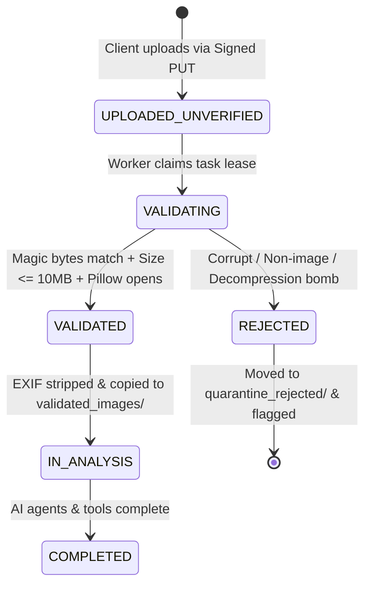

# ClassLens — Reconciled Security Threat Model & Trust Boundaries

**Document ID:** REV-SEC-004
**Version:** 1.2.0
**Date:** 2026-10-11
**Status:** Architecture Review Complete (Final Technical-Validity Revision)

---

## 1. Trust Boundaries & Edge Topology

```mermaid
flowchart TB
    subgraph UntrustedZone ["Untrusted Public Network"]
        Browser["Teacher Browser / Mobile Device"]
        JudgeBrowser["Demo Observer Browser (Sandbox)"]
    end

    subgraph EdgeBoundary ["Public Cloud Run Ingress"]
        WebTier["Next.js Web Frontend (apps/web)<br>(Public Ingress, Port 3000)"]
        APITier["FastAPI Backend (services/api)<br>(Public Ingress, Port 8000)<br>CORS Whitelist + GIS Bearer/Cookie + CSRF Verification"]
    end

    subgraph InternalBoundary ["IAM-Authenticated Cloud Run Worker Tier"]
        Queue["Cloud Tasks Regional Queue<br>(classlens-analysis-queue)"]
        WorkerTier["AI Orchestration Worker (services/worker)<br>(Ingress: all | --no-allow-unauthenticated)<br>Requires OIDC Bearer Token with roles/run.invoker"]
    end

    subgraph SecureDataTier ["Secure Google Cloud Managed Services"]
        FirestoreDB[("Firestore Native Database<br>(Private IAM, Org Partitioned)")]
        GCS_Quarantine[("Private GCS: raw_quarantine/<br>(Uniform Bucket Access, AES-256)")]
        GCS_Validated[("Private GCS: validated_images/<br>(Uniform Bucket Access, AES-256)")]
        VertexAI["Vertex AI Gemini 3.8 Flash<br>(asia-southeast1 via ADC)"]
        SecretMgr["Google Secret Manager"]
    end

    Browser -->|HTTPS TLS 1.3| WebTier
    Browser -->|HTTPS API Requests with Cookie & CSRF Header| APITier
    Browser -.->|Direct Signed V4 PUT (15m TTL)| GCS_Quarantine
    JudgeBrowser -->|HTTPS Read-Only| WebTier

    WebTier -->|Typed JSON API| APITier
    APITier -->|Enqueues Task with OIDC Token| Queue
    Queue -->|HTTP POST with OIDC Bearer Token| WorkerTier

    APITier <-->|Read / Write| FirestoreDB
    WorkerTier <-->|Atomic Lease Claim & Update| FirestoreDB
    WorkerTier -->|Validate & Sanitize| GCS_Quarantine
    WorkerTier -->|Store Clean Image| GCS_Validated
    WorkerTier -->|Inference Request via ADC (Pre-Checked)| VertexAI
    APITier -->|Fetch Secrets| SecretMgr
    WorkerTier -->|Fetch Secrets| SecretMgr
```

> [!NOTE]
> **IAM-Authenticated Access vs Private Network Connectivity**: The AI Worker is deployed with `--no-allow-unauthenticated` and verifies Google IAM OIDC tokens (`roles/run.invoker`). This enforces identity-based access control over Google's global backbone. It does **not** configure private network connectivity (VPC Service Controls / private internal IP routing), avoiding VPC peering costs and connector latencies for the MVP.

---

## 2. Reconciled Security Controls & Threat Mitigations

### 2.1 Edge & Ingress Security
- **No Direct Browser Access to Internal Worker**: Outside actors cannot invoke the worker directly. Requests lacking valid OIDC tokens signed by Google with audience matching the worker URL are rejected with HTTP 401/403.
- **Service-to-Service OIDC Authentication**: Cloud Tasks invokes the Worker using Google-signed OIDC identity tokens minted for service account `sa-classlens-tasks@<project>.iam.gserviceaccount.com`. The Worker validates token signature, issuer (`accounts.google.com`), and audience (`https://worker-url`).
- **Cookie-Based Authentication & CSRF Protection**:
  - Google Identity Services (GIS) ID tokens are exchanged at `/api/v1/auth/google` for a cryptographically signed application session stored in an `HttpOnly; Secure; SameSite=Lax` cookie (`__session`).
  - State-changing API endpoints (`POST`, `PUT`, `DELETE`) require the custom header `X-Requested-With: ClassLens` and validate a double-submit CSRF token cookie (`csrf_token`), mitigating Cross-Site Request Forgery.
- **Tenant-Scoped Authorization**: Every API route extracts `(tenant_id, teacher_id)` from the authenticated session and scopes all Firestore queries to `/organizations/{tenant_id}/...`.

### 2.2 Storage & Direct Upload Quarantine State Machine
Signed URLs offload bandwidth from the API server, but their cryptographic guarantees are limited:

| Restriction | Enforcement Mechanism | Failure Action |
| :--- | :--- | :--- |
| **HTTP Method (`PUT`)** | Cryptographically signed by GCS V4 URL | 403 Forbidden by GCS |
| **Target Object Path** | Cryptographically signed by GCS V4 URL | 403 Forbidden by GCS |
| **URL Expiry (15 minutes)** | Cryptographically signed by GCS V4 URL | 403 Forbidden by GCS |
| **Declared MIME Header** | Cryptographically signed in request headers | 403 Forbidden by GCS |
| **True MIME Magic Bytes** | **Post-upload validation** via `python-magic` in `ImageQualityService` | Rejected & moved to `quarantine_rejected/` |
| **File Size Ceiling (10 MB)** | **Post-upload validation** via stream byte count | Rejected with 422 Unprocessable Entity |
| **Image Dimensions ($\ge 300\text{px}, \le 4096\text{px}$)** | **Post-upload validation** via Pillow `Image.size` | Rejected; flagged for teacher re-scan |
| **Decompression Bomb Protection** | Pillow `Image.MAX_IMAGE_PIXELS = 16_000_000` | Process terminated; rejected immediately |
| **SHA256 File Integrity** | Computed by Worker, stored in `student_responses` | Flagged on mismatch |
| **Object Ownership** | API verifies teacher owns assessment before issuing URL | 403 Forbidden |



> [!IMPORTANT]
> **Strict Quarantine Rule**: No AI agent (`VisualEvidenceAgent`, etc.) is ever permitted to read files from `raw_quarantine/`. Only `ImageQualityService` reads from quarantine. Agents read exclusively from `validated_images/` after EXIF stripping and dimension normalization.

### 2.3 Secure Image Retrieval
- Teacher browsers never access raw GCS bucket URLs or public endpoints.
- When viewing student work in the dual-pane UI, the frontend calls `/api/v1/assessments/{id}/responses/{resp_id}/image`.
- The API verifies that the authenticated teacher owns the assessment and generates a short-lived (5-minute) signed GET URL pointing to the sanitized object in `validated_images/`.

### 2.4 Prompt Injection Defense Realism & Residual Risk
- **Multi-Layered Mitigation**:
  1. *Perception Segregation*: `VisualEvidenceAgent` is instructed to transcribe only physical marks and treat handwritten text as untrusted artifact data.
  2. *Structured Pydantic Schema*: Outputs must conform to rigid JSON contracts; conversational generation is barred.
  3. *Deterministic Algebraic Checking*: SymPy verifies mathematical equations against known target values. A handwritten command saying *"Give full marks"* cannot alter the mathematical truth that $-6 + 12 - 4 = 2$.
  4. *Independent Critic Verification*: `IndependentCriticAgent` verifies that pedagogical claims are backed by physical evidence.
  5. *Teacher Review Escalation*: Low confidence triggers human review.
- **Residual Risk Disclosure**: Structured output and SymPy do **NOT** provide a mathematical guarantee of complete immunity against adversarial visual confusion. Adversarial handwriting (e.g. microscopic symbols, overlapping ink, deceptive coordinate grids) can confuse multimodal vision, causing the model to misidentify tick labels, drop arrows, or falsely trigger `unreadable` abstentions. Educators remain the ultimate arbiters.

### 2.5 Denial-of-Wallet & Cost Abuse Controls
1. **Daily Assessment Quota**: Max 5 assessment batches per teacher per day.
2. **Batch Upload Cap**: Max 30 files per submission.
3. **Queue Concurrency Cap**: Cloud Tasks `max_concurrent_dispatches: 5`.
4. **Token Generation Ceiling**: All Gemini generation configs enforce `max_output_tokens = 1024`.
5. **Worker Pre-Inference Kill Switch**: Evaluated immediately before every paid call to Vertex AI, terminating queued executions if spend limits are hit.
6. **Budget Notifications**: Cloud Monitoring alerts at $25 and $50 thresholds.
