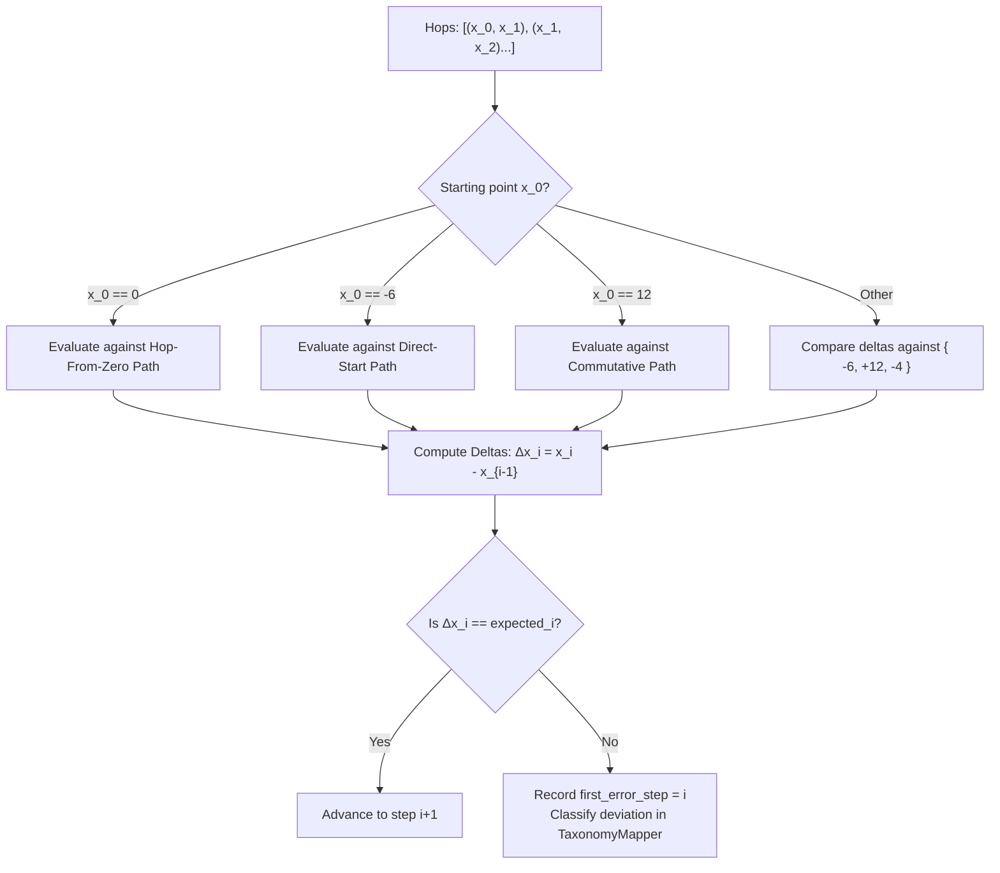

# Design: 001 — Deterministic Math & Geometry Verification

**Design ID:** DES-001
**Module:** `services/worker/math_verifier/`
**Related Spec:** [`spec.md`](file:///Users/gihanmu/Desktop/Projects/AIBuilderCup2026/ClassLens/specs/001-math-verification/spec.md)

---

## 1. Architectural Architecture & Module Organization

```text
services/worker/math_verifier/
├── __init__.py
├── sympy_checker.py          # SymPy exact rational arithmetic evaluator
├── number_line_geometry.py   # Vector displacement & hop path validator
├── method_matcher.py         # Matches hops against known valid pedagogical strategies
└── taxonomy_mapper.py        # Maps mathematical deviations to standard taxonomy IDs
```

---

## 2. Core Algorithms

### 2.1 Strategy Matching Algorithm
The system tests candidate observation vectors against three canonical path representations for Problem #1065658:

1. **Path A: Hop from Zero**:
   - $S_0 = 0 \to -6$ ($\Delta x_1 = -6$)
   - $S_1 = -6 \to +6$ ($\Delta x_2 = +12$)
   - $S_2 = +6 \to +2$ ($\Delta x_3 = -4$)
2. **Path B: Direct Start at Term 1**:
   - Starting point is $-6$.
   - $S_1 = -6 \to +6$ ($\Delta x_1 = +12$)
   - $S_2 = +6 \to +2$ ($\Delta x_2 = -4$)
3. **Path C: Commutative Rearrangements**:
   - E.g. $12 \to 8 \to 2$ ($\Delta x_1 = -4, \Delta x_2 = -6$).
   - Permutations of addends that sum to $+2$.



### 2.2 Deviation & Taxonomy Classification Rules
When a step fails ($\Delta x_i \ne \text{expected}_i$):
- If $\Delta x_i = -\text{expected}_i \implies$ `MISC-NUM-DIR-REVERSE` (reversed directional sign).
- If $|\Delta x_i| = |\text{expected}_i| \pm 1 \implies$ `MISC-ARITH-OFF-BY-ONE` (off-by-one magnitude count).
- If $\Delta x_i$ is completely inconsistent $\implies$ `MISC-ARITH-SLIP`.
- If end position matches target but intermediate deltas were incorrect $\implies$ `is_compensatory_error = True`.
