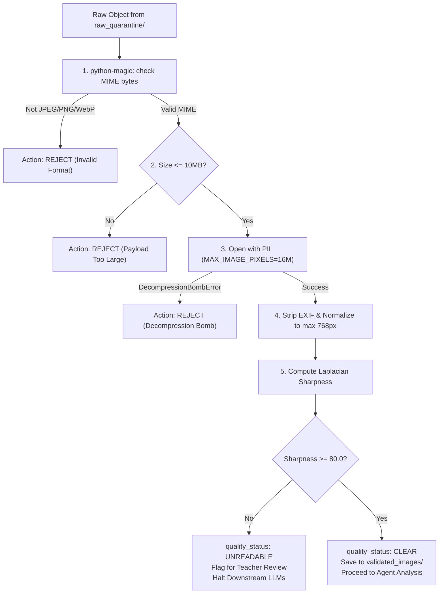

# Design: 002 — Binary Image Intake & Quarantine Validation

**Design ID:** DES-002
**Module:** `services/worker/intake/`
**Related Spec:** [`spec.md`](file:///Users/gihanmu/Desktop/Projects/AIBuilderCup2026/ClassLens/specs/002-image-intake/spec.md)

---

## 1. Module Architecture

```text
services/worker/intake/
├── __init__.py
├── quality_service.py     # Main ImageQualityService entrypoint
├── validator.py           # Magic bytes, size, and decompression bomb validation
├── sanitizer.py           # EXIF stripping & PIL re-encoding
└── metrics.py             # Laplacian variance sharpness & contrast calculation
```

---

## 2. Quarantine State Flow


