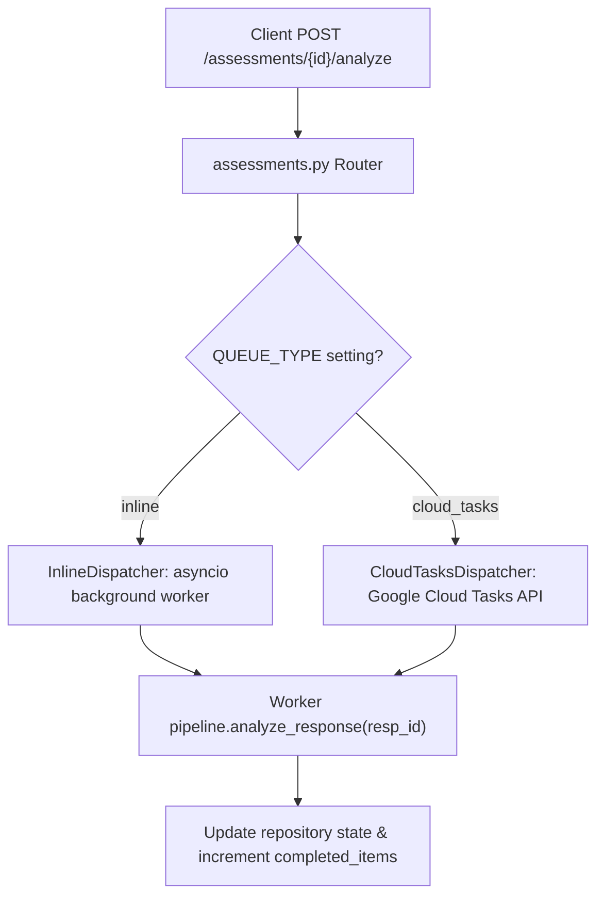

# Design: 004 — Assessment Analysis REST API & Dispatch

**Design ID:** DES-004
**Module:** `services/api/`
**Related Spec:** [`spec.md`](file:///Users/gihanmu/Desktop/Projects/AIBuilderCup2026/ClassLens/specs/004-analysis-api/spec.md)

---

## 1. Module Structure

```text
services/api/
├── __init__.py
├── main.py                  # FastAPI application entrypoint & middleware
├── config.py                # Environment configuration (Pydantic Settings)
├── auth/
│   ├── dependencies.py      # Session cookie & CSRF header validation
│   └── service.py           # GIS token verification & demo token minting
├── routers/
│   ├── auth.py              # /api/v1/auth/*
│   ├── assessments.py       # /api/v1/assessments/*
│   └── responses.py         # /api/v1/responses/*
├── dispatch/
│   ├── dispatcher.py        # Abstract task dispatcher interface
│   ├── inline_dispatcher.py # Local asyncio dispatcher for offline development
│   └── cloud_tasks.py       # Cloud Tasks HTTP queue dispatcher (cloud mode)
└── repository/
    ├── base.py              # Repository interfaces
    └── memory_repo.py       # Thread-safe in-memory repository for offline dev
```

---

## 2. Dispatcher Architecture


