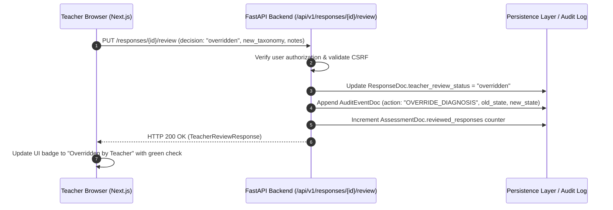

# Design: 005 — Teacher Inspection & Review Interface

**Design ID:** DES-005
**Module:** `apps/web/` & `services/api/`
**Related Spec:** [`spec.md`](file:///Users/gihanmu/Desktop/Projects/AIBuilderCup2026/ClassLens/specs/005-teacher-review/spec.md)

---

## 1. Component Hierarchy (Next.js 15 App Router)

```text
apps/web/src/
├── app/
│   ├── assessments/
│   │   └── [id]/
│   │       ├── responses/
│   │       │   └── [responseId]/
│   │       │       └── page.tsx           # Dual-Pane Inspection View
│   │       └── page.tsx                   # Assessment Overview
├── components/
│   ├── inspection/
│   │   ├── ImageViewerCanvas.tsx          # Pan, zoom, rotate image canvas
│   │   ├── DiagnosticSummaryCard.tsx      # Answer vs Reasoning status badges
│   │   ├── StepBreakdownList.tsx          # Number line jump step cards
│   │   ├── ErrorLocalizationCard.tsx      # First error callout with taxonomy badge
│   │   └── TeacherReviewForm.tsx          # Approve / Override action controls
│   └── ui/
│       ├── Button.tsx
│       ├── Badge.tsx
│       └── Modal.tsx
```

---

## 2. Review Override State Mutation Flow


