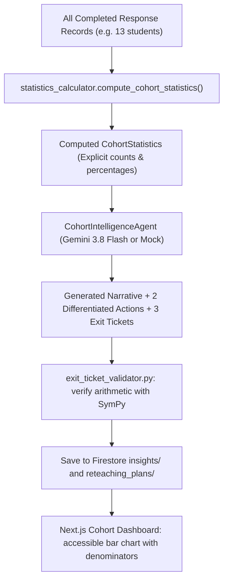

# Design: 006 — Cohort Misconception Dashboard & Differentiated Reteaching

**Design ID:** DES-006
**Module:** `services/worker/cohort/` & `apps/web/`
**Related Spec:** [`spec.md`](file:///Users/gihanmu/Desktop/Projects/AIBuilderCup2026/ClassLens/specs/006-class-insights/spec.md)

---

## 1. Module Structure

```text
services/worker/cohort/
├── __init__.py
├── statistics_calculator.py   # Pure Python cohort frequency aggregator
├── synthesizer.py             # CohortIntelligenceAgent or mock synthesizer
└── exit_ticket_validator.py   # SymPy verification of exit ticket questions
```

---

## 2. Cohort Data Flow


